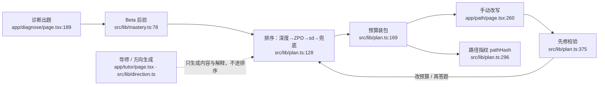

# 可解释的自适应学习路径 · 多学科

> 给高校硬课的学生做一条**算得出、说得清、改得动**的学习路径：先修图决定能不能学，Beta 后验决定先学哪个，时间预算决定这次学到哪。

**TL;DR**

- **9 学科 · 360 知识点 · 1080 题**：每学科 40 点 / 60 条先修边 / 120 题，注册表在 `src/data/subjects/index.ts:40`。
- **Beta 后验 + 纯函数规划**：掌握度带 ±区间；路径排序不联网、不用随机数（`src/lib/mastery.ts`、`src/lib/plan.ts`）。
- **给定图谱后，排序不调大模型**：不配任何 key，内置学科的诊断、路径、改写全部可用。注意自定义方向的**图谱本身**可由模型生成，模型因此决定了排序的输入；排序函数本身仍不联网、不用随机数。


**在线演示**：<https://chuanzhibei-adaptive-learning.vercel.app>（2026-10-26 抓取首页，显示「覆盖 9 个学科 · 360 个知识点 · 540 条先修关系 · 1080 道题」）

> 首页、路径页、关于页里与实现不符的文案（「CI 会红」「src/lib/llm.ts」「Ollama 预设」「拖动步骤」）已在本轮修正，现在文案与代码一致。


> 三个徽章都对应一条能当场跑的命令，见 [§6](#6-工程与验证)。徽章是静态的，数字来自本机实测，不是 CI 实时状态。

---

## 1. 30 秒看懂



每个节点的职责：

| 节点 | 输入 | 做什么 | 输出 |
| --- | --- | --- | --- |
| 诊断出题 | 图谱深度、各点掌握度、未做过的题 | 先修深度升序 → 掌握度均值升序 → 选预测正确率最接近 0.65 的题 | 下一道题 |
| Beta 后验 | 答对/答错 + 题目难度 | 答对加 α、答错加 β，权重 `w = 0.5 + 0.25d` | 均值、`sd`、`P(已掌握)` |
| 排序键 | 掌握度快照、先修图 | 深度升序 → ZPD 距离升序 → `sd` 降序 → 拓扑序 → id | 有序候选列表 |
| 预算装包 | 排序结果、预算 | 贪心装入；先修被推迟则后继阻塞 | `steps` / `deferred` / `blocked` |
| 手动改写 | 算法路径 | 上移、下移、移除，实时重算违规 | 新顺序 + 违规列表 |
| 先修校验 | 路径 + 已掌握集合 | 检查每条边的相对位置与缺失 | 违规文案 |
| 路径指纹 | 步骤序列 + 版本号 | SHA-256 | 64 位十六进制 |

**分层与职责**（自下而上，上层只能依赖下层）：

```
┌─ 数据层 ──────────────────────────────────────────────┐
│ 9 学科图谱与题库（静态 TS 模块）· Postgres/内存 6 张表    │
│ 职责：只存数据，不含规则                                  │
├─ 决策层 ──────────────────────────────────────────────┤
│ graph / mastery / plan / itemgen                       │
│ 职责：纯函数，无网络、无随机、无时间；可被测试逐位复现       │
├─ 触点层（可选）───────────────────────────────────────┤
│ rag + chat + direction + directionItems                │
│ 职责：检索、模型调用、生成结果校验；失败必须降级而不是阻塞    │
├─ 表现层 ──────────────────────────────────────────────┤
│ app/ 9 个页面 + 6 个 API 路由                           │
│ 职责：读写状态、展示数值理由、把纯函数结果画出来             │
└───────────────────────────────────────────────────────┘
```

关键约束：**决策层不 import 触点层**。`plan.ts` 的依赖只有 `graph.ts` 与 `mastery.ts`（`src/lib/plan.ts:11-18`），所以模型不可用时决策层行为完全不变。

<details>
<summary>PDF / 不支持 Mermaid 的平台：ASCII 版</summary>

```
[诊断出题 diagnose/page.tsx]
        │  答对/答错 + 难度
        ▼
[Beta 后验 mastery.ts] ──► (mean, sd, P)
        │
        ▼
[排序 plan.ts:128]  depth ↑ → |0.6-mean| ↑ → sd ↓ → 拓扑序/id
        │
        ▼
[装包 plan.ts:169]  15 分钟/新学，8 分钟/复习；先修被推迟 → 后继 blocked
        │
        ├──► [pathHash plan.ts:296]
        ▼
[手动改写 path/page.tsx] ──► [checkPrereqOrder plan.ts:375] ──► 违规提示
        ▲
        └── 改预算 / 再答题，回到排序
```

</details>

**一个具体的学生。** 小王在操作系统里想学第 3 章（`o10`–`o14` 五个知识点，`src/data/subjects/os.ts:28`）。按诊断页同一套选题规则模拟（全部答对）：候选点按「先修深度升序 → 掌握度均值升序」出题，两个会话共 24 题（每次上限 15 题，`app/diagnose/page.tsx:46`）测完 8 个点——`o01`–`o05` 是第 3 章的传递先修，`o34`–`o36` 属于文件系统方向、深度只有 0–2 所以也排在前面（诊断不限于目标点的先修闭包）。8 个点各 3 题全对，掌握度 0.700–0.740，`sd` 0.179–0.187。

- **90 分钟预算、目标 `o10`–`o14`** → 6 步：`o06` 进程控制块与进程控制 → `o07` 进程上下文切换 → `o08` 线程与多线程模型 → `o10` 处理机调度的层次与目标 → `o11` 先来先服务与短作业优先 → `o12` 优先级调度与时间片轮转，正好 90 分钟；`o13`、`o14` 进 `deferred`，`blocked` 为 0，`pathHash = 5c51a690…`。
- **改成 60 分钟** → 4 步（`o06`→`o07`→`o08`→`o10`，60 分钟），`o11` 进 `deferred`，另外 3 个点因先修被推迟进入 `blocked`，`pathHash = 0ec9da69…`。这就是界面上的「反事实」：不是换一条算法，而是同一算法换一个预算。
- **把 `o12` 上移到 `o11` 之前** → 立即报「`o11` 应先于 `o12`，实际排在其后（位置 5 > 4）」；**删掉 `o07`** → 报「`o07` 是 `o08` 的先修，但不在路径中，也未标记为已掌握」。

> 上面这一遍用 `targets` 限定到第 3 章，`planPath` 的入参与 MCP 的 `plan_path` 工具都支持；路径页也已支持按章多选（见 [§7](#7-功能清单)），章节只收窄 `targets`，跨章先修点仍会自动带上。

---

## 2. 它和推荐系统的区别

| 维度 | 常见推荐系统 | 本项目 |
| --- | --- | --- |
| 约束 | 按相似度或热度排序，不建模先修关系 | 先修 DAG 是硬约束：目标点的先修闭包全部进入候选，未掌握的先修排在后继之前；先修被预算推迟时，后继进 `blocked` 而不是照排（`src/lib/plan.ts:110`、`:170`） |
| 可解释 | 一个分数，说不清为什么 | 每一步一句带数值的理由（「尚无作答记录，先修深度 6，先建立基线（当前掌握度 10% ±17）」；复习步骤写成「已掌握 57%（±23），距目标还差 3 个百分点」，`src/lib/plan.ts:212`）+ 输入/路径双指纹 |
| 不确定性 | 点估计 | Beta 后验：界面显示 `70% ±19` 与 `P(已掌握)`，条带宽度就是 `±sd`（`src/components/ui.tsx:48`） |
| 方案数 | 单一结果 | 反事实预算对比：选一个对照预算，标出哪些步骤会被推迟或因先修阻塞（`app/path/page.tsx:92`） |
| 可改写 | 不可改 | 可上移/下移/移除，实时标违规；顺序只存在当前页面状态（`app/path/page.tsx:103`），刷新即丢 |

这张表里最关键的是第一行：**先修约束让「推荐」变成「能不能学」的判断**，而不是「想不想学」的猜测。第二行是它的直接后果——既然排序规则是显式的，就能把每一步的数值理由打印出来，也能对同样的输入复现同样的输出。

---

## 3. 自适应到底在哪

「自适应」在本项目里只有三件事，每件都能指到代码。

### ① 出题：下一个测哪个知识点、出哪道题

- **输入**：当前掌握度快照、每点已做过的题、图谱深度。
- **规则**：候选点按 `depth` 升序 → 掌握度均值升序 → `id` 排序；选中点里再选 `|predictCorrect(mean, d) − 0.65|` 最小的那道题（`app/diagnose/page.tsx:217`、`:232`）。0.65 是信息量较大的区间：太低多半在猜，太高测不出上限。
- **输出**：下一道题 + 所属知识点 + 难度。
- **证据门槛**：内置题每点 3 题、生成题 4 题（`src/lib/mastery.ts:123`），达到即换下一个点；全局上限 15 题（`app/diagnose/page.tsx:46`）。

实测效果：`o01`（depth 0，先验 0.35）三道题依次选 `d=1`（预测 0.641）、`d=2`（0.670）、`d=3`（0.653），全对后均值 0.740；`o10`（depth 6，先验 0.10）单独模拟时出题序列同样是 1→2→3，全对后均值只到 0.640。**出题序列相同、结果不同**——差别来自先验，不是难度标签。

### ② 排序：下一步学哪个

- **输入**：`PlanInput { graph, mastery, budgetMinutes, targets?, masteryTarget? }`。
- **规则**：先取目标点的先修闭包 ∪ 目标点，去掉已达 0.6 的点；再按 **先修深度升序 → ZPD 距离升序 → `sd` 降序 → 拓扑序/id** 排序（`src/lib/plan.ts:128-148`）；最后按 15 分钟/新学、8 分钟/复习贪心装包（`src/lib/plan.ts:169-197`）。
- **输出**：`steps`（带 `reason`）、`totalMinutes`、`deferred`、`blocked`、`pathHash`。
- **为什么是这个顺序**：深度保证不跳级；ZPD 距离让「跳一跳够得着」成为显式规则；`sd` 降序让最不确定的点优先获得证据；拓扑序与 id 只是兜底，保证完全确定。前三个键决定「先学哪个」，后两个键只负责在同分时给出稳定结果。

`learn` 与 `review` 由 `evidenceN` 决定：没作答过是新学，作答过但没达标是复习（`src/lib/plan.ts:180`）。装包阶段先修被推迟时，后继必须进 `blocked` 并带 `by`，否则会产出「先修不在路径、后继却在路径」的非法结果（`src/lib/plan.ts:170-176`）。

### ③ 预算反事实 + 手动改写

- **输入**：同一份掌握度快照 + 两个预算（30/60/90/120/180/240 分钟，`app/path/page.tsx:39`）。
- **规则**：对两个预算各跑一次 `planPath`，把对照预算下会被推迟或阻塞的步骤标灰并加「对照预算下会被推迟」标签（`app/path/page.tsx:184`、`:547`）。
- **手动改写**：上移/下移/移除按钮（`app/path/page.tsx:598-623`）改的是当前页面状态；每次改动后用 `checkPrereqOrder(graph, steps, { mastered: masteredSet(mastery) })` 严格模式重算违规（`app/path/page.tsx:251`、`src/lib/plan.ts:375`）。严格模式要求「先修既不在路径、也未标记已掌握」必须报违规；不传 `mastered` 的宽松模式只查顺序。
- **输出**：违规条数与逐条文案；无违规时显示「当前顺序仍满足全部先修约束」。

界面上的三个闭环对应三张图：[诊断](screenshots/diagnose.png)、[路径与指纹](screenshots/path.png)、[自定义方向诊断](screenshots/diagnose-direction.png)。

---

## 4. AI 用在哪、不用在哪

### 三个触点

| 触点 | 做什么 | 代码 | 无 key 时 |
| --- | --- | --- | --- |
| 导师解释 | BM25 检索 3 个知识点文档 → 作为上下文让模型讲解；**引用列表从回复里解析**，只列回复中真的出现、且确实在检索结果里的 `[kcId]` | `app/tutor/page.tsx:93-165`、`extractCitedKcIds` | `composeDeterministic`：检索片段 + 该点掌握度 + 题库解析拼装（`app/tutor/page.tsx:370`），界面标「知识库检索」 |
| 方向图谱 | 用户一句话 → 模型按 schema 输出知识点与先修边 → 服务端校验后才入库 | `src/lib/direction.ts:52-115`、`app/api/directions/generate/route.ts:62` | 关键词规则从现有学科挑选知识点（`src/lib/direction.ts:172`）；命中不足 5 个时补基础点，描述里如实写明「其中 N 个直接相关，其余是基础知识点」 |
| 方向题目 | 推进到缺题的 KC 时生成 4 题，落库缓存 | `src/lib/directionItems.ts:169`、`src/lib/itemgen.ts` | 该 KC 标记无题并跳过，路径照常可规划 |

### 知识口径（教材/讲义/模型）

**为什么单独一层。** 教材与讲义是「可以引用的来源」，模型生成的说法只是「依据」之一；把模型塞进来源列表会造出《某模型》第 1 版这种假书目。数据模型因此把两者分开：`MaterialKind = "textbook" | "lecture"`，`MaterialBasis = MaterialKind | "model"`（`src/lib/materials.ts:17-20`）。

**数据形状与纯函数**（`src/lib/materials.ts`）：

- `MaterialSource`：id、类型、书名 / 讲义名、作者、版次、年份；
- `MaterialChunk`：绑定一个或多个 `kcId` 的原文片段，带章节、小节与页码；页码缺失表示来源没有分页（如笔记），引用抬头不会编造页码；
- `MaterialClaim`：一条说法，`kcId + topic` 是争议维度，`basis` 是教材 / 讲义 / 模型；
- `MaterialPack` / `MaterialSelection`：数据包（来源 + 片段 + 说法）与用户选择（`sourceIds` 顺序即优先级，`resolutions` 是冲突 key → 选中的 claim）。

纯函数负责筛选、拼装与检测：`chunksForConcept` **先按勾选的来源过滤**，再按「来源优先级 → 章节匹配 → 页码 → id」排序（`src/lib/materials.ts:248`）——勾掉一个来源它就不进上下文、也不进「依据」；空选择等于「模型通用知识」，什么都不注入；`buildMaterialContext` 在字符预算内裁剪，**未决分歧永远保留在预算之外**（`:411`）；`detectConflicts` / `unresolvedConflicts` 判定口径分歧（`:493`、`:518`）；`notesAsPack` / `mergePacks` 把「我的讲义」并进内置包（`:552`、`:598`）；`validatePack` 查结构错误（`:619`）；`parseMaterialsState` 对坏存档一律回到空状态（`:718`）。

**两个内置数据包。** `src/data/materials/data-structures.ts`（数据结构，第 3 章栈与队列、第 4 章串，覆盖 c09–c14 中的 5 个知识点）与 `src/data/materials/network.ts`（计算机网络，第 5 章运输层，覆盖 n23–n28）。注册表在 `src/data/materials/index.ts:20` 的 `getMaterialPack`：没有内置资料的学科或自定义方向返回空包，诊断与路径照常可用。

**存本浏览器，但会随请求外发摘录。** 来源选择、冲突裁定与讲义正文都写 localStorage（`MATERIALS_STORAGE_KEY = "alp.materials.v1"`，`src/lib/materials.ts:23`；读写与订阅在 `src/lib/materialStore.ts:82`、`:148`），不上传本项目服务器。但出题与导师讲解时，命中的教材 / 讲义段落会随提示词**直接发给你配置的模型供应商**（浏览器直连，不经过本项目）——这是让模型按你的口径作答的前提，不配置模型时不外发。基于摘录生成的题目解析与「依据：」标注会随方向保存；方向设为公开后任何访问者都能看到解析与出处，讲义正文原文不入库。退出登录、或在本浏览器换另一个账号登录，都会删掉上一位用户的资料存档（`src/lib/useAuth.ts:96-116`）。

**冲突由用户选定。** `detectConflicts` 只在同一 `kcId + topic` 下出现两种以上**不同 statement** 时算分歧——同一句话被两本书都写了是共识，不是冲突。未选定时，注入的上下文会写「【口径分歧｜尚未选定】…请同时列出两种说法，不要替用户选择」（`src/lib/materials.ts:396`）；设置页逐条列出说法，用户选定后写入 `resolutions`，并在注入文本里追加一条「【口径裁定｜以此为准】…不要再列出其他来源的不同说法」（`src/lib/materials.ts` 的 `resolvedConflicts` / `resolutionBlock`）——只把提示删掉、仍让模型两说并陈，等于让用户以为自己选过了。`unresolvedConflicts` 会把「指向已删除说法」的旧裁定也算作未决，避免界面显示已选定而正文里没有对应说法。

**首版不解析 PDF / PPT。** 只接受粘贴文本（`src/components/material-source-panel.tsx`）；笔记没有页码字段，用户写的页码只作为正文末尾的标注保存。`validatePack` 把空章节、空正文、页码不成对当成结构错误，宁可拒绝一个包，也不让引用抬头带错定位。

**没覆盖的知识点回退模型知识。** `buildMaterialContext` 返回裁剪后的 `coveredKcIds` / `missingKcIds`；诊断生成只在真的摘到片段时把上下文交给 `ensureItems`（`app/diagnose/page.tsx:335`），没有片段时提示词只带知识点名、说明与章节，模型按自身知识出题；题卡的「依据：」也只在有摘录时出现。导师侧同样注入这份上下文（`app/tutor/page.tsx:83`），未覆盖的点退回 BM25 + 模型知识。

**内置学科的题不走生成。** 9 个内置学科的题目来自静态题库，教材 / 讲义依据只体现在**导师讲解**与**自定义方向的生成题**上；内置题的题卡标注是「第X章 · 内置题库（无页级出处）」，不会伪装成有书目出处。方向页的「生成全部题目」也还没有把资料上下文传进 `ensureAllItems`（见「真实缺口」）。

**同一题干只落一行。** 同一 KC 下题干重复会被 `checkItem` 判为 L2 失败（`src/lib/itemgen.ts:226-230`），服务端用该 KC 已有题目构造 `seenStems`（`app/api/directions/items/route.ts:160-162`），所以换一套教材口径重新生成同一道题不会落第二行；已落库那行保留首次写入的「依据：」标注，同一道题也就不会被计两次证据。服务端只接受两类客户端 checks：「双解校验」与「依据：…」（`app/api/directions/items/route.ts:277-282`），其余一律丢弃。

### 一条硬边界

`src/lib/plan.ts` 只 import `./graph` 与 `./mastery`，没有 `fetch`、没有 provider 引用、没有 `Date.now()` / `Math.random()`（`src/lib/plan.ts:11-18`）。这条边界由三样东西共同保证，缺一条都会退化成口头承诺：

1. **类型**：`PlanInput` 里没有模型字段，模型只能通过 `mastery` / `graph` 间接影响输入；
2. **canonical 字段清单**：`canonicalPlanJson` 只序列化 steps 的 `kcId / kind / estMinutes / source` 与两个版本号（`src/lib/plan.ts:234`），新增字段不会自动进入 `pathHash`；
3. **模型版本无关用例**：两个不同 `modelVersion` 必须得到同一 `pathHash`；再把 `fetch` / `Math.random` / `Date.now` 全换成「一调用就抛」，输出仍逐位一致（`src/lib/plan.test.ts:137-168`）。golden 的两个字面量锁在同一文件的 `:26-27`，换模型不会改变它们。

这条边界的**准确措辞**是：给定同一张图谱与同一份掌握度快照，排序结果与模型无关。自定义方向的图谱可能由模型生成（`src/lib/direction.ts:266`、`src/lib/useDirectionDraft.ts:92`），模型因此影响了「排序的输入」，但它不参与「输入到输出」的计算。README 里凡写「大模型不参与排序」的地方，都应按这句理解。

### 方向图谱的八条硬门禁

`validateDraft` 不合格就拒绝，不入库（`src/lib/direction.ts:52-115`）：

1. 标题非空且 ≤ 60 字，描述非空；
2. 知识点数量 5–20；
3. id 必须小写字母开头、只含小写字母数字下划线、≤ 16 字符；
4. id 不重复；
5. 知识点名称不重复（忽略空白差异）——两个同名的点会让诊断页出现两个一模一样的选项；
6. 边的两端必须存在、不能自环；
7. 不能成环、不能有重复边（复用 `validateGraph`，`src/lib/graph.ts:70`）；
8. 至少有一条先修边——0 条边的图没有先修约束，规划会退化成按 id 排序。

**不检查「语义相关性」。** 门禁只保证图在结构上可规划，不保证知识点真的属于这个主题。生成质量靠人工预览确认（`app/directions/page.tsx` 的预览区）与后续题目校验兜底。

为什么成环必须拦：`topologicalOrder` 用 Kahn 算法，遇到环时它不会报错，而是**静默返回偏序**——环上的点直接不出现（`src/lib/graph.ts:186-200`）。`computeDepths` 也只会把环当成深度 0（`:136`）。所以校验放在入库前，而不是指望下游算法兜底。

### 方向题目的五层校验

L1 结构（zod，4 选项）→ L2 卫生（选项互异、无「以上都对」、题干 8–200 字、解析含正确选项前 6 字、同 KC 去重）→ L3 答案（`answerText` 必须逐字等于恰好一个选项）→ L4 双解（两次独立批解，第二次反转选项顺序，必须选同一**文本**）→ L5 难度（三档映射 2/3/4）。纯函数在 `src/lib/itemgen.ts`；L4 是唯一需要发请求的一层，留在调用方（`src/lib/directionItems.ts`）。服务端落库时会用同一个 `checkItem` 重跑 L2/L3，不信任前端结论（`app/api/directions/items/route.ts`）。

**各层的判定与它挡不住什么：**

| 层 | 失败时 | 挡不住 |
| --- | --- | --- |
| L1 结构 | 整批重试 1 次，仍失败则该 KC 无题 | — |
| L2 卫生 | `rejected`，不落库、不展示 | 语义错误（选项互异但都在胡说） |
| L3 答案 | `rejected`，不落库、不展示 | — |
| L4 双解 | 降级 `practice`：可做、记录作答、**不计证据**（`weightScale=0`） | **模型两次一致地错**——两次都选同一个错误选项时 L4 通过 |
| L5 难度 | 不拒绝；提示写进 `checks`（前缀「提示：」）随题落库 | 难度标签本身是否正确 |

所以准确的说法是：五层校验能挡住「格式坏、选项脏、答案对不上、模型自己不一致」，
**挡不住「模型稳定地错」**。后者只能靠人工审题（见 §10 第 2 条）。
这也是为什么 L4 失败只降级为 practice 而不是丢弃——题目仍可能对，只是证据不可信。

### 降级矩阵

| | 有 key | 无 key |
| --- | --- | --- |
| 导师 | 检索 + 模型讲解，带引用 | 检索片段 + 掌握度 + 解析拼装，标「知识库检索」 |
| 方向图谱 | 模型生成 → 八条硬门禁 | 关键词规则从现有学科挑选 → 同样过门禁 |
| 方向题目 | 每 KC 生成 4 题 → 五层校验 → 落库 | 该 KC 无题并跳过；卡片给「去配置模型 / 只规划路径 / 跳过这个知识点」，生成失败时另有「手动添加题目 / 换模型重试」 |
| **路径** | **不降级** | **不降级**：只依赖图谱与掌握度 |

---

## 5. 核心算法

### 掌握度：难度加权 Beta 后验

```
先验  α₀ = s·p₀，β₀ = s·(1−p₀)，s = 2
      p₀ = max(0.10, 0.35 − 0.05·depth)
更新  答对 α += w；答错 β += w
      w = (0.5 + 0.25·d) × weightScale，d ∈ {1,2,3,4,5}
输出  mean = α/(α+β)
      sd   = √(αβ / ((α+β)²(α+β+1)))
```

代码：`src/lib/mastery.ts:43`（先验）、`:35`（权重）、`:78`（更新）、`:96`（均值）、`:107`（sd）。生成题的 `weightScale = 0.8`，仅练习题为 0（`src/lib/itemgen.ts:58`、`src/lib/mastery.ts:85`）。

**为什么 3 题够用（实测，不是推导）。** 对全部 360 个知识点各做「3 题全对」后统计：`sd` 最大 **0.196**、中位 **0.184**、最小 0.161，全部 ≤ 0.20 阈值。

这个结论**依赖先验与难度组合**，不能简化成「按众数难度 d=2 算」。实际难度直方图是 `{1: 227, 2: 348, 3: 349, 4: 156}`，全局众数是 d=3，而计算机网络学科的众数是 d=1（`src/data/subjects/network.ts` 共 40 道 d=1）。下面这张表只在 `p₀ = 0.35`（根节点）时成立，用来说明趋势：

| 同点全对题数 | 0 | 1 | 2 | 3 |
| --- | --- | --- | --- | --- |
| `sd`（d=1） | 0.275 | 0.258 | 0.228 | 0.201 |
| `sd`（d=2） | 0.275 | 0.248 | 0.209 | 0.179 |
| `sd`（d=3） | 0.275 | 0.238 | 0.193 | 0.161 |
| `sd`（d=4） | 0.275 | 0.228 | 0.179 | 0.146 |

深度越大 `p₀` 越低，同样的 3 题全对会留下更大的不确定度——`data-structures/c18`（depth 6，`p₀=0.10`，三道 d=1/2/3）的 3 题全对 `sd` 是 0.196，接近阈值。

**证据门槛按来源区分**（`src/lib/mastery.ts:114-145`）：

| 题源 | 折扣 | 每 KC 门槛 | 依据 |
| --- | --- | --- | --- |
| 内置题库 | 1.0 | 3 题 | 实测 360 个 KC 三题全对后 sd 最大 0.196 |
| 模型生成（`source=generated`） | 0.8 | 4 题 | depth=13、d=2 时 3 题 sd=0.2116（不达标），4 题 0.1911 |
| 手动录入（`source=manual`） | 1.0 | 3 题 | 与内置题同等，但界面标注「未做机器校验」 |
| 借用（`source=borrowed`） | 1.0 | 3 题 | 按 KC 名称从内置题库借同名知识点的题（`src/lib/borrow.ts`）；服务端会用同一个函数复算，客户端不能凭空声明 |
| 仅练习（L4 未过） | 0 | 不计 | 记录作答但不进 α/β |

折扣按落库的 `source` 字段判断（`app/diagnose/page.tsx` 的 `submit`），**不按题目 id 前缀猜**。
方向题的 id 都是 `di-` 开头（`src/lib/itemgen.ts`），用前缀判断会把 manual 误当 generated 打 0.8 折——
这是上一版的真实 bug。

**`sd` 与 `P(已掌握)` 是两个量。** `sd` 是后验精度，`P(p>0.6)` 是决策概率。实测 360 个知识点「3 题全对」后 `P(p>0.6)` 最小 0.604、中位 0.701、最大 0.848，没有一个到 0.90；要达标得把题库扩到 4–5 题/KC，会破坏数据集不变量。所以 `P` 只在界面上作为一行小字展示（`src/components/ui.tsx`），不做停测阈值。

**`sd` 与证据条数一起构成「证据充分」判据**（`src/lib/mastery.ts:138-145`）：

```
hasEnoughEvidence(state, target) = evidenceN >= target && sd <= 0.20
```

两个条件都要满足。只数条数会漏掉「条数够但对错分裂」——同一点答对 2 题、答错 1 题时
sd 比只答对 1 题还大。`CONFIDENCE_SD_THRESHOLD` 是这条判据的一半，不再是无引用的常量。

需要分清两个不同的地方：

| 用途 | 判据 | 位置 |
| --- | --- | --- |
| **停测**（还要不要继续出题） | 只看 `evidenceN < 门槛` | `app/diagnose/page.tsx` 的 `pickNext` / `kcNeedingItems` / `canPickMore` |
| **标注「证据充分」**（结果卡） | `evidenceN >= 门槛 && sd <= 0.20` | `hasEnoughEvidence` |

结果卡把「不足」拆成两种原因显示，不再统一写「未达 N 题门槛」：

| 原因 | 判定 | 文案 |
| --- | --- | --- |
| 条数不足 | `evidenceN < 门槛` | 「已测 n 题，未达 N 题门槛」 |
| 精度不足 | `evidenceN >= 门槛` 但 `sd > 0.20` | 「已测 n 题，题数够了但答案对错分裂，不确定度仍偏大（±X）」 |

内置题按典型序列 d=1/2/3 做「2 对 1 错」时 `n=3, sd=0.2041`，会落到第二种。
题库每 KC 恰好 3 题、停测也在 3 题时停止，所以这类 KC 的提示**不会被消除**——
它描述的是「这个掌握度不够可信」，不是「还缺题」。两者必须分开说。

停测不看 sd 是有意的：sd 在「对错各半」时最大，若拿它当停测条件，这类知识点会永远测不完。
界面上的「已测 n 题，未达 N 题门槛，掌握度仅供参考」也是按这个口径写的——**不是**「未计入掌握度」，
这些作答已经更新了 α/β，只是精度还不够。

### 预测正确率与选题

```
predictCorrect(p, d) = 1 / (1 + exp(−(logit(p) − 0.6·(d − 3))))
```

`p=0.35` 时 d=1..5 的预测值为 `0.641 / 0.495 / 0.350 / 0.228 / 0.140`（`src/lib/mastery.ts:157`）。不叠加 0.25 的猜测率下限：加上之后 d=3 会变成 0.51，与「难度 3 对应掌握度本身」的直觉冲突，也让 0.65 的选题目标失去意义。这是产品假设，不是文献结论。

### 路径：三步纯函数

```
1. 候选集  目标先修闭包 ∪ 目标点，去掉 mean ≥ 0.6 的
2. 软排序  depth ↑ → |0.6 − mean| ↑ → sd ↓ → 拓扑序/id
3. 装包    15 分钟/新学、8 分钟/复习，装不下进 deferred；先修被推迟则后继进 blocked
```

不用 0-1 背包求最优：知识点之间有先修约束，不能只按价值密度挑；带先修约束的预算装包是 NP-hard，本期不做精确解。贪心 + 拓扑序的每一步都能说清「为什么排在这」，这比「最优但说不清」更符合产品目标。

### 可复现性：两个指纹

| 指纹 | 覆盖 | 用途 |
| --- | --- | --- |
| `inputHash` | budget + masteryTarget + targets + mastery(α, β, evidenceN) + kgVersion（`src/lib/plan.ts:264`） | 判断输入是否变过 |
| `pathHash` | steps 的 `kcId / kind / estMinutes / source` + algoVersion + kgVersion（`src/lib/plan.ts:234`） | 判断输出是否变过 |

**不覆盖** `reason`、`deferred`、`blocked`、`totalMinutes`——`totalMinutes` 由 steps 决定，前三个是解释性字段。改 `estMinutes` 会让 `pathHash` 变，这条有专门用例（`src/lib/plan.test.ts:154`）。

golden case 的两个字面量锁在 `src/lib/plan.test.ts:26-27`，可用 `npm run path:hash` 重新打印核对：

```
inputHash  f9f9999230b4c06be74c235e4f7bedc39dcb7c4b947dea80f4dbb89539e61ecd
pathHash   ad7ccec537db36ee7b0070aca3f9f99006e92521e16ce2608def4df76f2b9e66
```

承诺的措辞是「同一个 attempt 快照 → 同一条路径」，不是「同一输入 → 同一路径」：生成题会改变作答，作答会改变掌握度，掌握度会改变路径。

**路径页显示两个指纹，它们指向不同的东西：**

| 面板项 | 是谁的指纹 | 什么时候会变 |
| --- | --- | --- |
| 算法路径指纹 | `planPath` 输出（纯算法结果） | 输入或算法版本变化 |
| 当前显示顺序指纹 | 页面上实际列出的步骤顺序（含手动调整） | 手动上移/下移/删除，或预算变化 |

手动改写后两者不同，这是**预期**而不是 bug：算法结果没变，你看到的是改过的顺序。
面板同时显示两者，就是为了让这个差异可见，而不是让「路径指纹」指向一个用户看不到的路径。

手动改写只存 kcId 顺序（`app/path/page.tsx` 的 `manualOrder`），不存整份 steps。
所以改预算时会用新 plan 的步骤集合重放用户调整过的相对次序——
「手动 16 步 → 预算改 30 分钟」会立刻收缩到 2 步，而不是停在 16 步。
手动步骤的 `reason` 仍是算法排序时的理由，页面会补一句「理由说明的是算法排序依据；当前位置是你手动调整的」，
不假装理由跟着位置重算。

### 复杂度实测

`npm run bench`（Node 24.15.0 / Windows 10.0.26300 x64，本机多次运行；样本间差异主要来自机器负载与热状态，所以给区间）：

| 项目 | 40 节点 | 500 节点 |
| --- | --- | --- |
| 拓扑排序 | 0.0017 ms/次 | 0.0055 ms/次 |
| ZPD 贪心路径（40 步） | 0.0028 ms/次 | 0.0094 ms/次 |
| 先修闭包 | 0.0035 ms/次 | — |
| Beta 更新（单次作答） | < 0.0001 ms/次 | — |

以上是最近一次 `npm run bench` 的原始输出（多数项目 2000 次循环取均值，500 节点路径为 500 次）。
不同机器与负载下会有 ±30% 波动，所以**不写成硬阈值**；要复核就自己跑一遍。

波动来自机器负载（本机最慢与最快样本差 3–4 倍），不是算法不稳定。即便取最慢样本，40 点图的规划也在 0.02 ms 量级，所以路径页改预算可以同步重算，不需要 loading 状态。

---

## 6. 工程与验证

### 一个被测试抓到的真实 bug

`pathHash` 依赖一个手写的同步 SHA-256——Web Crypto 是异步的，而 `planPath` 必须是同步纯函数。初版实现在消息填充边界（55、119 字节）算错了填充块数，哈希值错误。`src/lib/hash.test.ts` 用 Node 内置 `crypto` 逐条交叉验证时发现了它（修复记录见提交 `12fe2c6` 的「过程中修复的真实缺陷」第 1 条）：现在 14 个用例覆盖空串、55/56/63/64/119/120/128/1000 字节与中英混合，全部一致（`src/lib/hash.test.ts:19-40`）。

如果不测，`pathHash` 的整个「可复现」承诺就是假的。

### 验证命令与实测结果

| 命令 | 验证什么 | 本次实测 |
| --- | --- | --- |
| `npm run typecheck` | TypeScript strict | exit 0 |
| `npm test` | 347 条单元测试（17 个文件） | 347 passed |
| `npm run kg:validate` | 9 学科逐科：无环、无悬空边、每 KC 恰好 3 题、难度均值在 1.8–2.9 | 0 error |
| `npm run check:secrets` | 仓库无真实密钥 | 扫 110 个文件，无命中 |
| `npm run path:hash` | 打印 golden case 双指纹 | 与 `src/lib/plan.test.ts:26-27` 字面量一致 |
| `npm run lint` | ESLint 9 扁平配置（`eslint.config.mjs`） | 0 error / 19 warning |
| `npm run bench` | 路径算法性能 | 见 §5 |
| `npm run verify` | typecheck + test + kg + secrets 串跑 | 四个子命令分步实跑均 exit 0 |

本次数字用 `node node_modules/...` 的入口直接跑出（`vitest.mjs run`、`tsc`、`tsx`），与 `npm` 脚本调用的是同一份配置；`npm run verify` 就是上面四个子命令的串跑。

**E2E 必须显式清空 `DATABASE_URL`**：仓库的 `.env.local` 里可能有真实 Neon 连接串，
`next dev` 会自动读取它，于是 E2E 会往远端库写测试账号与方向。
命令前缀加 `DATABASE_URL=` 后 `getDb()` 退化为进程内内存存储，测试数据随进程退出消失。

三个脚本都要求先起服务（`DATABASE_URL= npx next dev -p 3211`）。**E2E 的数字是在
内存库上跑出来的**；Postgres 路径没有实跑（会写用户库），只按 neon 驱动的类型定义与
`fullResults` 文档修正了 `run()` 的返回值口径，并用假 Db 的接口测试锁住调用方语义。

密钥扫描做过反向自测：临时写入一个 `sk-` 开头的假密钥，`npx tsx scripts/check-secrets.ts` 报「发现 1 处疑似密钥」并以退出码 1 结束；删除后恢复退出码 0。

### 端到端测试

需要先 `npm run build && npm start`：

| 脚本 | 覆盖 | 最近一次实测 |
| --- | --- | --- |
| `DATABASE_URL= BASE_URL=http://localhost:3211 npx tsx scripts/smoke.ts` | 首页/主题/设置/诊断/路径/导师/方向/市场 UI 流程，含 7 条自定义方向回归 | 53/53 通过 |
| `DATABASE_URL= BASE_URL=http://localhost:3211 npx tsx scripts/auth-smoke.ts` | 注册/登录/登出/进度隔离/方向权限/市场复制 | 22/22 通过 |
| `DATABASE_URL= BASE_URL=http://localhost:3211 npx tsx scripts/mcp-smoke.ts` | MCP 三种原语与错误码 | 16/16 通过 |

> 这三组数字是最近一次完整 E2E 的结果，本轮没有重跑（需要 `next build` 起服务）；新增的章节选择与知识口径面板尚未进入 smoke 脚本。

> 用 `localhost` 而不是 `127.0.0.1`：Next 16 开发服务器默认拦截 `127.0.0.1` 的 HMR 请求，客户端组件不会 hydrate，页面看起来「点了没反应」。

### 可控 Mock 供应商（生成链路集成检查）

`scripts/mock-provider.ts` 是一个只监听 `127.0.0.1` 的 OpenAI 兼容端点，按 baseUrl 路径分四档；`scripts/mock-gen-check.ts` 用真实 `ensureItems` 跑完整生成链路，只把 `/api/directions/items` stub 成内存回显。两条命令都不需要数据库、Next 服务或真实 key：

```bash
# 单独启动 mock（127.0.0.1:3212），用于在设置页里手填供应商
node node_modules/tsx/dist/cli.mjs scripts/mock-provider.ts

# 一键跑集成检查（脚本自己起 mock，不需要先开服务）
node node_modules/tsx/dist/cli.mjs scripts/mock-gen-check.ts
```

在设置页填 `http://127.0.0.1:3212/v1`、密钥任意非空、模型名 `mock-model`（mock 不校验 key 与模型名，只要求请求体是 OpenAI 兼容形状）。四档各自证明什么：

| baseUrl | mock 行为 | 证明什么 |
| --- | --- | --- |
| `/v1` | 按题目当前选项顺序返回正确文本 | 正常链路：4 题全部 accepted，`checks` 同时带「双解校验」与「依据：」 |
| `/shuffle/v1` | `answers` 数组整体倒序，但每条 `index` 仍是正确题号 | L4 必须按 `index` 落槽：按 index 对齐后 4 题全 accepted；同一响应若按数组顺序取，`compareSolverAnswers` 4 题全 false（脚本里的哨兵） |
| `/badsolve/v1` | 反转批次里第 3、4 题故意答错 | 双解不一致只降级为 practice：2 accepted + 2 practice，并报「未达到 3 题门槛」 |
| `/truncate/v1` | 返回 `finish_reason=length`、空 content | `callChat` 抛 `ChatError(kind=truncated)`；`ensureItems` 会吞掉异常，所以脚本直接对 `callChat` 断言 |

本次实跑：`node node_modules/tsx/dist/cli.mjs scripts/mock-gen-check.ts` → 19 项 PASS（exit 0）。除上表五档外，脚本还覆盖**坏 JSON**（两次都不可解析时报「模型输出无法解析」，而不是静默 0 题）与**同批重复题干**（L2 去重拒题、本批凑不够 4 题）。

**它不替代什么。** `mock-gen-check.ts` 把 `/api/directions/items` stub 掉，不经过 Next 路由、数据库与浏览器：服务端落库语义仍由 `src/lib/items-route.test.ts` 锁，完整 UI 流程仍靠 `scripts/smoke.ts` / `scripts/auth-smoke.ts`。mock 固定回答 4 道栈题，也不检查出题质量。

### 可访问性

`node research/tools/contrast-audit.mjs` 对 5 套配色 × 明暗两种模式逐对计算 WCAG 对比度：**210 对，未通过 0 对**（含参考项）。正文最低 15.50:1，次要文字最低 7.24:1。

### 其他可验证的工程点

- **PBKDF2-HMAC-SHA256 600,000 次**（`src/lib/auth.ts:20`），常量时间比较（`:100`），账号不存在时也跑一次哈希以免暴露时序（`:213`）。参数对齐 OWASP Password Storage Cheat Sheet 对 PBKDF2-HMAC-SHA256 的建议值。
- **Postgres 6 表 + 内存双实现**（`src/lib/db.ts:17`、`:82`、`:394`），同一套 SQL 接口，测试不需要外部服务。
- **BM25 中文 bigram + 单字降权 0.35**（`src/lib/rag.ts:33`、`:61`），不引分词库、不装向量数据库。
- **供应商预检**：地址为空/格式错/粘了 `/chat/completions`/HTTPS 页面填 HTTP 地址，都在发请求前分类拦下（`src/lib/provider.ts:196`）；错误按 401/404/429/5xx/CORS/超时分类给修复建议（`:327`）。

---

## 7. 功能清单

按用户旅程排列，每条写「你能看到什么」。

| 功能 | 你能看到什么 | 界面证据 |
| --- | --- | --- |
| 诊断 | 按先修顺序出题，答完立刻显示该点掌握度从 x% 变到 y%，附解析 | [diagnose.png](screenshots/diagnose.png) |
| 学习路径 | 每步带数值理由（截图里是「尚无作答记录，先修深度 0，先建立基线（当前掌握度 35% ±28）」）；改预算立即重算 | [path.png](screenshots/path.png) |
| 按章节设目标 | 路径页多选教材章节，只收窄候选；跨章先修点自动带上，全选或清空都回到整科；「候选 N 点」与「预算排入 M 步」分开显示 | 路径页顶部，无独立截图（`src/components/chapter-goals.tsx`） |
| 反事实 | 选一个对照预算，被推迟或因先修阻塞的步骤分别计数，阻塞点给出阻塞者 | 同上，第二张卡片 |
| 知识口径与出处 | 设置页选教材 / 讲义优先级、逐条裁定口径分歧、粘贴「我的讲义」；题卡显示「依据：[教材·《…》·第3章·第45–46页]」 | 设置页「知识口径与出处」，无独立截图 |
| 手动改写 | 每步右侧 ↑ ↓ ×，违规时顶部红条列出具体哪条先修被违反 | 同上 |
| 路径指纹 | 输入指纹、路径指纹、算法版本、图谱版本、推迟/阻塞数量 | 同上，页尾 |
| 课程导师 | 回答下方列出引用的知识点 `[c09]`；无 key 时标「知识库检索」 | [tutor.png](screenshots/tutor.png) |
| 自定义方向 | 一句话生成 5–20 个知识点与先修边，预览确认后才保存；保存后 `/path?direction=<id>` 直接规划路径 | [directions.png](screenshots/directions.png)、[diagnose-direction.png](screenshots/diagnose-direction.png) |
| 方向市场 | 浏览、搜索、选用（复制图谱到自己名下，默认私有） | [market.png](screenshots/market.png) |
| 账号 | 邮箱注册即登录；登录后进度写服务端，换设备能继续 | [login.png](screenshots/login.png) |
| 设置 | 8 个供应商预设、两种协议、连通性测试、5 套配色 × 明暗（+ 跟随系统） | [浅色](screenshots/settings-light.png)、[深色](screenshots/settings-dark.png)、[校验提示](screenshots/settings-validation.png) |
| MCP 端点 | `POST /api/mcp`：tools 5 / resources 18 / prompts 2 | 无界面，见 `app/api/mcp/route.ts:57` |
| 主题 | 5 套配色 × 明暗，210 对对比度 0 失败 | [深色首页](screenshots/home-dark.png) |

---

## 8. 快速开始与部署

环境要求：Node.js ≥ 20.9（推荐 22 或 24）、npm 10+。

```bash
npm install
npm run dev          # http://localhost:3000
npm run build && npm start
```

**不配任何 API key 也能完整使用诊断、路径、章节目标与手动改写。** 导师回答退化为知识库检索拼装，自定义方向退化为从现有学科挑选知识点；知识口径的教材 / 讲义选择与冲突裁定也不依赖模型。想启用模型讲解：打开 `/settings`，填地址、密钥、模型名，点「测试连通性」，保存。

进度：未登录时存本浏览器 `localStorage`；登录后以服务端为准，之后每次变更防抖写回（`src/lib/useLearner.ts`）。

登录时的合并规则是 `{...local.subjects, ...server}`（`src/lib/useLearner.ts` 的 `merged`）：
**服务端已有的学科覆盖本地同名学科；本地独有的学科保留**。所以准确说法是「服务端优先，本地独有的不丢」，
而不是「拉取覆盖本地」。不做逐条双向合并——同一学科只有一个权威来源，避免两端的旧值互相覆盖。

供应商预设：DeepSeek、OpenAI、Anthropic Claude、通义千问、Kimi、智谱 GLM、自定义（OpenAI 兼容）、自定义（Anthropic 兼容）。刻意不放 Ollama 预设——公开 Web 服务的大多数用户没有本地模型；需要的话用自定义端点填 `http://localhost:11434/v1`（`src/lib/provider.ts:53`）。

密钥只存浏览器 `localStorage`，请求由浏览器直连你填的地址，本项目后端不转发。代价是受 CORS 与混合内容限制，设置页会就地提示。

### 部署到 Vercel

```bash
npm i -g vercel
vercel login
vercel --prod
```

**需要配置 `DATABASE_URL`**（Postgres 连接串，Vercel 上可用 Neon 集成一键注入）。它承载 6 张表：`users`、`sessions`、`progress`、`directions`、`direction_picks`、`direction_items`（建表语句在 `src/lib/db.ts:394` 的 `SCHEMA` 常量，幂等）。教材 / 讲义选择与冲突裁定不在数据库里——它们只属于浏览器（`alp.materials.v1`）。

**不配 `DATABASE_URL` 会发生什么**：`getDb()` 会退化为**进程内内存存储**（`src/lib/db.ts:379-383`）。本地开发与测试没问题，但部署环境里重启即丢，账号、跨设备进度、方向市场都不可用。所以「不需要数据库」只对匿名本地试用成立，对线上服务不成立。

**模型供应商不需要环境变量**，由用户在设置页自填，Vercel 上不保管任何密钥。

### 自托管

```bash
npm ci && npm run build && npm start   # 默认 3000 端口
```

需要 Node ≥ 20.9；要账号与多用户进度，需要可达的 Postgres（`DATABASE_URL`）；不需要数据库时可以只用匿名本地进度。

---

## 9. 项目结构

只列 6 个决策模块与 4 个入口页；其余文件用 `git ls-files src app` 查看。

```
src/lib/plan.ts        路径排序、装包、双指纹、SHA-256、先修校验（纯函数）
src/lib/mastery.ts     Beta 后验、sd、P(已掌握)、预测正确率
src/lib/graph.ts       DAG 校验、深度、拓扑序、先修闭包
src/lib/direction.ts   描述 → 图谱草稿 + 八条硬门禁
src/lib/itemgen.ts     生成题五层校验 + contentHash
src/lib/db.ts          Postgres / 内存双实现，6 张表
app/diagnose/page.tsx  诊断出题与掌握度更新
app/path/page.tsx      路径、章节范围、反事实、手动改写、指纹
app/tutor/page.tsx     检索 + 浏览器直连供应商
app/directions/page.tsx + market/page.tsx  自定义方向与市场
```

知识口径的纯函数在 `src/lib/materials.ts`，localStorage 读写与订阅在 `src/lib/materialStore.ts`；章节聚合与候选范围在 `src/lib/chapters.ts`；反事实汇总在 `src/lib/planDiff.ts`。

学科注册表在 `src/data/subjects/index.ts`，数据集校验在 `scripts/validate-kg.ts`。`src/lib/` 现有 24 个非测试模块 + 17 个测试文件。

---

## 10. 已知限制与下一步

### 已验证能力

- 9 学科图谱与题库规模一致：`npm run kg:validate` → 0 error。
- 掌握度、排序、装包、指纹、检索、题目校验、知识口径、数据库双实现、方向题目接口语义：`npm test` → 347 passed。
- 主流程、认证与市场、MCP 协议：三个 E2E 脚本 53 / 22 / 16 全通过（最近一次实测，本轮未重跑）。
- 5 套配色 210 对对比度：0 失败。
- 仓库无真实密钥：`npm run check:secrets`，并做过植入假密钥的反向自测。

### 一轮独立审读发现并已修复的问题

这些是代码层面的真实缺陷，不是文案问题。**覆盖情况按行标注**：标「单测」的有纯函数用例，
标「E2E」的由 `scripts/smoke.ts` 实测，标「脚本」的由独立脚本实跑（`scripts/mock-gen-check.ts`），
标「手测」的没有自动化用例、按界面操作核对，标「仅改文案」的没有测试（文案改动无法用测试表达）。

| 问题 | 根因 | 修复 |
| --- | --- | --- |
| 路径页点一次「上移」，回诊断页显示「没有可出的题」 | `recordPathEdit` 没传 graph，`progressOf` 回落到内置学科，给方向写出 c01–c40 掌握度 | `recordPathEdit` / `attemptedQuestionIds` / `attemptCount` 加可选 graph 参数；路径页传 `target.graph`；`learner.test.ts` 有回归用例，smoke 检查 localStorage 里不出现 `cNN` 式 id |
| 无 key 时「跳过这个知识点」点了没反应，页面永远到不了「诊断完成」 | `current?.kcId ?? gen.kind === "failed" ? ... : ""` 被解析成 `(a ?? b) ? c : d`，no-model 时取到空串 | 重写 `skipCurrentKc` 的取值与 `done` 判定；no-model 时一次性跳过所有缺题 KC（逐个跳过是把系统问题变成用户劳动） |
| 自定义方向第一个被测点是 depth 7 | `kcNeedingItems` 按 `graph.concepts` 数组顺序取，而关键词拼装按得分排序、LLM 提示词也不要求拓扑序 | 三处一起改：`kcNeedingItems` 按深度排序、`composeFromExisting` 用 `topologicalOrder`、提示词加第 7 条要求 concepts 按先修顺序 |
| 答案对不上的题仍展示，学生选对却被判错 | L3 失败降级成 practice，`answerIndex` 兜底 0，诊断按选项 A 判分 | L3 失败改为 `rejected`（答案不可知就不展示）；practice 只由 L4 产生，此时答案文本是确定的 |
| Postgres 上 `run()` 恒返回 0，插入成功却报失败 | neon 驱动默认只返回行数组，INSERT 无 RETURNING 时是 `[]` | 改用 `fullResults: true` 取 `rowCount`；新增 `items-route.test.ts` 用「run 恒返回 0」的假 Db 锁住调用方语义 |
| 手动题被打了 0.8 折，README 却写 1.0 | 用 `id.startsWith("di-")` 判断生成题，而 manual 题的 id 也是 `di-` | 改按落库的 `source` 字段判断 |
| 手动改写后改预算不重算，指纹不反映显示顺序 | `displayed = manualSteps ?? plan.steps`，预算只重算 plan | 只存 kcId 顺序，用 `applyManualOrder` 把顺序重放到新 plan 上；面板并列「算法路径指纹」与「当前显示顺序指纹」 |
| `CONFIDENCE_SD_THRESHOLD` 全仓库无引用，README 却说 sd 是内部判据 | `hasEnoughEvidence` 只看 evidenceN | 判据改为 `evidenceN >= target && sd <= 0.20`；并写清「停测只看条数、标注才看 sd」两个不同用途 |
| 无 key 的 fallback 把无关知识点说成相关 | 命中不足 5 个时补基础点，描述仍写「与 X 相关的 N 个知识点」 | 补点时描述改为「其中 N 个直接相关，其余是基础知识点」 |
| 首页「全部达到 WCAG AAA」夸大 | 实算最低 3.26:1（分隔线，非文本元素） | 改为「正文与次要文字 AAA，非文本元素 AA」 |
| 仓库里硬编码了真实手机号与邮箱 | smoke 用它做隐私比对 | 改为正则匹配「像手机号/像邮箱」的串，仓库不再存真实值 |
| 「强制带 [kcId] 引用」只是提示词要求 | 界面把检索到的 docs 全部列为引用 | 新增 `extractCitedKcIds`：只列回复里真的出现、且确实在检索结果里的 id |
| 「拖动步骤」文案与实现不符 | 实现是 ↑ / ↓ / × 按钮 | 改文案，首页/路径页/关于页三处一并修（仅改文案） |
| 「移除」是空操作，被删的步骤又回到末尾 | `applyManualOrder` 只从 order 里删 kcId，第二个循环又把 plan 里「不在 order」的它追加回来 | 手写状态改为 `ManualEdit{order, removed}`；`removed` 里的点重放时排除。单测 3 条 + smoke「移除真的减少一步且不再回来」 |
| 点一次「上移」，整条路径都标「已手动调整」 | `applyManualOrder` 给 order 里每个点都写 `source: "manual"` | 不再改写 source；新增 `movedKcIds` 比较相对次序，只标真的换了位置的点。单测 4 条 + smoke「只标记真的挪动过的步骤」 |
| 有题但不够门槛时空白死锁 | `pickNext` 无题可出、`kcNeedingItems` 只认 `accepted === 0`、`canPickMore` 说还有工作 → 三张卡都不渲染 | `kcNeedingItems` 改判 `accepted < 门槛`；新增「题目不够」卡，给「再生成一批 / 手动补题 / 跳过 / 只规划路径」四个出口；跳过改为批量。smoke「题不够门槛时给出明确出口」 |
| 无 key 降级丢掉真正命中的知识点 | 补基础点时用 `scored.slice(0, N)` 按图谱顺序取，命中的 c34 被挤出前 5 | 先放 `picked` 再补基础点；单测 2 条锁「命中的点必须保留」「声称的相关数不多于实际」 |
| 「证据不足」提示与判据矛盾（n=3 却写「未达 3 题门槛」） | 文案只提条数，而判据是「条数 ∧ sd」 | `MasteryBar` 的 `evidenceShortfall` 拆成 `count` / `precision` 两种文案；后者说明「题数够了但对错分裂」 |
| 服务端信任客户端的 `source` | `source` 决定折扣（generated 0.8、manual 1.0），却完全由客户端声明 | manual 必须不带 `difficultyReason`（那是生成流程的字段）；borrowed 必须能被服务端用 `borrowItems` 复算出同一题干；其余按 generated。单测 2 条 |
| `borrowed` 是不可达的 source | 类型里有、README 折扣表里有，但没有任何代码会产生它 | 实现 `src/lib/borrow.ts` 的 `borrowItems`：按 KC 名称从内置题库借用同名知识点的题；单测 6 条 |
| L5 的 notes 从未落库 | `checkItem` 算了 notes，但 payload 没带 | notes 并入 `checks`（前缀「提示：」）落库；「已通过 N 项校验」不计提示项 |
| **真实缺口 4（上一版）：路径页只能按整科规划，不能按章 / 按目标点收窄** | `/path` 没有把章节选择传给 `planPath`，`targets` 只在 MCP 与库函数里可用；`inputHash` 也没有体现章节范围 | 路径页新增 `ChapterGoals`（`src/components/chapter-goals.tsx:14`）：`chaptersOf` 按章号聚合、支持多选，`chapterScope` 把选中章节展开成 targets + 跨章先修点（`src/lib/chapters.ts:103`），**图谱始终完整**；`targets` 同时传给 `planPath` 与 `computeInputHash`（`src/lib/plan.ts:283`），换章节会改变输入指纹。覆盖：单测 `chapters.test.ts` 13 条 + `planDiff.test.ts` 6 条；路径页多选 / 全选 / 清空为手测 |
| **反事实只显示「因时间不足被推迟」，对照预算下的 blocked 点不出现** | 页面直接读 `PlanResult.deferred`，没有 `blocked` 汇总；阻塞点既不在推迟数里，也没有逐条原因 | 新增 `summarizeCounterfactual`（`src/lib/planDiff.ts:31`），把 `deferred` / `blocked` / `blockedNotInPath` 分开，`blockedByOf` 给每个点列出阻塞者；步骤卡按当前显示路径判断「是否已在路径上」。覆盖：单测 `planDiff.test.ts` 6 条；路径页对照预算为手测 |
| **「重新诊断」把掌握度一起清空，用户只想重测却丢了进度** | 重新诊断与清空进度共用一个 `reset`，都调用 `resetSubject`；`gen` 状态也没归零，失败卡会立刻重现 | 拆成 `restartSession`（清会话状态、保留 learner 与掌握度）与 `clearAll`（二次确认后 `resetSubject`，再重置会话）；`resetSubject` 的注释写明只供清空使用（`src/lib/useLearner.ts:135-139`）。覆盖：手测诊断页两个按钮（状态在页面组件里，没有单测） |
| **L4 双解按数组顺序取答案，模型换个返回顺序就整批降级 practice** | `solveBatch` 直接 `parsed.answers.map(...)`；两次批解是 `Promise.all` 并发的，数组顺序与题号没有约定 | 新增 `parseSolverAnswers`（`src/lib/itemgen.ts:361`）按 1-based `index` 落槽：缺失留空、重复取最后一条、越界丢弃并记 issue；`solveBatch` 返回 `{ordered, missing, issues}`（`src/lib/directionItems.ts:123`）。覆盖：单测 `itemgen.test.ts` 5 条 + `scripts/mock-gen-check.ts` 的 shuffle 档与「按数组顺序取必全错」哨兵 |
| **内存库 DELETE 不看 WHERE，一律按 (user_id, subject_id) 删并返回 1** | 两种删除形状（清空某用户全部 / 只删一个学科）共用一条路径；按 user_id 清空时行还在、返回值却是 1，界面表现为「点了清空，刷新又回来」 | `src/lib/db.ts:129-150` 按 WHERE 是否含 `subject_id` 分两种形状，返回真实删除行数；不存在的键返回 0。覆盖：单测 `src/lib/db.test.ts:162-206` 3 条 |
| **plan 的「与 LLM 无关」用例是恒真断言** | 同一份输入跑两次再比较，永远相等；没有换掉外部状态 | 把 `fetch` / `Math.random` / `Date.now` 全换成「一调用就抛」，要求输出逐位不变（`src/lib/plan.test.ts:137-168`）。**关于模型版本只能说结构上到不了**：`PlanInput` 没有 `modelVersion` 字段，`canonicalPlanJson` 也只序列化 `steps + algoVersion + kgVersion`，多传的模型字段会被丢弃——所以「两个 modelVersion 同 hash」不可能失败，它不是证据。覆盖：单测 |
| **推理模型第一次测连通性必红** | 探活请求只给 `max_tokens: 16`，而推理模型的思考 token 也计入这个预算：实测 deepseek-v4.1-flash 把 16 token 全用在 reasoning_content 上，`content` 为空、`finish_reason=length`，于是被判定为「响应异常」。用户会以为地址或密钥填错 | 探活预算提到 64；并把「200 + 合法响应体 + `finish_reason=length` + 正文为空」判为**连通**（端点、密钥、模型名都已验证），只对 `stop` 且正文为空才报响应异常（`src/lib/provider.ts` 的 `buildRequest` 与 `testConnection`）。覆盖：单测 `provider.test.ts` 2 条 + ego 真实模型实测（一次点击即绿） |
| **自定义方向生成被截断后静默退化成规则拼装** | `useDirectionDraft` 只给 2000 token，推理模型把预算吃光 → `ChatError(truncated)` → catch 里直接走 `generateFallback`：用户要「图论」，拿到的是「从数据结构里挑了 18 个树/图知识点」，来源标注还是「从现有学科挑选」 | 首次给 4096，遇截断再加倍到 8192 重试一次（截断可恢复，直接降级才是浪费）；方向页的失败提示也从「N 个知识点生成失败：名字」改成带上去重后的真实原因（实测里 46 次调用全 200、落了 52 题，失败其实是没到 4 题门槛）。覆盖：ego 真实模型实测（同一句描述，修复后 `模型生成`、14 个知识点） |
| **生成链路只有单测，没有跨模块集成检查** | `ensureItems`、L1–L5、落库回显、依据标注各自有单测，但没人把「真实 ensureItems + 模型响应 + 服务端回显」串起来跑 | 新增可控 Mock 供应商 `scripts/mock-provider.ts` 与集成脚本 `scripts/mock-gen-check.ts`：正常 / 数组倒序 / 双解不一致降级 / 截断 / 坏 JSON / 同批重复题干六档，共 19 项检查。覆盖：脚本 19 项全 PASS（本次实跑，exit 0） |

### 真实缺口

1. **教师班级视图未实现。** 现在只有「一个学生一份进度」，没有班级聚合、没有「谁卡在哪」的视图。这是产品叙事里最大的一块空白。
2. **4 个新学科未经学科专家复核。** 离散数学、机器学习基础、概率论与数理统计、学术英语写作的题目由模型生成后经脚本校验（题数、无环、难度分布、解析长度），但没有任课教师逐题核对。9 个学科共 1080 题的难度标注都需要教师确认。
3. **没有真实学生数据。** 所有掌握度数字来自自测与构造的快照，不是教学现场采集。
4. **手动改写的顺序不持久化。** 只存在页面状态，刷新回到算法排序；每次改动会记一条 `pathEdits` 审计记录（`src/lib/learner.ts:150`），但不会恢复顺序。
5. **未做 Lighthouse / Core Web Vitals 实测。** 没有 LCP / INP / CLS 数字。
6. **浏览器直连供应商受 CORS 约束。** 部分供应商不允许浏览器调用，需要自建代理；本项目没有内置代理方案，只在设置页提示。
7. **自定义方向的题目依赖模型，但不是完全不可诊断。** 无 key 时不会自动生成新题；仍可**手动录题**后诊断（`/directions` 的「手动录题」，E2E 覆盖），或只规划路径。生成题的成本数字（¥0.0009–0.0066/题）是调研值，本机没有可用 key，未复测。
8. **L4 双解校验只在浏览器侧做。** 服务端落库时重跑 L2/L3，不重跑 L4（要再调模型，成本高且结论不可缓存）。恶意客户端可以把未过 L4 的题标成 accepted——在「用户自己的方向」场景下可接受，做教师共享题库时必须搬到服务端。
9. **`P(已掌握)` 只展示，不做停测准则。** 3 题全对后 P 最高 0.848，达不到 0.90；拿它当阈值会迫使题库扩到 4–5 题/KC。
10. **学科规模固定为 40 点 / 60 边 / 120 题。** 这是由「3 题可达证据充分」反推的约束，新增学科必须遵守；规模不同的学科需要重新校准参数。
11. **方向删除后遗留的进度行不清理。** 进度按方向 UUID 存在 `progress.subject_id`，方向删了行还在；不影响功能（UUID 不复用），只占空间。
12. **没有 CI。** 所有检查靠本地 `npm run verify` 与三个 E2E 脚本手动跑。仓库里没有 `.github/workflows`。
13. **界面文案与实现不符的六处已在本轮全部修正**（不再是缺口，列在此处便于核对改了什么）：
    - `app/page.tsx` 的「CI 会红」→「`npm test` 里的 golden 字面量会失败」；
    - `app/page.tsx` 的 `src/lib/llm.ts` → `app/tutor/page.tsx · 引用从回复里解析`；
    - `app/page.tsx` 的「Ollama 预设」→「DeepSeek / OpenAI / Claude / 通义 / Kimi / 智谱 预设」；
    - `app/path/page.tsx` 与 `app/about/page.tsx` 的「拖动步骤」→「↑ / ↓ 调整顺序」；
    - 首页「全部达到 WCAG AAA」→「正文与次要文字 AAA、非文本元素 AA」；
    - 首页「正文对比度最低 15.5:1」→「15.50:1」（实测 forest/light）。

    修正后 `grep -rn "CI 会红\|llm\.ts\|Ollama 预设\|拖动" app/` 无命中。
14. **`.env.example` 列出的 `DEEPSEEK_API_KEY` / `OPENAI_API_KEY` 没有被任何代码读取。** 全仓库只有 `DATABASE_URL`、`VERCEL_ENV`、`FORCE_SECURE_COOKIE` 与三个 E2E 脚本的 `BASE_URL` 被读。供应商配置走浏览器 `localStorage`，环境变量预置这条路没有实现。
15. **方向页的「生成全部题目」不带资料上下文。** `ensureAllItems` 的选项里没有 `material`，只有诊断页的懒生成会传；同一批题从两个入口生成，依据标注会不一致。
16. **「依据：」是客户端声明，服务端无法复算。** 服务端不加载资料包（笔记只在 localStorage），所以 `app/api/directions/items/route.ts` 只按前缀放行并原样落库；公开方向的题目对匿名访问者可读，等于「作者声明的出处」。它不参与判分与证据计数，但做教师共享题库前必须搬到服务端。
17. **教材 / 讲义存储不分账号。** 存的是浏览器级键，登录时比对 `alp.materials.owner` 来清空上一位用户的存档；同一浏览器多账号快速切换仍可能在一次渲染内看到旧值（已挂载面板靠事件重读）。
18. **`restartSession` 没有自动化回归。** 拆成「重开会话」与「清空进度」这件事只做了手测：状态在页面组件里，仓库没有组件测试环境（`vitest.config.ts` 只跑 `src/**/*.test.ts`，环境为 node）。

### 下一步

教师班级视图 → 4 个新学科的专家审题 → 真实课程小规模试用 → Lighthouse 实测与演示视频。

---

## 11. 团队与合规

**2026 第九届传智杯全国大学生数智创新与 AI 应用大赛**

| 项 | 内容 |
| --- | --- |
| 竞赛名称 | 2026 第九届传智杯全国大学生数智创新与 AI 应用大赛 |
| 报名赛道 | AI WEB 网页开发挑战赛（技术应用赛 · 团队赛） |
| 团队名称 | 胆子肥嘟嘟队 |
| 团队编号 | 38543 |
| 所属院校 | 北京电子科技学院 |
| 参赛组别 | B 组 |
| 团队成员 | 李双、于凯、王一超 |
| 指导教师 | 李浩亮 |

赛程：预指导作品提交 2026-10-31 15:00 截止；省赛报名与作品提交 2026-11-18 截止，评审意见约 2027 年 1 月底发布。页面上的团队信息从 `src/data/team.ts` 取数，本文内容与之一致（[关于页截图](screenshots/about.png)）。

### 合规与数据

- **数据最小化**：注册只收邮箱、密码、显示名；不采集电话、住址、身份证号等联系方式与身份信息。
  仓库里**没有**任何真实手机号或邮箱：`scripts/smoke.ts` 的隐私检查用正则匹配「像手机号/像邮箱」的串，
  不再硬编码真实号码做比对（旧写法本身就是一次泄露）。`src/data/team.ts` 只存姓名。
  注意：Git 提交历史里的作者邮箱由 Git 配置决定，不在本仓库的文件内容中。
- **不使用未成年人数据**，也不使用任何真实学生数据集；演示数据全部由项目自行构造。
- **密码**：PBKDF2-HMAC-SHA256，600,000 次迭代，每用户随机盐，常量时间比较；不存明文。
- **密钥**：仓库内无真实 API 密钥，`npm run check:secrets` 可验证；用户自填的模型密钥只存浏览器本地，不上传本项目服务器。
- **许可**：MIT，见 `LICENSE`（其中另有一段说明：题库为教学演示用途，正式使用前须由任课教师逐题核对）。`research/` 下引用的外部资料版权归原作者，正式材料引用时保留出处。
