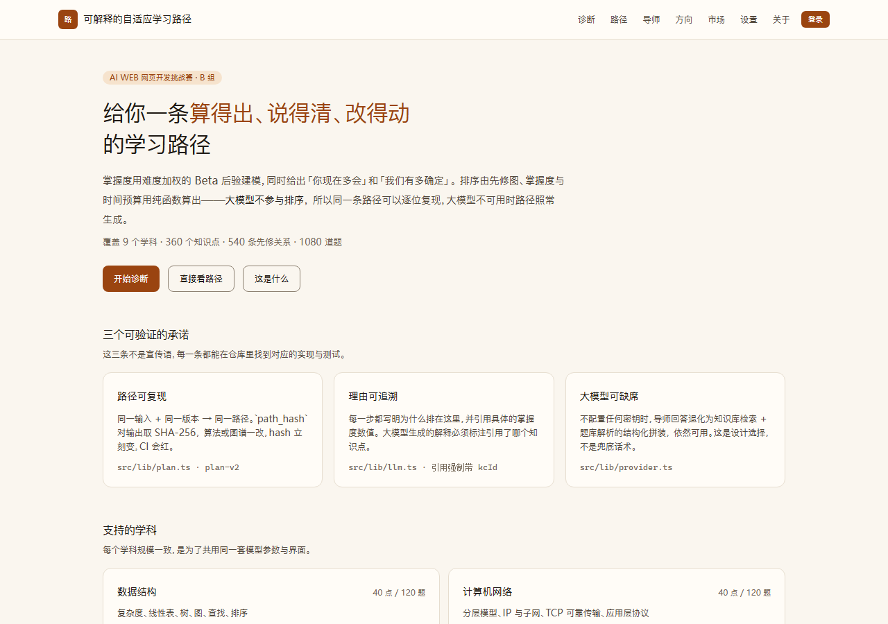

<div align="center">

# 可解释的自适应学习路径

给高校硬课的学生一条**算得出、说得清、改得动**的学习路径。

先修图决定能不能学 · Beta 后验决定先学哪个 · 时间预算决定这次学到哪

[在线演示](https://chuanzhibei-adaptive-learning.vercel.app) · [架构与算法](docs/architecture.md) · [RAG 与存储](docs/rag.md) · [验证记录](docs/verification.md) · [已知限制](docs/limits.md)


</div>



## 这是什么

一个多学科自适应学习系统：学生先做一轮诊断，系统用 Beta 后验收敛出每个知识点的掌握度，再在先修约束下排出「这次该学哪几步」，每一步都带数值理由，可以改预算、可以手动调顺序，违规会当场标出。

和常见推荐系统的区别只有一句话：**它判断的是「能不能学」，不是「想不想学」**。先修 DAG 是硬约束，未掌握的先修排在后继之前；先修被预算推迟时，后继进 `blocked` 而不是照排。

- **9 学科 · 360 知识点 · 540 条先修边 · 1080 题**，每学科 40 点 / 60 边 / 120 题，`npm run kg:validate` 逐科校验无环、无悬空边、每点恰好 3 题。
- **排序是纯函数**：`planPath` 只依赖图谱与掌握度，不联网、不取时钟、不用随机数；给定输入，路径逐位可复现（`pathHash`）。
- **不配任何 API key 也能完整使用**：诊断、路径、章节目标、手动改写、记忆卡、预测校准、教材检索与上传检索都不需要模型。

## 核心特性

| 能力 | 你能得到什么 |
| --- | --- |
| **可解释的路径** | 每一步一句带数值的理由（「尚无作答记录，先修深度 6，先建立基线（当前掌握度 10% ±17）」），外加输入 / 路径双指纹 |
| **不确定性可见** | 掌握度不是点估计：界面显示 `70% ±19` 与 `P(已掌握)`，条带宽度就是 `±sd` |
| **预算反事实** | 同一份掌握度换一个预算，直接看到哪些步骤被推迟、哪些因先修阻塞，阻塞点列出阻塞者 |
| **可改写** | 每步可上移 / 下移 / 移除，即时重算先修违规；章节多选只收窄候选，跨章先修点自动带上 |
| **证据链** | 导师回答先检索再生成，引用逐个逐字核对；联网结果与方向无关时被过滤，教材没有就说没有 |
| **账号级知识库** | 每个自定义方向一份知识库，支持 Markdown / TXT / 带文本层 PDF；登录后同步到账号，换设备能拿回 |
| **密钥不进浏览器** | server 模式下模型 / 搜索 / 语音密钥 AES-256-GCM 加密存库，任何响应只回 `••••` + 末 4 位 |
| **方向市场与 MCP** | 方向可公开、可复制；`POST /api/mcp` 暴露 5 tools / 18 resources / 2 prompts，全部只读 |

更多界面与文案见 [功能清单](docs/features.md)。

## 30 秒跑起来

要求 Node.js ≥ 22.13（`pdfjs-dist@6.4.299` 的 engines 限制，Node 20 不支持）。

```bash
npm install
npm run dev            # http://localhost:3000
```

不配环境变量即可试用全部离线能力。需要账号、跨设备同步与 server 模式密钥时，再补：

| 变量 | 必需性 | 作用 |
| --- | --- | --- |
| `DATABASE_URL` | 线上必需 | Postgres 连接串，承载 10 张表；缺失时退化为进程内内存，重启即丢 |
| `ALP_SECRET_KEY` | server 模式必需 | 32 字节随机数的标准 base64；缺失时拒绝保存密钥（503），绝不退化为明文 |
| `ALP_SECRET_KEY_ID` | 可选 | 密钥版本号，缺省 `v1`；当前只支持一把主密钥 |
| `ALP_EMBED_BASE_URL` / `_API_KEY` / `_MODEL` | 可选 | 服务端 embedding 兜底，三项齐全才生效；缺失时向量检索退化为 BM25 |
| `ALP_ALLOW_HTTP_PROVIDER_HOSTS` | 可选 | 允许代理访问 `http://` 的主机名单；**命中即整体信任该主机**（含环回 / 内网），默认空 |
| `ALP_ALLOW_MEMORY_SECRETS` / `HEALTH_TOKEN` | 仅测试 / 可选 | 前者只允许本地测试写内存密钥；后者给 `/api/health` 开详细检查 |

生成主密钥：`node -e "console.log(require('crypto').randomBytes(32).toString('base64'))"`。真实值写 `.env.local`（已 gitignore）。

部署到 Vercel：`vercel --prod`，并在项目里配置 `DATABASE_URL`（可用 Neon 集成）与 `ALP_SECRET_KEY`。自托管反向代理必须对 `/api/llm/chat` 关闭 `proxy_buffering`。调用模式、进度合并规则、完整环境变量与 nginx 示例见 [部署说明](docs/deploy.md)。

## 架构

```
诊断出题 → Beta 后验 → 排序（深度 → ZPD → sd → 兜底）→ 预算装包 → 手动改写 → 先修校验
                              │
                              └─ pathHash = SHA-256(steps + algoVersion + kgVersion)

可选能力（失败只降级自己，不阻塞核心路径）：
导师/方向 ─┬─ BM25 / 混合检索 ── 流式回答 ── 逐字引用核对
           ├─ 联网检索（DeepSeek / Tavily / 维基百科）
           ├─ 上传资料（IndexedDB + 账号 kb_docs / kb_chunks）
           └─ 语音朗读（浏览器 / mimo chat-audio）
```

关键约束：**决策层不 import 触点层**。`plan.ts` 的依赖只有 `graph.ts` 与 `mastery.ts`，所以模型、搜索、存储全部不可用时，排序行为完全不变。模型只参与「生成图谱 / 生成题目 / 写解释」，不参与排序。

分层图、每个节点的输入输出、Beta 后验公式、排序键与复杂度实测见 [架构与算法](docs/architecture.md)。

## RAG 与存储

RAG 在这个项目里不是「给聊天加点上下文」，而是**回答必须有出处**：

```
提问 ─┬─ 知识点：BM25 top3 ─────────────────────────────────┐
      └─ 上传资料：BM25 top20 ∥ 向量 top20 → RRF(k=60) → top3 ─┤
                                                                ▼
                              注入 [kcId] / [资料n] → 模型流式回答 → 逐字核对引用
```

| 参数 | 值 |
| --- | --- |
| BM25 `K1` / `B` | 1.5 / 0.75，中文 bigram + 单字降权 0.35，最低分 0.5 |
| 混合检索 | 每路候选 20，RRF `k=60`，注入 top3，余弦阈值 0.25，相邻切块去重 |
| 切块 | 500 字 + 50 字重叠，单方向上限 800 段 / 40 万字 |
| 评测 | 50 条（字面 15 / 同义 15 / 答不上 10 / 域外 10） |

**存储链路**：浏览器解析 PDF / Markdown → 切块 → 未登录写 IndexedDB（单事务）；登录后本地先写，再 `PUT /api/kb` 做文档级 CAS 写入 `kb_docs` / `kb_chunks`，向量以 JSON 文本存列、按游标分页取回（不引 pgvector）。10 张表：`users`、`sessions`、`progress`、`directions`、`direction_picks`、`direction_items`、`user_secrets`、`kb_docs`、`kb_chunks`、`memories`。

**实测与边界**（`npm run eval:rag`，2026-10-29 本机）：recall@3 `1.000`、MRR@10 `1.000`、全文金句 `1.000`。但这套评测**已饱和**，只能证明基础检索没坏，不能证明标题加权或向量 / RRF 的提升；域外查询 emptyRate 为 `0.000`（10 条全部返回了文档，是缺陷信号不是通过）；混合检索只接上传资料且尚未评测。

完整链路、参数出处、降级矩阵、数据表与评测明细见 [检索与存储](docs/rag.md)。

## 验证

测试、图谱、学科数三个徽章都能当场跑出来，数字为 2026-10-29 本机实测：

| 命令 | 验证什么 | 最近实测（2026-10-29） |
| --- | --- | --- |
| `npm run verify` | typecheck + 单测 + 图谱 + 密钥扫描 | **exit 0** |
| `npm run test` | 66 个测试文件 | **1594 passed** |
| `npm run kg:validate` | 9 学科图谱与题库 | **0 error**（360 点 / 540 边 / 1080 题） |
| `npm run build` | Next 16 生产构建 | **exit 0**（24 个路由） |
| `npm run eval:rag` | 50 条检索评测 | recall@3 `1.000`，OOD empty `0.000` |
| `npm run check:secrets` | 仓库无真实密钥 | 扫 236 个文件，**0 命中** |
| `auth-smoke` / `mcp-smoke` | 注册登录隔离 / MCP 协议 | **34/34** / **16/16**（内存库） |

E2E 必须在命令前加 `DATABASE_URL=`，否则 `next dev` 会读到真实连接串并把测试账号写进线上库。原始终端输出、Mock 供应商的 19 项集成检查、可访问性对比度实测见 [验证记录](docs/verification.md)。

## 项目结构

```
src/lib/plan.ts          路径排序、装包、双指纹、先修校验（纯函数）
src/lib/mastery.ts       Beta 后验、sd、P(已掌握)、预测正确率
src/lib/graph.ts         DAG 校验、深度、拓扑序、先修闭包
src/lib/rag.ts           BM25 bigram + 标题加权（纯函数）
src/lib/hybrid.ts        RRF 融合与相邻去重（纯函数）
src/lib/kbServer.ts      知识库行映射、文档级 CAS、向量分页
src/lib/secretCrypto.ts  AES-256-GCM、AAD、kid、掩码（服务端）
app/                     9 个页面 + 14 个 API 路由
scripts/                 validate-kg / eval-rag / check-secrets / 三个 E2E
```

完整模块清单见 [架构与算法](docs/architecture.md#项目结构)。

## 已知限制

- **没有教师班级视图**，也不使用任何真实学生数据；4 个新增学科未经任课教师逐题复核。
- **检索评测饱和且不拒答域外问题**：recall@3 已到 1.000，证明力有限；OOD 全部返回文档。
- **内置知识点仍走纯 BM25**，混合检索只接上传资料，且这部分没有评测集。
- **没有 CI**，所有门禁靠本地 `npm run verify` 与 E2E 脚本手动跑。
- **知识库同步不承诺线性化**：删除无 tombstone、CAS 不是事务、远端读会覆盖本地未上传的修改。
- **没有自建限流**，`/api/search` 与 `/api/tts` 没有请求体上限，公网部署需在代理层补。

30 条缺口与每条的原因、修法见 [已知限制](docs/limits.md)；评分点逐项对照与「不可宣称」的措辞见 [评分对照](docs/scoring.md)。

## 文档

| 文档 | 内容 |
| --- | --- |
| [架构与算法](docs/architecture.md) | 流程图、分层约束、Beta 后验公式、排序键、复杂度实测、模块清单 |
| [AI 触点、硬门禁与降级](docs/ai.md) | 六个 AI 触点、只读核对、思考强度、联网、TTS、知识口径、L1–L6 校验、降级矩阵 |
| [检索与存储](docs/rag.md) | 提问链路、参数表、降级矩阵、上传存储链路、10 张表、50 条评测 |
| [部署说明](docs/deploy.md) | Node 版本要求、调用模式、进度合并规则、环境变量、Vercel 与自托管 |
| [功能清单](docs/features.md) | 按用户旅程排列的 23 项能力与界面证据 |
| [验证记录](docs/verification.md) | 门禁原始输出、E2E、Mock 供应商、可访问性、工程细节 |
| [已知限制](docs/limits.md) | 已验证能力、已修复问题、真实缺口、能力边界、下一步 |
| [评分对照](docs/scoring.md) | 评分表逐项映射到代码路径与可跑命令 |

## 团队与合规

2026 第九届传智杯全国大学生数智创新与 AI 应用大赛 · AI WEB 网页开发挑战赛（技术应用赛 · 团队赛）

| 团队 | 编号 | 院校 | 组别 | 成员 | 指导教师 |
| --- | --- | --- | --- | --- | --- |
| 胆子肥嘟嘟队 | 38543 | 北京电子科技学院 | B 组 | 李双、于凯、王一超 | 李浩亮 |

- **数据最小化**：注册只收邮箱、密码、显示名；仓库与测试数据里没有真实手机号或邮箱。
- **密码**：PBKDF2-HMAC-SHA256 600,000 次，每用户随机盐，常量时间比较。
- **密钥**：仓库内无真实密钥（`check:secrets` 可验证）；用户密钥按模式存放，server 模式加密落库、只回掩码，local 模式仅存浏览器。
- **上传资料**：只保存抽取后的文本与切块，不保存原文件；按 `user_id` 隔离，不随方向公开或复制。

许可：[MIT](LICENSE)（题库为教学演示用途，正式使用前须由任课教师逐题核对）。
