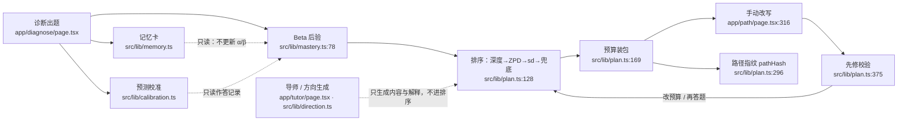
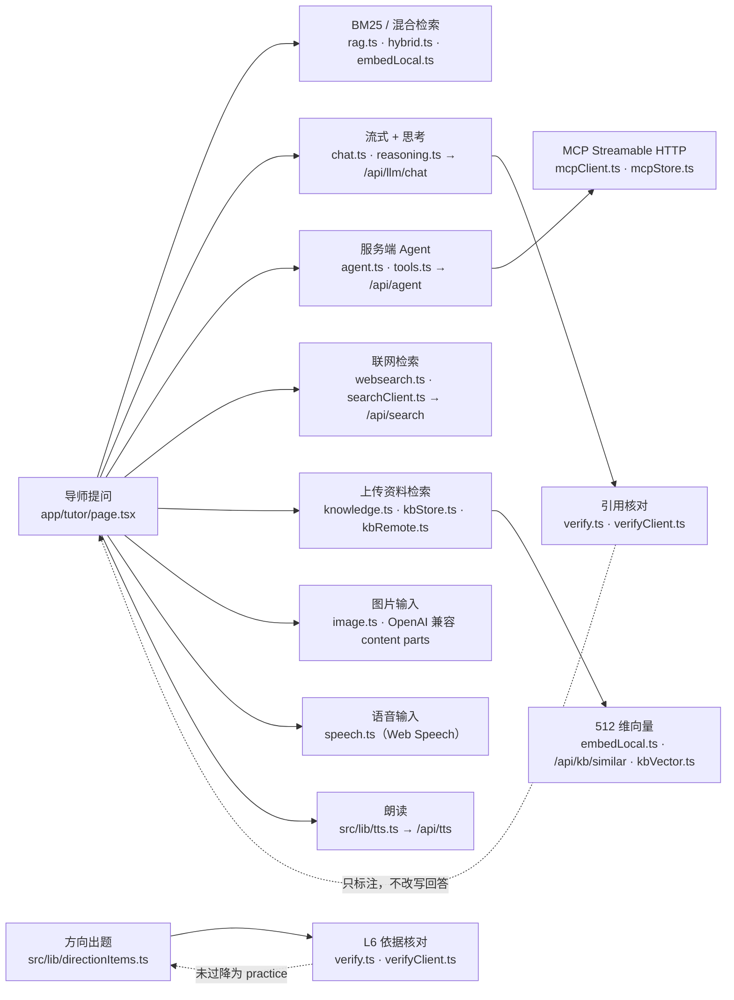

# 架构与算法

## 2026-11-04 学习界面与交互

首页流程预览使用当前课程题目、知识点与真实规划结果，不写入作答证据。导师工作台在桌面并排展示教材与对话，移动端复用相同材料面板为抽屉；引用原文只预填问题，不自动发送。

React Flow 图谱通过 `learningGraph.ts` 展示现有 DAG、已核对掌握度与当前步骤，不修改 `planPath`。默认保留完整先修链，并控制额外上下文密度；全科关系可显式展开。未测评节点不显示先验百分比，手动移除、预算暂缓与先修阻塞分别标识，练习入口携带知识点定位。

交互原语仅引入 Radix Dialog / Tooltip，复用原有五套主题；图谱按路由拆包。GSAP 负责诊断反馈与清单 Flip，React Flow 独立管理画布变换，动画作用域均有清理。减少动态效果时直接呈现真实终态。3D 星图为参考方案中的可选项，本次保留可阅读、可键盘操作的二维图谱与清单。

## 2026-11-04 学情与教学上下文

`learningContext.ts` 从登录会话、课程 / 私有方向权限、服务端题库、已选答案与账号知识库构建一次运行的快照。掌握度由已核对选项重算，模型无权传入 α/β；未观测点保留先验参与规划，但不把先验百分比当作学生的真实测量。

Agent 首轮已有隔离的学情与检索 tool 消息，其后模型只能调用绑定当前目标的只读工具。普通导师通过统一 useLearner 读取服务端校验后的进度；两条链路共享人格、语气、教学帮助档位与资料来源规则。公开 MCP 的模拟接口保持独立。

进度复用 `updated_at` 作为 revision，条件写入失败返回 409，客户端按稳定 attemptId 合并证据并重试。重测仅归档旧证据；最近一次作答前后的路径由 `learningReport.ts` 重建，不改变 `planPath` 的排序规则。完整实现与验证见 [改进记录](improvements-2026-11-04.md)。

## 整体流程



**可选能力层**（都不在核心路径上，失败时只降级自己）：



每个节点的职责：

| 节点 | 输入 | 做什么 | 输出 |
| --- | --- | --- | --- |
| 诊断出题 | 图谱深度、各点掌握度、未做过的题 | 先修深度升序 → 掌握度均值升序 → 选预测正确率最接近 0.65 的题 | 下一道题 |
| Beta 后验 | 答对/答错 + 题目难度 | 答对加 α、答错加 β，权重 `w = 0.5 + 0.25d` | 均值、`sd`、`P(已掌握)` |
| 排序键 | 掌握度快照、先修图 | 深度升序 → ZPD 距离升序 → `sd` 降序 → 拓扑序 → id | 有序候选列表 |
| 预算装包 | 排序结果、预算 | 贪心装入；先修被推迟则后继阻塞 | `steps` / `deferred` / `blocked` |
| 手动改写 | 算法路径 | 上移、下移、移除，实时重算违规 | 新顺序 + 违规列表 |
| 先修校验 | 路径 + 已掌握集合 | 检查每条边的相对位置与缺失 | 违规文案 |
| 路径指纹 | 步骤序列 + 版本号 | SHA-256 | 64 位十六进制 |
| 记忆卡 | 答错的题、易混的知识点对、复习自评 | 到期阶梯 1/3/7/21 天；连续 4 次「记住了」毕业 | 待复习卡片（不更新 α/β） |
| 预测校准 | 作答前的 `predicted` + 实际对错 | Wilson 区间、O/E、Brier；30/60/100 三档 | 一句话结论 + 折叠明细 |
| L6 依据核对 | 一批 3–4 题 + 该知识点的原文 | 逐字 quote、答案与选项比对；整批一次调用 | `checks` + 未过降为 practice |

**分层与职责**（自下而上，上层只能依赖下层）：

```
┌─ 数据层 ──────────────────────────────────────────────┐
│ 9 学科图谱与题库（静态 TS 模块）· Postgres/内存 12 张表   │
│ 方向上传知识库（IndexedDB 本机 + 账号 kb_docs/kb_chunks） │
│ 职责：只存数据，不含规则                                  │
├─ 决策层（纯函数）─────────────────────────────────────┤
│ graph / mastery / plan / itemgen / memory / calibration│
│ knowledge / rag / hybrid / vector / embedding / ragEval│
│ verify / websearch / reasoning                         │
│ 职责：无网络、无随机、无时间；可被测试逐位复现             │
├─ 触点层（可选）───────────────────────────────────────┤
│ chat + direction + directionItems + verifyClient       │
│ + searchClient + external + upstream + ssrfGuard       │
│ + tts + kbStore/kbLocal/kbRemote/vectorCache           │
│ + embeddingClient/hybridSearchClient + server* 适配     │
│ + materials + pdf + textFile + image + speech          │
│ + agent + tools + mcpClient + mcpStore + kbVector      │
│ 职责：检索、模型调用、浏览器/账号存储与语音；失败必须降级   │
├─ 表现层 ──────────────────────────────────────────────┤
│ app/ 9 个页面 + 18 个 API 路由                          │
│ 职责：读写状态、展示数值理由、把纯函数结果画出来             │
└───────────────────────────────────────────────────────┘
```

关键约束：**决策层不 import 触点层**。`plan.ts` 的依赖只有 `graph.ts` 与 `mastery.ts`（`src/lib/plan.ts:11-18`），所以模型不可用时决策层行为完全不变。新增的 `memory.ts` / `calibration.ts` / `knowledge.ts` / `rag.ts` / `hybrid.ts` / `vector.ts` / `embedding.ts` / `ragEval.ts` / `verify.ts` / `websearch.ts` / `reasoning.ts` 同样不碰网络、IndexedDB 与系统时钟；`pathHash` 与 golden case 没有因为这一轮新增功能而变化。

<details>
<summary>PDF / 不支持 Mermaid 的平台：ASCII 版</summary>

```
[诊断出题 diagnose/page.tsx]
        │  答对/答错 + 难度
        ▼
[Beta 后验 mastery.ts] ──► (mean, sd, P)
        │
        ▼
[排序 plan.ts:128]  depth ↑ → |0.6-mean| ↑ → sd ↓ → 拓扑序/id
        │
        ▼
[装包 plan.ts:169]  15 分钟/新学，8 分钟/复习；先修被推迟 → 后继 blocked
        │
        ├──► [pathHash plan.ts:296]
        ▼
[手动改写 path/page.tsx:316] ──► [checkPrereqOrder plan.ts:375] ──► 违规提示
        ▲
        └── 改预算 / 再答题，回到排序

可选能力层（都不阻塞核心路径）：
[导师提问] ─► BM25 / 混合检索 ─┬─► 流式回答 + 思考 ─► 引用核对（只标注）
                         ├─► 联网检索 [网络n]（外部网页，未核对；server 模式经 /api/search）
                         ├─► 上传资料检索 [资料n]（本机 IndexedDB + 账号同步 + 512 维向量）
                         ├─► 服务端 Agent（/api/agent，本地 5 工具 + 用户 MCP 工具）
                         ├─► 图片输入（OpenAI 兼容）· 语音输入（Web Speech）
                         └─► 朗读（浏览器 / 在线语音；server 模式经 /api/tts）
[方向出题] ─► L1 → L2 → L3 → L4 → L6 依据核对 ─► 落库
[诊断作答] ─► 记忆卡（不更新 α/β）· 预测校准（只读 attempts）
```

</details>

**一个具体的学生。** 小王在操作系统里想学第 3 章（`o10`–`o14` 五个知识点，`src/data/subjects/os.ts:28`）。按诊断页同一套选题规则模拟（全部答对）：候选点按「先修深度升序 → 掌握度均值升序」出题，两个会话共 24 题（每次上限 15 题，`app/diagnose/page.tsx:74`）测完 8 个点——`o01`–`o05` 是第 3 章的传递先修，`o34`–`o36` 属于文件系统方向、深度只有 0–2 所以也排在前面（诊断不限于目标点的先修闭包）。8 个点各 3 题全对，掌握度 0.700–0.740，`sd` 0.179–0.187。

- **90 分钟预算、目标 `o10`–`o14`** → 6 步：`o06` 进程控制块与进程控制 → `o07` 进程上下文切换 → `o08` 线程与多线程模型 → `o10` 处理机调度的层次与目标 → `o11` 先来先服务与短作业优先 → `o12` 优先级调度与时间片轮转，正好 90 分钟；`o13`、`o14` 进 `deferred`，`blocked` 为 0，`pathHash = 5c51a690…`。
- **改成 60 分钟** → 4 步（`o06`→`o07`→`o08`→`o10`，60 分钟），`o11` 进 `deferred`，另外 3 个点因先修被推迟进入 `blocked`，`pathHash = 0ec9da69…`。这就是界面上的「反事实」：不是换一条算法，而是同一算法换一个预算。
- **把 `o12` 上移到 `o11` 之前** → 立即报「`o11` 应先于 `o12`，实际排在其后（位置 5 > 4）」；**删掉 `o07`** → 报「`o07` 是 `o08` 的先修，但不在路径中，也未标记为已掌握」。

> 上面这一遍用 `targets` 限定到第 3 章，`planPath` 的入参与 MCP 的 `plan_path` 工具都支持；路径页也已支持按章多选（见 [§8](features.md)），章节只收窄 `targets`，跨章先修点仍会自动带上。

## 与推荐系统的区别

| 维度 | 常见推荐系统 | 本项目 |
| --- | --- | --- |
| 约束 | 按相似度或热度排序，不建模先修关系 | 先修 DAG 是硬约束：目标点的先修闭包全部进入候选，未掌握的先修排在后继之前；先修被预算推迟时，后继进 `blocked` 而不是照排（`src/lib/plan.ts:111`、`:170`） |
| 可解释 | 一个分数，说不清为什么 | 每一步一句带数值的理由（「尚无作答记录，先修深度 6，先建立基线（当前掌握度 10% ±17）」；复习步骤写成「已掌握 57%（±23），距目标还差 3 个百分点」，`src/lib/plan.ts:212`）+ 输入/路径双指纹 |
| 不确定性 | 点估计 | Beta 后验：界面显示 `70% ±19` 与 `P(已掌握)`，条带宽度就是 `±sd`（`src/components/ui.tsx:279`） |
| 方案数 | 单一结果 | 反事实预算对比：选一个对照预算，标出哪些步骤会被推迟或因先修阻塞（`app/path/page.tsx:99`） |
| 可改写 | 不可改 | 可上移/下移/移除，实时标违规；顺序按目标存 `localStorage`（`alp.path.manual.v1`，`src/lib/manualPath.ts:16`），刷新可读回 |

这张表里最关键的是第一行：**先修约束让「推荐」变成「能不能学」的判断**，而不是「想不想学」的猜测。第二行是它的直接后果——既然排序规则是显式的，就能把每一步的数值理由打印出来，也能对同样的输入复现同样的输出。

## 自适应在哪

「自适应」在本项目里只有三件事，每件都能指到代码。

## ① 出题：下一个测哪个知识点、出哪道题

- **输入**：当前掌握度快照、每点已做过的题、图谱深度。
- **规则**：候选点按 `depth` 升序 → 掌握度均值升序 → `id` 排序；选中点里再选 `|predictCorrect(mean, d) − 0.65|` 最小的那道题（`app/diagnose/page.tsx:396`）。0.65 是信息量较大的区间：太低多半在猜，太高测不出上限。
- **输出**：下一道题 + 所属知识点 + 难度。
- **证据门槛**：内置题每点 3 题、生成题 4 题（`src/lib/mastery.ts:123`），达到即换下一个点；全局上限 15 题（`app/diagnose/page.tsx:74` 的 `HARD_CAP`）。

实测效果：`o01`（depth 0，先验 0.35）三道题依次选 `d=1`（预测 0.641）、`d=2`（0.670）、`d=3`（0.653），全对后均值 0.740；`o10`（depth 6，先验 0.10）单独模拟时出题序列同样是 1→2→3，全对后均值只到 0.640。**出题序列相同、结果不同**——差别来自先验，不是难度标签。

## ② 排序：下一步学哪个

- **输入**：`PlanInput { graph, mastery, budgetMinutes, targets?, masteryTarget? }`。
- **规则**：先取目标点的先修闭包 ∪ 目标点，去掉已达 0.6 的点；再按 **先修深度升序 → ZPD 距离升序 → `sd` 降序 → 拓扑序/id** 排序（`src/lib/plan.ts:128-148`）；最后按 15 分钟/新学、8 分钟/复习贪心装包（`src/lib/plan.ts:169-197`）。
- **输出**：`steps`（带 `reason`）、`totalMinutes`、`deferred`、`blocked`、`pathHash`。
- **为什么是这个顺序**：深度保证不跳级；ZPD 距离让「跳一跳够得着」成为显式规则；`sd` 降序让最不确定的点优先获得证据；拓扑序与 id 只是兜底，保证完全确定。前三个键决定「先学哪个」，后两个键只负责在同分时给出稳定结果。

`learn` 与 `review` 由 `evidenceN` 决定：没作答过是新学，作答过但没达标是复习（`src/lib/plan.ts:180`）。装包阶段先修被推迟时，后继必须进 `blocked` 并带 `by`，否则会产出「先修不在路径、后继却在路径」的非法结果（`src/lib/plan.ts:170-176`）。

## ③ 预算反事实 + 手动改写

- **输入**：同一份掌握度快照 + 两个预算（30/60/90/120/180/240 分钟，`app/path/page.tsx:41`）。
- **规则**：对两个预算各跑一次 `planPath`，把对照预算下会被推迟或阻塞的步骤标灰并加「对照预算下会被推迟」标签（`app/path/page.tsx:221`、`:636`）。
- **手动改写**：上移/下移/移除按钮（`app/path/page.tsx:672-693`）改的是当前页面状态；每次改动后用 `checkPrereqOrder(graph, steps, { mastered: masteredSet(mastery) })` 严格模式重算违规（`app/path/page.tsx:305`、`src/lib/plan.ts:375`）。严格模式要求「先修既不在路径、也未标记已掌握」必须报违规；不传 `mastered` 的宽松模式只查顺序。
- **输出**：违规条数与逐条文案；无违规时显示「当前顺序仍满足全部先修约束」。

界面上的三个闭环对应三张图：[诊断](../screenshots/diagnose.png)、[路径与指纹](../screenshots/path.png)、[自定义方向诊断](../screenshots/diagnose-direction.png)。

## 核心算法

四个纯函数：掌握度、预测正确率、路径排序与装包、双指纹。下面给出公式、参数与实测。

## 掌握度：难度加权 Beta 后验

```
先验  α₀ = s·p₀，β₀ = s·(1−p₀)，s = 2
      p₀ = max(0.10, 0.35 − 0.05·depth)
更新  答对 α += w；答错 β += w
      w = (0.5 + 0.25·d) × weightScale，d ∈ {1,2,3,4,5}
输出  mean = α/(α+β)
      sd   = √(αβ / ((α+β)²(α+β+1)))
```

代码：`src/lib/mastery.ts:43`（先验）、`:35`（权重）、`:78`（更新）、`:96`（均值）、`:107`（sd）。生成题的 `weightScale = 0.8`，仅练习题为 0（`src/lib/itemgen.ts:58`、`src/lib/mastery.ts:85`）。

**为什么 3 题够用（实测，不是推导）。** 对全部 360 个知识点各做「3 题全对」后统计：`sd` 最大 **0.196**、中位 **0.184**、最小 0.161，全部 ≤ 0.20 阈值。

这个结论**依赖先验与难度组合**，不能简化成「按众数难度 d=2 算」。实际难度直方图是 `{1: 227, 2: 348, 3: 349, 4: 156}`，全局众数是 d=3，而计算机网络学科的众数是 d=1（`src/data/subjects/network.ts` 共 40 道 d=1）。下面这张表只在 `p₀ = 0.35`（根节点）时成立，用来说明趋势：

| 同点全对题数 | 0 | 1 | 2 | 3 |
| --- | --- | --- | --- | --- |
| `sd`（d=1） | 0.275 | 0.258 | 0.228 | 0.201 |
| `sd`（d=2） | 0.275 | 0.248 | 0.209 | 0.179 |
| `sd`（d=3） | 0.275 | 0.238 | 0.193 | 0.161 |
| `sd`（d=4） | 0.275 | 0.228 | 0.179 | 0.146 |

深度越大 `p₀` 越低，同样的 3 题全对会留下更大的不确定度——`data-structures/c18`（depth 6，`p₀=0.10`，三道 d=1/2/3）的 3 题全对 `sd` 是 0.196，接近阈值。

**证据门槛按来源区分**（`src/lib/mastery.ts:114-145`）：

| 题源 | 折扣 | 每 KC 门槛 | 依据 |
| --- | --- | --- | --- |
| 内置题库 | 1.0 | 3 题 | 实测 360 个 KC 三题全对后 sd 最大 0.196 |
| 模型生成（`source=generated`） | 0.8 | 4 题 | depth=13、d=2 时 3 题 sd=0.2116（不达标），4 题 0.1911 |
| 手动录入（`source=manual`） | 1.0 | 3 题 | 与内置题同等，但界面标注「未做机器校验」 |
| 借用（`source=borrowed`） | 1.0 | 3 题 | 按 KC 名称从内置题库借同名知识点的题（`src/lib/borrow.ts`）；服务端会用同一个函数复算，客户端不能凭空声明 |
| 仅练习（L4 未过） | 0 | 不计 | 记录作答但不进 α/β |

折扣按落库的 `source` 字段判断（`app/diagnose/page.tsx` 的 `submit`），**不按题目 id 前缀猜**。
方向题的 id 都是 `di-` 开头（`src/lib/itemgen.ts`），用前缀判断会把 manual 误当 generated 打 0.8 折——
这是上一版的真实 bug。

**`sd` 与 `P(已掌握)` 是两个量。** `sd` 是后验精度，`P(p>0.6)` 是决策概率。实测 360 个知识点「3 题全对」后 `P(p>0.6)` 最小 0.604、中位 0.701、最大 0.848，没有一个到 0.90；要达标得把题库扩到 4–5 题/KC，会破坏数据集不变量。所以 `P` 只在界面上作为一行小字展示（`src/components/ui.tsx`），不做停测阈值。

**`sd` 与证据条数一起构成「证据充分」判据**（`src/lib/mastery.ts:138-145`）：

```
hasEnoughEvidence(state, target) = evidenceN >= target && sd <= 0.20
```

两个条件都要满足。只数条数会漏掉「条数够但对错分裂」——同一点答对 2 题、答错 1 题时
sd 比只答对 1 题还大。`CONFIDENCE_SD_THRESHOLD` 是这条判据的一半，不再是无引用的常量。

需要分清两个不同的地方：

| 用途 | 判据 | 位置 |
| --- | --- | --- |
| **停测**（还要不要继续出题） | 只看 `evidenceN < 门槛` | `app/diagnose/page.tsx` 的 `pickNext` / `kcNeedingItems` / `canPickMore` |
| **标注「证据充分」**（结果卡） | `evidenceN >= 门槛 && sd <= 0.20` | `hasEnoughEvidence` |

结果卡把「不足」拆成两种原因显示，不再统一写「未达 N 题门槛」：

| 原因 | 判定 | 文案 |
| --- | --- | --- |
| 条数不足 | `evidenceN < 门槛` | 「已测 n 题，未达 N 题门槛」 |
| 精度不足 | `evidenceN >= 门槛` 但 `sd > 0.20` | 「已测 n 题，题数够了但答案对错分裂，不确定度仍偏大（±X）」 |

内置题按典型序列 d=1/2/3 做「2 对 1 错」时 `n=3, sd=0.2041`，会落到第二种。
题库每 KC 恰好 3 题、停测也在 3 题时停止，所以这类 KC 的提示**不会被消除**——
它描述的是「这个掌握度不够可信」，不是「还缺题」。两者必须分开说。

停测不看 sd 是有意的：sd 在「对错各半」时最大，若拿它当停测条件，这类知识点会永远测不完。
界面上的「已测 n 题，未达 N 题门槛，掌握度仅供参考」也是按这个口径写的——**不是**「未计入掌握度」，
这些作答已经更新了 α/β，只是精度还不够。

## 预测正确率与选题

```
predictCorrect(p, d) = 1 / (1 + exp(−(logit(p) − 0.6·(d − 3))))
```

`p=0.35` 时 d=1..5 的预测值为 `0.641 / 0.495 / 0.350 / 0.228 / 0.140`（`src/lib/mastery.ts:157`）。不叠加 0.25 的猜测率下限：加上之后 d=3 会变成 0.51，与「难度 3 对应掌握度本身」的直觉冲突，也让 0.65 的选题目标失去意义。这是产品假设，不是文献结论。

## 路径：三步纯函数

```
1. 候选集  目标先修闭包 ∪ 目标点，去掉 mean ≥ 0.6 的
2. 软排序  depth ↑ → |0.6 − mean| ↑ → sd ↓ → 拓扑序/id
3. 装包    15 分钟/新学、8 分钟/复习，装不下进 deferred；先修被推迟则后继进 blocked
```

不用 0-1 背包求最优：知识点之间有先修约束，不能只按价值密度挑；带先修约束的预算装包是 NP-hard，本期不做精确解。贪心 + 拓扑序的每一步都能说清「为什么排在这」，这比「最优但说不清」更符合产品目标。

## 可复现性：两个指纹

| 指纹 | 覆盖 | 用途 |
| --- | --- | --- |
| `inputHash` | budget + masteryTarget + targets + mastery(α, β, evidenceN) + kgVersion（`src/lib/plan.ts:264`） | 判断输入是否变过 |
| `pathHash` | steps 的 `kcId / kind / estMinutes / source` + algoVersion + kgVersion（`src/lib/plan.ts:234`） | 判断输出是否变过 |

**不覆盖** `reason`、`deferred`、`blocked`、`totalMinutes`——`totalMinutes` 由 steps 决定，前三个是解释性字段。改 `estMinutes` 会让 `pathHash` 变，这条有专门用例（`src/lib/plan.test.ts:154`）。

golden case 的两个字面量锁在 `src/lib/plan.test.ts:26-27`，可用 `npm run path:hash` 重新打印核对：

```
inputHash  f9f9999230b4c06be74c235e4f7bedc39dcb7c4b947dea80f4dbb89539e61ecd
pathHash   ad7ccec537db36ee7b0070aca3f9f99006e92521e16ce2608def4df76f2b9e66
```

承诺的措辞是「同一个 attempt 快照 → 同一条路径」，不是「同一输入 → 同一路径」：生成题会改变作答，作答会改变掌握度，掌握度会改变路径。

**路径页显示两个指纹，它们指向不同的东西：**

| 面板项 | 是谁的指纹 | 什么时候会变 |
| --- | --- | --- |
| 算法路径指纹 | `planPath` 输出（纯算法结果） | 输入或算法版本变化 |
| 当前显示顺序指纹 | 页面上实际列出的步骤顺序（含手动调整） | 手动上移/下移/删除，或预算变化 |

手动改写后两者不同，这是**预期**而不是 bug：算法结果没变，你看到的是改过的顺序。
面板同时显示两者，就是为了让这个差异可见，而不是让「路径指纹」指向一个用户看不到的路径。

手动改写只存 kcId 顺序（`app/path/page.tsx` 的 `manualOrder`），不存整份 steps。
所以改预算时会用新 plan 的步骤集合重放用户调整过的相对次序——
「手动 16 步 → 预算改 30 分钟」会立刻收缩到 2 步，而不是停在 16 步。
手动步骤的 `reason` 仍是算法排序时的理由，页面会补一句「理由说明的是算法排序依据；当前位置是你手动调整的」，
不假装理由跟着位置重算。

## 复杂度实测

`npm run bench`（Node 24.15.0 / Windows 10.0.26300 x64，本机多次运行；样本间差异主要来自机器负载与热状态，所以给区间）：

| 项目 | 40 节点 | 500 节点 |
| --- | --- | --- |
| 拓扑排序 | 0.0017 ms/次 | 0.0055 ms/次 |
| ZPD 贪心路径（40 步） | 0.0028 ms/次 | 0.0094 ms/次 |
| 先修闭包 | 0.0035 ms/次 | — |
| Beta 更新（单次作答） | < 0.0001 ms/次 | — |

以上是最近一次 `npm run bench` 的原始输出（多数项目 2000 次循环取均值，500 节点路径为 500 次）。
不同机器与负载下会有 ±30% 波动，所以**不写成硬阈值**；要复核就自己跑一遍。

波动来自机器负载（本机最慢与最快样本差 3–4 倍），不是算法不稳定。即便取最慢样本，40 点图的规划也在 0.02 ms 量级，所以路径页改预算可以同步重算，不需要 loading 状态。

## 项目结构

只列核心决策模块、本轮新增的可选能力模块与入口页；其余文件用 `git ls-files src app` 查看。

```
src/lib/plan.ts        路径排序、装包、双指纹、SHA-256、先修校验（纯函数）
src/lib/mastery.ts     Beta 后验、sd、P(已掌握)、预测正确率
src/lib/graph.ts       DAG 校验、深度、拓扑序、先修闭包
src/lib/direction.ts   描述 → 图谱草稿 + 八条硬门禁 + 标题校验
src/lib/itemgen.ts     生成题 L1–L5 校验 + contentHash + 批解解析
src/lib/db.ts          Postgres / 内存双实现，12 张表

src/lib/rag.ts         BM25 bigram、单字降权、域外门控、MIN_SCORE（标题加权仅评测用；纯函数）
src/lib/hybrid.ts      RRF k=60、候选 20、top3、余弦 0.25、相邻去重（纯函数）
src/lib/vector.ts      向量校验、余弦、topK（纯函数）
src/lib/embedding.ts   两个维度确定的预设、嵌入输入、FNV-1a（纯函数）
src/lib/ragEval.ts     50 条评测解析与 recall@3 / MRR@10 / 全文金句指标（纯函数）
src/lib/memory.ts      记忆卡：错题 / 易混、1/3/7/21 天到期、200 张容量（纯函数）
src/lib/calibration.ts Wilson 区间、O/E、Brier、30/60/100 档位（纯函数）
src/lib/knowledge.ts   切块、编码探测、uploadsToPack、BM25 检索（纯函数）
src/lib/materialStore.ts 教材 / 讲义 localStorage 读写与订阅
src/lib/materials.ts   资料包、冲突检测、上下文裁剪（纯函数）
src/lib/kbStore.ts     存储契约 + useKnowledgeBase hook + 重新导出解析器
src/lib/kbLocal.ts     IndexedDB 适配器（docs / chunks）
src/lib/kbRemote.ts    远端适配器 + 本地/远端复合存储 + getKbStorageForUser
src/lib/kbServer.ts    行映射、上传校验、文档级 CAS、片段分页（服务端）
src/lib/kbVector.ts    kb_chunk_vectors 读写、精确余弦查询（服务端）
src/lib/vectorContracts.ts 512 维向量上传 / 相似查询契约（zod）
src/lib/vectorCache.ts 片段向量缓存（IndexedDB，按 model+FNV 键）
src/lib/embeddingClient.ts /api/llm/embeddings 客户端、LRU 50 条
src/lib/hybridSearchClient.ts 检索适配层：BM25 + 向量 + RRF + 降级说明
src/lib/embedLocal.ts  浏览器本地 bge-small-zh-v1.5 嵌入（Worker，失败降级）
src/lib/pdf.ts         pdfjs-dist 抽文本；无文本层如实拒绝（不做 OCR）
src/lib/image.ts       图片格式 / 压缩 / 体积 / 张数限制（纯逻辑）
src/lib/speech.ts      Web Speech 可用性检测、转写拼接、错误翻译（纯逻辑）
src/lib/tools.ts       5 个只读工具定义与实现（MCP 与 Agent 共用）
src/lib/agent.ts       服务端有界工具循环（纯状态机）
src/lib/agentContracts.ts Agent 请求体、事件、运行上限（zod）
src/lib/mcpClient.ts   MCP 2025-06-18 Streamable HTTP 客户端
src/lib/mcpStore.ts    用户 MCP 服务器配置与鉴权头加密
src/lib/textFile.ts    File → Uint8Array，解码复用 knowledge.ts
src/lib/verify.ts      逐字 quote 校验、L6 整批解析、引用核对判定（纯函数）
src/lib/verifyClient.ts 核对请求：每 KC 一次 / 每回答一次，失败 fail-open
src/lib/reasoning.ts   SSE 解码、reasoning/正文分流、三档思考请求体（纯函数）
src/lib/chat.ts        callChat / callChatStream / probeThinking（local 直连 / server 代理）
src/lib/websearch.ts   网络结果归一化、[网络n] 解析（纯函数）
src/lib/searchClient.ts 三家搜索的客户端分发、30 分钟会话缓存、供应商回退 notice
src/lib/tts.ts         浏览器语音 / 在线语音、文本清洗（2000 字）、两种协议
src/lib/mimo.ts        chat-audio 请求体、base64 解码、响应解析（纯函数）
src/lib/memoryServer.ts / memoryClient.ts / memorySync.ts  记忆卡 LWW、显式删除、合并纯函数
src/lib/accountTransition.ts 换账号时清哪些浏览器存档（纯函数）
src/lib/serverConfig.ts 调用模式、GET/PUT/DELETE /api/config 客户端
src/lib/userSecrets.ts 密钥 CRUD、options 白名单、公开响应只回掩码
src/lib/secretCrypto.ts AES-256-GCM、AAD、kid、掩码（服务端）
src/lib/serverEmbedding.ts / serverSearch.ts / serverTts.ts  服务端代发适配
src/lib/upstream.ts    LLM 配置解密、端点拼装、SSE 代理、错误脱敏
src/lib/ssrf.ts / ssrfGuard.ts  出站地址形状、DNS、钉 IP 三层判定
src/lib/routeAuth.ts / origin.ts  登录校验、同源校验、统一 JSON 错误
src/lib/apiContracts.ts 请求契约（config / llm / embeddings / search / tts / kb / memories / agent / kb 向量，zod strictObject）

app/diagnose/page.tsx  诊断出题、记忆复习、预测校准、生成轨迹
app/path/page.tsx      路径、章节范围、反事实、手动改写、指纹
app/tutor/page.tsx     流式回答、思考面板、联网、上传混合检索、引用核对、朗读、智能体轨迹、图片 / 语音输入
app/directions/page.tsx + market/page.tsx  自定义方向、知识库上传/同步、市场
app/settings/page.tsx  调用模式、账号配置（掩码）、MCP 服务器、模型文件自检、TTS / 搜索 / 配色
app/api/*              18 个路由：auth、progress、directions(×3)、config、llm(×2)、
                       search、tts、kb、kb/vectors、kb/similar、memories、mcp、
                       mcp/servers、agent、health
```

知识口径的纯函数在 `src/lib/materials.ts`，localStorage 读写与订阅在 `src/lib/materialStore.ts`；章节聚合与候选范围在 `src/lib/chapters.ts`；反事实汇总在 `src/lib/planDiff.ts`；方向题目的 IO 与流程轨迹在 `src/lib/directionItems.ts`。

学科注册表在 `src/data/subjects/index.ts`，数据集校验在 `scripts/validate-kg.ts`。`src/lib/` 现有 **81 个非测试模块 + 84 个测试文件**；`src/components/` 另有 9 个测试文件（`calibration-card`、`image-input`、`knowledge-upload`、`market-status`、`memory-review`、`mini-markdown`、`motion`、`nav-links`、`tutor-logic`），`src/` 根目录另有 1 个（`settings-page`），合计 **94 个测试文件、1996 条用例**（`npm run test` 2026-10-30 实测）。
