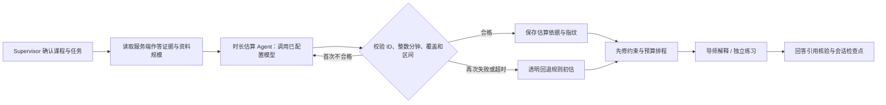

# 服务端文档与学习用时编排

2026-11-12。队友分支 `feature/mistakes-notebook-ux` 通过 `fa09f44` 合入 main。本轮保留错题本、图谱和导师操作改进，替换附件全文拼接与固定学习时长。

## 文档生命周期

1. 浏览器计算 SHA-256，只提交文件元数据查询复用状态。同账号、同课程、同文件返回同一文档 ID，后续追问只带 ID。
2. 新文件以 512 KiB 分片上传，分片幂等写入 PostgreSQL；请求及数据库分批响应均有体积边界。重新选择同一文件可续传。
3. 服务端重新校验大小和 SHA-256。PDF 按真实页码解析，每次最多处理 8 个文字页或 1 个 OCR 页，并保存检查点。短文字层的扫描页通过原生画布栅格化，使用随部署打包的中英 Tesseract 模型识别，不依赖运行时下载语言包。
4. 正文完整解析后用现有知识库切块器分段。单条 SQL 同时发布文档及全部片段；未完成的文档不进入知识库。字符、页数、课程资料容量超限时明确拒绝，不截成半份文档。
5. BM25 检索相关片段，上传语料保留主题门控，允许主题单一语料的低 IDF 分数。相同正文片段去重，再按配置的 token 预算装入上下文。概览类提问可取代表性片段，并明确说明未覆盖全文。
6. 会话单独保存文档 ID、文件名、哈希、页数和 OCR 信息。回答的 `uploadHits` 保存本轮引用原文，继续使用 `[资料N]` 和“上传资料”核对界面。跨设备和会话分支继承这些字段，不复制全文到问题中。

文档和引用始终按账号与课程鉴权。匿名用户仍可使用本机文字层知识库；导师的服务端文档附件和扫描 OCR 需要登录。

成功后立即删除临时原文件分片，保留文本索引和来源元数据。未完成或失败的分片超过 24 小时，在该账号下次上传时惰性清理。检查点由请求推进；关闭页面后，重新选择原文件可继续，不宣称后台始终运行。OCR 针对中英印刷体，复杂版式、公式与手写内容需要核对原文。

## 模型上下文配置

设置支持 `contextWindowTokens`、`responseReserveTokens`、`retrievalMaxTokens`，本机和账号配置均持久保存。未填写时使用保守的 8192 窗口和 2048 回答预留；不要把这个默认值当成模型的真实规格。

检索按保守 token 估算扣除问题、历史、回答和系统余量，整段选取，不再按两万字符截断。中文估计偏保守，预算统计标记为 `conservative-v1`，不是供应商账单的精确 token 数。思考模式额外预留对应输出空间；窗口不足时关闭本轮思考。HTTP 请求的体积上限属于传输保护，与模型上下文设置分开。

## 时长 Agent 的实际执行链

时长估算按模型窗口分批，服务端最多并发两批，有总时间边界。模型须返回每个知识点的新学分钟、复习分钟、参考区间、置信度和理由。未知或重复知识点、缺项、非整数、越界或区间矛盾都不能进入排程。一次结构修复失败后回退规则初估，并记录状态。

`estimate_learning_time` 是只读教学工具，导师可查询某几步的估算依据，不能提交自己编造的分钟或掌握度。`plan_path` 使用经校验的估算作为显式输入。`plan-v3` 仍然是纯函数：固定图谱、证据、时长输入和预算后输出可复现；模型在排程前估算成本，先修合法性和预算约束由代码执行。

首页、路径、设置中的技术指纹及教学 Agent 使用同一估算链路。服务端缓存按账号、课程内容、证据、资料规模、供应商和模型区分，成功缓存 24 小时，失败回退缓存 60 秒；并发请求共享处理租约。没有模型时，初估根据内容长度、先修深度和掌握证据变化，已经移除固定 15/8 分钟。当前没有真实学习耗时标签，界面将这些值标为估算，不作为实际计时记录。

## 接口与存储

| 接口 | 职责 |
| --- | --- |
| `POST /api/documents` | 创建、幂等上传分片、推进服务端解析 |
| `POST /api/documents/retrieve` | 文档作用域检索和上下文预算选择 |
| `POST /api/learning/time-estimates` | 读取真实学情，执行估算、校验和缓存 |
| `POST /api/agent` | 串接教学任务、时长估算和受约束排程 |

`0004_learning_artifacts.sql` 新增账号隔离的 `learning_artifacts`，存放文档处理检查点、临时分片和估算缓存。最终文档仍进入 `kb_docs` / `kb_chunks`，完整问答仍进入原会话表。开发内存实现镜像同一 SQL 契约，PostgreSQL 测试验证文档发布及租约行为。

## 验证

- `documentStore.test.ts`：内存与 PostgreSQL 的完整正文、去重、续传、哈希校验、账号隔离、逐页检查点及原子发布。
- `documentParser.test.ts`：真实 PDF 文字层、真实扫描 PDF 中英 OCR 和大于两万字的完整正文。
- `learningTime.test.ts`：可变规则初估、非法模型结果、结构修复、缓存、先修约束及 token 预算。
- `scripts/document-smoke.ts`：生产构建下的服务端上传、扫描 PDF、引用快照、跨设备、分支、模型时长排程和前端输入框分离；供应商使用隔离的模拟服务，测试不会使用真实账号密钥。
- 原有端到端检查同步了设置中的学习证据入口及包含错题本的六项手机导航。

验收结果：112 个测试文件、2162 项单元测试通过；完整端到端回归通过，其中新增文档、扫描 OCR、部署资源、本机 BYOK 与时长排程共 24 项。生产构建成功；Lint 为 0 error、43 条既有 warning。测试使用隔离内存库及模拟供应商，未使用真实账号密钥。
