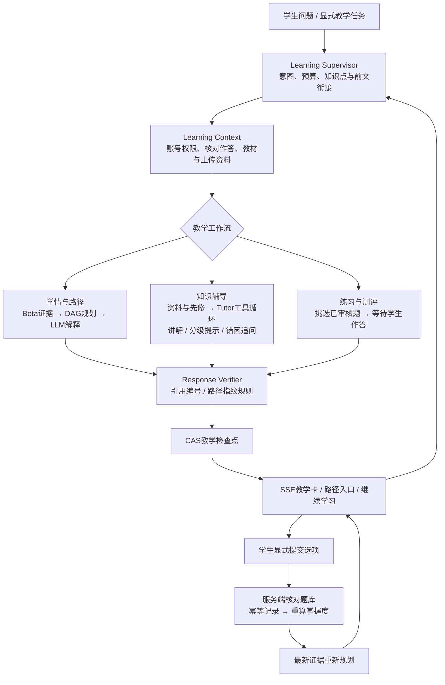

# Learning Supervisor 教学编排

本轮把导师从单次工具问答改为有教学状态的受控工作流。项目名称仍为「自适应学习路径」，参考对话中的「智慧学伴」不作为本项目品牌。

设计参考：[用户指定的编排调研](chatgpt-conversation://6af09f29-e82c-83ea-b316-354c6dca6a22)、[LangGraph Workflows and Agents](https://docs.langchain.com/oss/javascript/langgraph/workflows-agents)、[DeepTutor](https://github.com/HKUDS/DeepTutor)、[Adaptive GenAI Learning Tutor](https://github.com/dglabsxyz/adaptive-genai-learning-tutor)。借鉴状态图、专业化节点与共享学习上下文，代码为本项目实现，未复制上述项目源码，也未安装新的 Agent 框架。

[赛事官方页面](https://www.boxuegu.com/matchTrack/detail/?id=10037) 于 2026-11-09 经 ego 实际读取：Agent/工作流设计考察复杂流程、规划、工具调用与自主决策；AI 应进入核心学习体验。以下给出可运行的对应关系，不把框架名称或角色数量作为完成依据。

| 节点 | 实现与职责 | 模型权限 |
| --- | --- | --- |
| Supervisor | `learningWorkflow.ts` 路由 `explain / hint / practice / review_path / analyze_error`；显式任务优先，自动模式根据问题路由；预算与知识点均校验 | 本轮为可解释的确定性路由；界面可纠正，不伪称 LLM 分类 |
| Learning Context | `learningContext.ts` 重放账号的可核对选项，重新计算学情；本轮资料与先修信息受控传递 | 不接受模型自报掌握度，不把未观测说成薄弱 |
| Path workflow | 先执行 `plan_path`，将已验证知识点、路径步骤、预算与指纹作为结构化产物；模型解释这些结果 | 无排序或修改先修关系权限 |
| Tutor workflow | 同一 LLM 按专业化教学策略执行，结合最近四轮问答；分级提示、知识讲解、错因分析使用不同节点策略 | 节点内可自主调用允许的只读工具；辅导节点不暴露路径规划工具 |
| Exercise workflow | 选当前知识点尚未作答的已审核题；题目不足时明确提示；用完后重复题标为重复练习 | 本轮采用现有题库，不让 LLM 临时生成未经审核、直接计证据的题 |
| Response Verifier | 输出前检查引用编号所属课程/资料、路径指纹；隐藏无法核验的值 | 确定性规则检查，不冒充语义事实验证；原有可选原文核对后处理仍保留 |
| Assessment | `/api/agent/answer` 根据检查点和服务端题库核对学生选择 | 无模型参与；不接受客户端传入正确性、权重或掌握度 |
| Checkpoint | `learning_sessions` 按账号与课程保存一个最新教学检查点及最多四轮问答 | 模型不能读写其他账号或直接操作表；不保存图片或模型凭据 |

模型角色采用共享 Runtime + 不同教学策略，未部署六七个自治模型。工具循环保留原有并发池、冻结工具集、超时、循环检测和预算；远程 MCP 仍限用户勾选且声明为只读的工具。服务端只向下一节点传递当前课程中真实存在的知识点 ID，第三方工具内容无权扩充权限或改写系统指令。

## 状态、协议与恢复

`WorkflowSnapshot` 是前后端共用 Zod 契约，包含 `runId / targetId / intent / focusKcId / budgetMinutes / resumedTurns / stages / plan / exercise / verification / status / persisted`。

状态流为 `running → complete` 或 `running → awaiting_answer`；失败为 `failed`。作答完成状态由服务端实际作答记录派生，不能只依赖客户端显示“已完成”。

- `POST /api/agent` 增加可选 `intent / resetSession`；保留当前课程、资料来源、语气、帮助档位等字段。历史由服务器读取，不接受客户端伪造历史中的 system/tool 消息。
- SSE 新增 `workflow`，与 `text / tool_call / tool_result / notice / done` 共六类。`done` 仍且只发送一次，并携带最终快照与本轮实际资料。阶段先更新，正文经过规则检查后一次发布；当前上游仍非逐 token 流式。
- `GET /api/agent/session?targetId=...` 恢复最新任务；需要登录并核对方向访问权限。
- `POST /api/agent/answer` 仅接受 `targetId / runId / questionId / selectedIndex`；同源、登录、严格结构与 4KB 限量检查。
- 检查点保存采用 revision CAS。并发运行只有一条可替换同版本；另一条结果仍可读，界面明确未保存且禁用提交。中断或模型失败不覆盖旧检查点。
- 刷新能恢复待作答或已核对的练习；新任务可以不携带前文，但不会清空学习进度。最近四轮限制每问 1000 字、每答 1500 字；更早对话不保留。每轮仍重新读取真实学习证据。
- “恢复”指已完成节点后的教学任务恢复，不是请求中途、工具执行中途的进程级断点续跑。

## 作答闭环与一致性

练习卡提交是明确的用户操作，不是 Agent 的写工具。服务端检查检查点是否仍有效、题目及选项是否变化、方向题是否仍审核通过；选项不存在或过期检查点直接拒绝。

作答使用稳定 `attemptId = runId:questionId`，以已有进度 revision 条件写入，冲突重新读取并最多重试三次。同一个提交重试返回相同判分且不新增记录；已提交后换答案返回 409。同题重复练习可留历史，但不重复增加证据。题目权重、正确性、难度和累计证据均沿用服务端重算。

写入进度成功即为判分事实。检查点中的待作答标记无需和进度跨表事务更新；刷新通过稳定 attemptId 恢复真实完成状态，从而避免“进度已写、会话未写”导致重复记分。之后重新规划使用同一条最新证据，前端同步拉取进度，路径卡和全页规划保持相同的预算与合法目标范围。

## 使用与验收

登录、保存服务端模型配置后打开课程导师，默认启用「智能体（教学工作流）」。在教学任务选择「自动识别」或显式指定任务；路径请求支持时间预算。先问一个知识点，再点“用一道题检查理解”，发送后得到独立练习卡；提交后展示核对结果、证据数量和重算路径，答错时可继续错因分析。

验证命令：`npm run verify`、`npm run lint`、`npm run build`、`npm run test:e2e`。新增测试覆盖三类工作流、续问/重置、工具权限、引用与指纹防伪、检查点隔离与并发、选项校验、幂等判分、过期卡、刷新恢复。E2E 使用隔离内存库与本机可控模型，绝不向真实服务提交测试作答或调用付费模型。

当前边界：自动路由基于规则，复杂多意图需用户选择；只保存最新检查点；无进程级持久执行引擎；本轮不做在线生成题 Agent；普通 BYOK 模式不运行服务端工作流。规则核验不保证语义正确，分级提示仍需实际模型质量评测。生产 Postgres 与真实第三方模型/MCP 的端到端调用未以本轮测试替代。

2026-11-09 本机验收：106 个测试文件 / 2086 条测试通过；生产构建 32 个路由；E2E 学习流程 297 项、鉴权 36 项、MCP 18 项通过。图谱数据、密钥扫描、导师规则评测与检索评测通过；ESLint 无错误（已有警告未全量清理）。路径 golden 输入和输出指纹未变。ego 实际验证了 30 分钟方案、栈练习、正确判分与刷新恢复；截图接口仍报告窗口最小化，桌面 1280×900 和手机 390×844 的截图由现有 Playwright 测试生成并检查。测试账号、模型凭据、日志与截图位于仓库外的临时验收目录。
