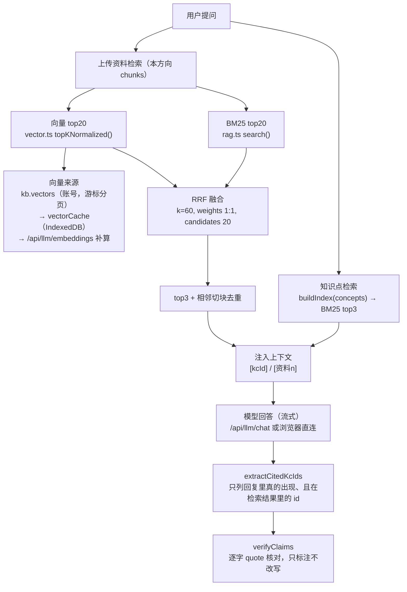

# 检索与存储（RAG 是核心）

RAG 在本项目里不是「给聊天加点上下文」的装饰，而是**回答必须有出处**的实现方式：导师回答先检索、再注入、最后逐字核对引用；上传资料同样先切块、再混合召回。它**不进入**路径排序与掌握度——`plan.ts` 仍然只依赖图谱与 Beta 后验（[§4](ai.md) 的硬边界）。

## 13.1 一次提问的完整链路



<details>
<summary>ASCII 版</summary>

```
提问
 ├─ 知识点：buildIndex → BM25 top3（titleBoost=1）
 └─ 上传资料：
      BM25 top20 ─┐
                   ├─ RRF(k=60, 1:1, candidates=20) → top3 → 相邻去重
      向量 top20 ──┘
      向量：kb.vectors（账号）→ vectorCache（IndexedDB）→ /api/llm/embeddings
 → 注入 [kcId]/[资料n] → 模型流式回答
 → extractCitedKcIds（回复里出现 ∩ 检索结果）→ verifyClaims（逐字，只标注）
```

</details>

两条检索的范围不同，必须分开说：

| 检索对象 | 路径 | 是否用向量 | 代码 |
| --- | --- | --- | --- |
| 内置 / 自定义方向的**知识点文档** | 现建 BM25 索引 → `search(index, question, 3)` | **否**，纯 BM25 | `app/tutor/page.tsx:347` |
| 用户**上传片段** | BM25 top20 + 向量 top20 → RRF → top3 → 相邻去重 | 有 embedding 时是；否则只 BM25 | `app/tutor/page.tsx:436-443`、`src/lib/hybridSearchClient.ts:104` |

所以「RAG 是核心」指的是**证据链是核心**，不是「所有检索都已接向量」。内置知识点接向量仍是缺口（[§11](limits.md) 第 27 条）。

> 知识点索引不是评测用的 `kbDocuments`：导师页用 `target.graph.concepts` 现建（名称 + 章节 + 摘要 + 该点题目解析，`app/tutor/page.tsx:277-289`），自定义方向没有内置题库时只收名称与摘要。`kbDocuments` 40 篇只用于 50 条评测（见下文「RAG 评测」），两者不能互相证明。

## 13.2 参数表

| 参数 | 值 | 位置 | 说明 |
| --- | --- | --- | --- |
| BM25 `K1` / `B` | 1.5 / 0.75 | `src/lib/rag.ts:67-68` | 词频饱和 / 长度归一化 |
| 单字 token 权重 | 0.35 | `src/lib/rag.ts:61` | 中文单字区分度低，压住跨领域误命中 |
| BM25 最低分 `MIN_SCORE` | 0.5 | `src/lib/rag.ts:64` | 低于它不返回；宁可不给依据 |
| 标题加权 `titleBoost` | 默认 1；评测用 2 | `src/lib/rag.ts:94-103`、`scripts/eval-rag.ts:85` | 1 表示整段标题分支不执行，分数与旧实现逐位一致 |
| 每路候选 | 20 | `src/lib/hybrid.ts:43`、`src/lib/hybridSearchClient.ts:30-33` | BM25 与向量各取 20 再融合 |
| RRF 平滑常数 `k` | 60 | `src/lib/hybrid.ts:40` | 原论文默认值；rank1 与 rank3 相对差约 3.2% |
| 两路权重 | 1 : 1 | `src/lib/hybridSearchClient.ts:140` | 缺省权重 1；非正数按 0 计（该路不参与） |
| 融合后注入条数 | 3 | `src/lib/hybrid.ts:46` | 3 条依据足够回答，再多稀释提示词 |
| 向量余弦阈值 | 0.25 | `src/lib/hybrid.ts:49` | 低于它不进融合，不凑满 k 条 |
| 相邻切块去重 | ≥20 码点重叠 | `src/lib/hybrid.ts:52` | 切块本身有 50 码点重叠 |
| 嵌入输入上限 | 2000 码点 | `src/lib/embedding.ts:49` | 标题 + 空行 + 正文，按码点截断 |
| 已知 embedding 维度 | OpenAI 1536 / 百炼 1024 | `src/lib/embedding.ts:27-46` | 模型名认不出来返回 null，宁可退回 BM25 |
| 切块 | 500 字 + 50 字重叠 | `src/lib/knowledge.ts:17-38` | 常规块 ≤500，只有边界尾块可能 <80 |

RRF 公式：`score(id) = Σ weight_i / (k + rank_i)`，`rank` 从 1 起，只按名次不看原始分数，所以 BM25 与余弦的尺度差异不影响融合；同一路重复 id 只计第一次，同分按 id 升序（`src/lib/hybrid.ts:81-114`）。检索结果必须带 `kcId` / `资料n`，否则回答无法引用到具体出处。

## 13.3 降级矩阵

| 条件 | 检索行为 | 界面 / 响应 |
| --- | --- | --- |
| 未配置 embedding（llm 行无 `embeddingModel`） | 只走 BM25 | `retrievalNotice(false)`：「本次未使用语义检索（未配置 embedding 模型）」 |
| `/api/llm/embeddings` 返回 404 / 503 | 本次只用 BM25，并把 `embeddingStatus` 记为 `unsupported` | 不弹错误框；显示「本次未使用语义检索」提示；后续不再请求 |
| embedding 网络 / 5xx / 超时 | 本次只用 BM25，`embeddingStatus` 不变 | 显示同一提示；不把一次抖动永久记成「不支持」 |
| 查询向量与索引模型不一致 | 放弃向量路 | 只 BM25；不把两种模型的向量混进同一索引 |
| 向量维度不符 / 含非有限值 / 零范数 | 该片段跳过，不当作 0 分 | 无提示（逐条提示会刷屏） |
| 所有向量分数 < 0.25 | 向量路为空，RRF 只剩 BM25 一路 | 同「未使用语义检索」的说明 |
| BM25 分数 < 0.5 | 该文档不返回 | 可能 0 条依据，按「未找到依据」渲染 |
| 两路皆空 | 返回 `[]`，不注入检索依据 | 导师回答没有检索片段；教材 / 上传 / 网络摘录与掌握度 / 题库解析仍可能拼装，界面必须把「有依据」与「无依据」分开 |
| KB 远端不可用 / 未登录 | 只用本机片段；向量表为空 | `syncWarning` 说明「仅显示本机资料」 |
| 片段补嵌入失败（单批超时） | 该批片段 `embedding` 落 null，BM25 仍可命中 | 无提示；不把坏向量写进索引 |
| 引用校验失败（模型引了不存在的 id） | 引用列表为空 | 「本次回复未包含可核对的引用」 |

**「两路皆空 → 拒答」的准确含义**：检索层不生成答案，也不伪造依据；它返回空列表，导师页按「没有检索到可引用的知识点」渲染，模型仍可能按自身知识回答——界面必须让「有依据」与「无依据」可区分。真正的「拒答」只发生在没有模型、走 `composeDeterministic` 且没有命中片段时：它不会编造出处。

## 13.4 存储链路（一次上传到哪里）

1. 浏览器解析文件（`pdf.ts` / `textFile.ts`）→ `knowledge.ts` 切块（500 + 50 重叠）。
2. `getKbStorageForUser(userId)` 解析存储（`src/lib/kbRemote.ts:512`）：
   - 未登录 → `kbLocal.ts` 的 IndexedDB `alp-kb-v1`（`docs` / `chunks`，按 `directionId` 建索引）；
   - 已登录 → 复合存储：**本地先写**（单事务），成功后 `PUT /api/kb`；远端失败只记 `syncWarning`，不回滚本地（409 例外：会抛 `KbConflictError`，让界面提示刷新后重试）。
3. 服务端 `putKbDocument`（`src/lib/kbServer.ts:450`）：CAS → upsert `kb_docs` → 补向量 → upsert `kb_chunks` → 删本次列表外的旧片段。向量以 JSON 文本存 `kb_chunks.embedding`，不引 pgvector；`embedding_dim` 校验维度。
4. 读取：`GET /api/kb?directionId=` 回 docs + chunks（**不含向量**）；`?vectors=1&after=&limit=` 按 `chunk_id` 游标分页取向量（`src/lib/kbServer.ts:623`）。
5. 检索时向量缓存：`useKnowledgeBase.ensureVectors()`（`src/lib/kbStore.ts:539`）→ `vectorCache.ensureVectors`（`src/lib/vectorCache.ts:111`）→ 缺失的经 `/api/llm/embeddings` 补算并写回 IndexedDB `alp-vectors-v1`。

**为什么不装向量数据库**：知识点文档只有几十 KB，上传片段最多 800 段 / 方向；进程内 BM25 与 `Float32Array` 余弦足够，且不增加运维与迁移成本。代价是向量检索在应用层做，跨方向不能共享索引，也没有 ANN 加速——这是当前规模下的取舍，不是通用方案。

## 数据表

10 张表全部在 `src/lib/db.ts:781` 的 `SCHEMA` 常量里，进程首次 `getDb()` 时幂等执行。Postgres 与内存实现共用同一套 SQL 形状；内存实现的删除 / 分页分支必须逐条精确匹配（否则会静默返回 0 / `[]`）。

| 表 | 用途 | 主键 | 关键列 / 加密 | 跨设备语义 |
| --- | --- | --- | --- | --- |
| `users` | 账号 | `id` | `email` 唯一、`password_hash`（PBKDF2） | 所有设备同一账号 |
| `sessions` | 登录会话 | `token` | `user_id`、`expires_at`；Cookie `alp_session`（httpOnly / sameSite=lax / 14 天） | **不跨设备**：每个浏览器一份会话 |
| `progress` | 每用户每学科进度 JSON | `(user_id, subject_id)` | `data`（掌握度、attempts、pathEdits；**不含 memories**） | 登录后服务端权威；本地独有的学科保留 |
| `directions` | 自定义方向 | `id` | `graph_json`、`is_public`、`user_id` | 服务端；公开方向任何人可读 |
| `direction_picks` | 用户选用过的方向 | `(user_id, direction_id)` | `created_at` | 服务端 |
| `direction_items` | 方向题目缓存 | `id`，`UNIQUE(direction_id, content_hash)` | `stem` / `options_json` / `answer_index` / `checks_json` / `source` / `status` | 服务端；公开方向题目匿名可读 |
| `user_secrets` | 账号级供应商配置 | `(user_id, kind)` | **密文字段**：`secret_ct` / `secret_iv` / `secret_tag` / `secret_kid`；`secret_hint` 只存掩码；`options_json` 只存白名单字段 | 服务端；浏览器永远拿不到明文 |
| `kb_docs` | 上传文档元数据 | `(user_id, doc_id)` | `title` / `file_name` / `kind` / `size` / `page_count` / `char_count` / `chunk_count` / `kc_ids_json` | 登录后本地 + 账号副本；不公开 / 不复制 |
| `kb_chunks` | 上传片段 | `(user_id, chunk_id)`，外键 `(user_id, doc_id)` 级联 | `text` / 页码 / `embedding`（JSON 文本）/ `embedding_model` / `embedding_dim` | 同上；向量按游标分页取 |
| `memories` | 记忆卡 | `(user_id, mem_id)` | `payload`（整张卡 JSON）/ `kind` / `kc_id` / `status` / `updated_at` | 登录后 LWW 同步；`PUT` 不删行，删除显式 `DELETE` |

## 14.1 `user_secrets`：只回掩码，密钥 AES-256-GCM

- `kind` 四选一：`llm` / `search-deepseek` / `search-tavily` / `tts`；同一 `(user_id, kind)` 只有一行。
- 加密参数：`aes-256-gcm`，主密钥 = `ALP_SECRET_KEY` 的 32 字节标准 base64；IV 12 字节随机；tag 16 字节；AAD = `user_secrets:${userId}:${kind}`（`src/lib/secretCrypto.ts:18-24`、`:108-116`）。把一行的密文贴到另一行 / 另一个用户上，解密直接失败。
- 明文下限 8 个码点；短于它拒绝保存，避免把占位符存成正式配置。
- `GET /api/config` 只返回 `configured` / `hint` / `label` / `api` / `baseUrl` / `model` / `options` / `updatedAt`；`hint` 固定 `••••` + 末 4 位，长度不随密钥变化（`secretHint`，`src/lib/secretCrypto.ts:218`）。
- 没有 `ALP_SECRET_KEY` 时 `/api/config` 拒绝保存（503 `KEY_ENC_UNAVAILABLE`），**绝不退化为明文落库**；内存后端也拒绝写密钥（503 `PERSISTENCE_UNAVAILABLE`，测试可设 `ALP_ALLOW_MEMORY_SECRETS=1`）。
- 当前只支持一把主密钥：`ALP_SECRET_KEY_ID` 改变后旧行统一报 `KEY_KID_UNKNOWN`，需要用户重存（[§11](limits.md) 第 29 条）。

## 14.2 同步语义速查

| 数据 | 未登录 | 登录后 | 冲突 / 删除 |
| --- | --- | --- | --- |
| 进度 | `localStorage` | `progress` 表；服务端优先，本地独有学科保留 | 同学科单权威，不做逐条合并 |
| 记忆卡 | `SubjectProgress.memories` | `memories` 表；LWW `max(lastSeenAt, createdAt)` | `PUT` 只 upsert；删除显式 `DELETE`；单卡删除未接线 |
| 知识库 | IndexedDB `alp-kb-v1` | 本地 + `kb_docs` / `kb_chunks`；本地先写 | 文档级 CAS，409 不写行；删除无 tombstone |
| 教材 / 讲义 | `alp.materials.v1` | 仍只在本机（浏览器级键） | 换账号时清空；不随账号同步 |
| 供应商密钥 | local `alp.*.v1` | `user_secrets` 密文 | 换账号清本机；服务端行保留 |

**账号切换**：`planAccountTransition` 对「A→B / A→匿名」清空 learner、本机 KB、搜索 / 语音密钥、教材讲义；「匿名→B」保留并登记归属；登出无条件清空并删调用模式键（`src/lib/useAuth.ts:73-116`、`:239`）。服务端已保存的配置不会因切换被删除。

## 14.3 内存实现的精确分支

内存库不是 SQL 引擎，靠「归一化后按子串匹配」分派；漏一个分支就是静默 `return 0` / `[]` / `null`。因此每条形状都必须有独立测试（`src/lib/db.test.ts`）。

| 操作 | 形状 | 判定顺序 | 返回值 |
| --- | --- | --- | --- |
| 删配置 | `DELETE FROM user_secrets WHERE user_id = $1 AND kind = $2` | 唯一形状 | 1 / 0 |
| 删文档 | `DELETE FROM kb_docs WHERE user_id = $1 AND doc_id = $2` | **先判 `doc_id =`** | 删文档 1 / 0，并级联删片段 |
| 删方向文档 | `DELETE FROM kb_docs WHERE user_id = $1 AND direction_id = $2` | 再判 `direction_id =` | 文档数，并级联删该方向片段 |
| 删片段 | `DELETE FROM kb_chunks WHERE user_id = $1 AND chunk_id = $2` | **先判 `chunk_id =`** | 1 / 0 |
| 删文档片段 | `DELETE FROM kb_chunks WHERE user_id = $1 AND doc_id = $2` | 再判 `doc_id =` | 删除条数 |
| 删方向片段 | `DELETE FROM kb_chunks WHERE user_id = $1 AND direction_id = $2` | 最后判 `direction_id =` | 删除条数 |
| 删单卡 | `DELETE FROM memories WHERE user_id = $1 AND mem_id = $2` | **先判 `mem_id =`** | 1 / 0 |
| 清学科卡 | `DELETE FROM memories WHERE user_id = $1 AND subject_id = $2` | 再判 `subject_id =` | 删除条数 |
| 向量分页 | `SELECT chunk_id, embedding, ... WHERE user_id = $1 AND direction_id = $2 AND chunk_id > $3 ORDER BY chunk_id LIMIT $4` | **先判 `chunk_id >`**，参数顺序固定 | 升序切片 |
| 按文档列片段 | `SELECT ... WHERE user_id = $1 AND doc_id = $2 ORDER BY chunk_id` | 方向过滤可选，`order by chunk_id` 单独分支 | 行数组 |

两个顺序是硬要求：`kb_docs` 先判 `doc_id` 再判 `direction_id`，否则「删一篇」会被当成「删整个方向」；`kb_chunks` 先判 `chunk_id` 再 `doc_id` 再 `direction_id`，三种键都含 `id =`，顺序错了会把「删一段」当成「删整篇」。分页必须先于方向过滤，否则游标永远推不动（`src/lib/db.ts:545-575`）。

「静默成功」的四个出口是 `run` 末尾 `return 0`、`all` 末尾 `return []`、`one` 末尾 `return null`，以及 `ensureSchema` 吞掉「内存实现不认 CREATE TABLE」。这四处都靠 `db.test.ts` 的「写 → 读」成对断言与每条删除形状的返回值断言兜住，不靠肉眼。

## RAG 评测

## 15.1 50 条构成

评测集在 `scripts/eval-data/rag-eval-50.jsonl`，每行一个 JSON 对象，共 50 条：

| 类别 | 条数 | `goldKcIds` | `relatedKcIds` | `goldPhrase` |
| --- | --- | --- | --- | --- |
| `literal`（字面） | 15 | 非空 | 任意 | **必填**，逐字摘自语料 |
| `paraphrase`（同义改写） | 15 | 非空 | 任意 | **必填** |
| `answer-absent`（有相关点但答不上） | 10 | **必须为空** | **必须非空** | 可选 |
| `out-of-domain`（域外） | 10 | 必须为空 | 必须为空 | 可选 |

`parseEvalItems`（`src/lib/ragEval.ts:147`）逐行校验 id 唯一、类别合法、字段类型与每类约束；坏行带行号报错，不静默少测。脚本另加三道检查（`scripts/eval-rag.ts:128-163`）：总数 50、分类 15/15/10/10、语料恰好 40 篇、`goldKcIds` / `relatedKcIds` 都在 `kbDocuments` 里、`goldPhrase` 必须逐字出现在某个 gold 文档正文中。

## 15.2 指标定义

设 answerable = `literal ∪ paraphrase`（30 条）。

| 指标 | 定义 | 分母 |
| --- | --- | --- |
| `recall@3` | 每条「gold 与 top3 的交集大小 ÷ gold 大小」，再取平均 | 30 |
| `recall@3Literal` / `recall@3Paraphrase` | 同上，按类别 | 15 / 15 |
| `MRR@10` | 每条 `1 / 第一个 gold 在 top10 中的名次`；未命中记 0 | 30 |
| `goldPhraseInFullText` | top3 中至少一篇的**全文**（title + text）包含 `goldPhrase` 的条目比例 | 有 `goldPhrase` 的条目（30） |
| `answerAbsentRelatedHit`（answer-absent relatedHitRate） | top3 至少命中一个 `relatedKcIds` 的 answer-absent 条目比例 | 10 |
| `answerAbsentEmpty` | 检索结果完全为空的 answer-absent 条目比例 | 10 |
| `outOfDomainEmpty` | 检索结果完全为空的 out-of-domain 条目比例 | 10 |
| `outOfDomainFalseContext` | `1 − outOfDomainEmpty`，即「把无关内容当成依据」的比例 | 10 |
| `unanswerableEmpty` | answer-absent ∪ out-of-domain 的空检索率 | 20 |

**金句判定为什么必须用全文**：`search()` 返回的 `snippet` 是 `text.slice(0, 160)`（`src/lib/rag.ts:160`），而 40 篇知识库正文有 230–322 个码点，例题解析大多落在 160 字之后。用 snippet 判「金句是否被检索到」会把大量真实命中记成未命中——这是上一版的 blocker。现在 `evaluateRetrieval` 在调用方传入的 `corpus`（kcId → `title + "\n" + text`）里做 `includes`（`src/lib/ragEval.ts:290-306`）；top3 里出现 corpus 之外的 id 直接抛 `EvalDataError`，不静默记未命中。

**answer-absent 为什么主指标是 relatedHitRate 而不是「必须为空」**：这类问题的答案不在任何知识点里，但存在一个「相关、可提供背景」的知识点。检索命中它是有用的（导师可以据此说明「这属于 X 的范畴，但教材没有展开」），所以 `answerAbsentRelatedHit` 越高越好；`answerAbsentEmpty` 是另一种可接受形态的观察值，两者都不单独构成通过条件。

## 15.3 复现命令

```bash
# 基线 + 标题加权（默认 ×2）
npm run eval:rag

# 调整标题词频放大倍数（1–10）
npm run eval:rag -- --title-boost 3

# 混合检索：提供文档 / 查询向量文件（示例路径；仓库未附带 vectors.json）
npm run eval:rag -- --mode hybrid --vectors scripts/eval-data/vectors.json

# 混合检索：或配置服务端 embedding（三项齐全）
ALP_EMBED_BASE_URL=... ALP_EMBED_API_KEY=... ALP_EMBED_MODEL=... \
  npm run eval:rag -- --mode hybrid
```

向量文件形状：`{ "documents": { "c01": [数字...] }, "queries": { "lit-01": [数字...] } }`；`queries` 可省略，缺的会用 embedding 端点补算。脚本同时校验总数、分类、语料与向量维度；缺向量时**不会**偷偷跳过，而是报错。

## 15.4 本轮实跑

```text
$ npm run eval:rag
RAG 检索评测
════════════════════════════════════════════════════════════════════════
评测集：scripts/eval-data/rag-eval-50.jsonl（50 条）
分类：literal 15 / paraphrase 15 / answer-absent 10 / out-of-domain 10
语料：kbDocuments 40 篇完整正文（title+text）；金句在 top3 全文判定
模式：auto；title 加权 ×2

[BM25 基线]
  recall@3                 1.000（30/30）   字面 1.000（15/15） / 同义 1.000（15/15）
  MRR@10                   1.000（30/30）
  goldPhraseInFullText     1.000（30/30）
  answer-absent relatedHitRate   1.000（10/10）
  out-of-domain emptyRate        0.000（0/10）   falseContextRate 1.000（10/10）
  unanswerableEmptyRate    0.000（0/20）   （answer-absent ∪ out-of-domain）

[BM25 + title×2]
  recall@3                 1.000（30/30）   字面 1.000（15/15） / 同义 1.000（15/15）
  MRR@10                   1.000（30/30）
  goldPhraseInFullText     1.000（30/30）
  answer-absent relatedHitRate   1.000（10/10）
  out-of-domain emptyRate        0.000（0/10）   falseContextRate 1.000（10/10）
  unanswerableEmptyRate    0.000（0/20）   （answer-absent ∪ out-of-domain）

混合检索：未测（未提供 --vectors，且未配置 ALP_EMBED_BASE_URL / ALP_EMBED_API_KEY / ALP_EMBED_MODEL）

对比（列 = 检索配置，值 = 指标）
metric                      BM25        title×2
recall@3                    1.000       1.000
recall@3 literal            1.000       1.000
recall@3 paraphrase         1.000       1.000
MRR@10                      1.000       1.000
goldPhraseInFullText        1.000       1.000
answer-absent relatedHit    1.000       1.000
out-of-domain empty         0.000       0.000
out-of-domain falseContext  1.000       1.000
unanswerableEmpty           0.000       0.000
EXIT=0
```

## 15.5 结论与不可宣称

1. **金句 blocker 已关闭**：判定改在全文，30/30 命中；上一版用 160 字 snippet 的误判不再存在。
2. **评测集已饱和**：BM25 基线在 answerable 上全部 1.000，`title×2` 与基线逐项相同。因此这份 50 条**不能**用来证明「标题加权有效」或「向量 / RRF 提升」——它只能证明「基础检索没有坏」。
3. **`outOfDomainEmpty = 0.000`**：10 条域外问题全部返回了文档。检索层没有拒答能力（BM25 的 `MIN_SCORE = 0.5` 挡不住 OOD 查询里的高频 bigram）。这是**缺陷信号，不是通过**；改进列入 [§11](limits.md) 第 26 条。
4. **混合检索未测**：没有 `--vectors` 文件，也没有 `ALP_EMBED_*`。脚本如实打印「未测」并以 0 退出——没测就是没测，不编数字。原因写在这里，不写成「效果与 BM25 相当」。
5. **发布门槛**（口径定义，本轮均满足）：`recallAt3 ≥ 0.90`、`goldPhraseInFullText ≥ 0.95`、`answerAbsentRelatedHit ≥ 0.90`。`outOfDomainEmpty` 不设门槛，因为它当前为 0；设一个「≥0.5」的门槛只会让 CI 永远红。
6. **评测对象不是上传资料**：50 条跑的是 `kbDocuments` 40 篇知识点；生产里接 RRF 的是用户上传片段。上传资料的混合检索目前没有评测集，只有单测覆盖 `createRetriever` / `retrieveUploadsHybrid` 的排序与降级。

## 15.6 外部端点真机探测（2026-10-29）

脚本：`scripts/probe-external.ts`，入口 `npm run probe:external`；单端点开关 `--deepseek-search` / `--mimo` / `--embedding`。输出纪律：只打印 status、content-type、顶层 keys、结果数、音频字节数与首 4 字节；不打印密钥、Authorization、base64 或完整响应正文。退出码：0 = 跑完（含「未验证」），1 = 有凭据但探测失败，2 = 参数错误。

```text
$ npm run probe:external
外部端点真机探测
════════════════════════════════════════════════════════════════════════
只打印 status / content-type / 顶层 keys / 结果数 / 音频头；不打印密钥与正文。

== DeepSeek 搜索 ==
POST https://api.deepseek.com/v1/tools/search
未验证：缺少 DeepSeek 官方搜索凭据：ALP_E2E_LLM_BASE_URL 的主机是 api.jasonsome.cn，不是 api.deepseek.com；也没有 DEEPSEEK_API_KEY

== MiMo 语音合成 ==
端点：<未配置>
未验证：缺少 MIMO_BASE_URL / MIMO_API_KEY / MIMO_MODEL

== Embedding 向量 ==
端点：<未配置>
未验证：缺少 ALP_EMBED_BASE_URL / ALP_EMBED_API_KEY / ALP_EMBED_MODEL

────────────────────────────────────────────────────────────────────────
汇总：通过 0 / 失败 0 / 未验证 3
EXIT=0
```

结论：**三个端点本轮都没有完成带凭据的成功调用**，所以不能写「DeepSeek 搜索已验证」「mimo 已验证」「embedding 已验证」。`.env.local` 里的 `ALP_E2E_LLM_*` 指向中转域 `api.jasonsome.cn`，脚本坚持「只有 base_url 主机是 `api.deepseek.com` 才把该 key 当 DeepSeek 搜索密钥」，不拿中转密钥请求官方端点。完整记录（含无凭据 curl 的 401、MiMo 假凭据失败路径）在 `docs/verification/2026-10-29-external-endpoints.md`。
