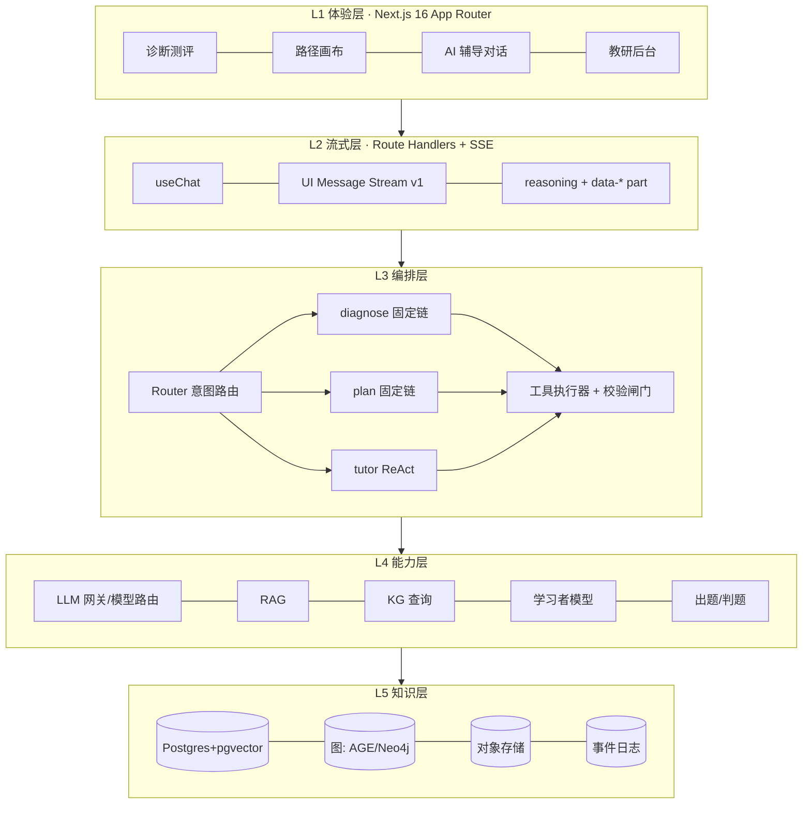

# 自适应学习路径规划 · 技术架构方案

> **⚠️ 与 06-synthesis.md 的冲突以 06 为准（2026-10-22 复核）**：本文件写于选题阶段，规模假设是 200–400 概念、n≥10 试点；06 把规模收敛到 **40 概念 / 120 题（每 KC 3 题）/ 一个班 40 人**，并因此**弃用 BKT 与 IRT 3PL、改用 Beta-Bernoulli**（06 §1.3、§3.3）。本文 §3 的 BKT/IRT 公式保留作为「为什么不用」的论证材料，不再作为实现依据。下列段落已就地标注：§1 存储/图、§2 SHACL、§3 学习者模型、§5 安全、§6 索引参数、§7 编排。**开发按 06 写。**

> 传智杯 AI WEB 网页开发挑战赛，作品截止 2026-11-18。评分：AI 技术深度 35%（大模型集成 8%、Agent/工作流 8%、RAG 6%、多模态 5%、安全可控 4%、MCP/工具 4%）、创新性 25%、前端工程 10%、实用性 10%、体验 10%、社会价值 10%（`research/raw/track-10037-rules.md:58-77`）。本方案逐条对齐 6 个 AI 细分项。

## 0. 一句话架构

路径规划拆成**可验证的三段**：知识图谱判定"能不能学"（硬约束），学习者模型判定"该不该学"（掌握度），**LLM 只在两者筛出的候选集之后做「解释与内容生成」，不参与排序**（2026-10-22 第二次修订：原写「做排序、解释、内容生成」，与 06 §1.4 的「路径可复现」冲突，已改）。可行性由代码判定、顺序由纯函数算出——这是防幻觉的关键，也是答辩最容易被追问的点。




## 1. 技术选型

| 层 | 选型 | 依据 |
| --- | --- | --- |
| 前端 | **Next.js 16.4.2 + React 19 + TS**；Tailwind + shadcn/ui + Framer Motion；Zustand（UI 态）+ TanStack Query（服务端态） | `loading.tsx` 自动把 page 包进 Suspense（nextjs.org/docs/app/api-reference/file-conventions/loading）；16 起 Turbopack 默认、`proxy.ts` 取代 `middleware.ts`（nextjs.org/blog/next-16）；shadcn 官方定位 "This is not a component library"（ui.shadcn.com/docs）。**版本已由 06 §3.2 锁定为 16.4.2（`npm view next version` = 16.4.2，2026-10-21）** |
| AI 交互 | **Vercel AI SDK 6（锁 `ai@6.0.312`）**、`@ai-sdk/react` | `streamText`、`ToolLoopAgent`、`Output.object` 结构化输出。**⚠️ `ai` 的 latest 是 7.0.148；6.x 最新为 6.0.312。本文件原写的 `stopWhen: isStepCount(5)` 在两版都不成立——v6 与 v7 导出的都是 `stepCountIs`（解包 tarball 核对，见 06 §8 第 8 条），下文 §7 已改** |
| 存储/图 | **Postgres 单库**：业务表 + pgvector；**图查询用递归 CTE，不装 Apache AGE / Neo4j** | pgvector 支持 `<->`/`<#>`/`<=>`、HNSW，vector 索引上限 2000 维（github.com/pgvector/pgvector）；40 节点 / 60 边的闭包实测 0.0045 ms（`bench/bench-path.mjs` 跑的是图 A = 40 节点 / 60 边），图数据库是纯运维负担。**⚠️ 原写「60 节点 / 90 边」有误**：脚本第 8 行的 `N_MID=60, E_MID=90` 只是未使用的常量，实际 `buildDag` 只跑 40/60 与 500/984 两张图（bench:118-119）。**⚠️ 原写「+ Apache AGE；可换 Neo4j」已废弃** |
| 编排/观测 | 优先 AI SDK `ToolLoopAgent`，需持久化再上 LangGraph；Langfuse 自托管 | LangGraph 有 `StateGraph`、`MemorySaver`/`PostgresSaver`、`thread_id`（docs.langchain.com/oss/javascript/langgraph/persistence）；Langfuse 提供 tracing/成本/prompt 版本（langfuse.com/docs） |

> Vue 路线同样可行：Nuxt 4 + `@ai-sdk/vue` 的 `useChat`，服务端 `streamText` + `toUIMessageStream` + `createUIMessageStreamResponse`（ai-sdk.dev/docs/getting-started/nuxt）。选 Next.js 的实质理由：赛道把 "React + Next.js 14+" 列为全栈 AI Web "推荐首选"（`track-10037-rules.md:184`），且 RSC/Suspense 与 AI SDK 示例同源。

## 2. 知识图谱：数据、Schema、构建、校验

**数据来源**：① 公开教材/课标目录（只取知识点名与章节序，正文需授权，演示用自制讲义）；② 1EdTech CASE 的 Parent/Child 层级与 GUID 体系（1edtech.org/standards/case）；③ schema.org `Course`/`LearningResource` 复用 `teaches`、`educationalLevel`、`timeRequired`、`coursePrerequisites` 字段名（schema.org/Course）；④ EdNet 作冷启动先验，131,441,538 条交互 / 784,309 名学生，CC BY-NC 4.0（arXiv:1912.03072）；⑤ 自建 **60 概念 / 90 边**小图谱作主战场（06 §1.2 定稿；原写 200–400 概念，28 天内无法人工校验）。**⚠️ 2026-10-22 修订。****不做全量 GraphRAG 索引**：官方 README 明言 "GraphRAG indexing can be an expensive operation"，建议 "start small"（github.com/microsoft/graphrag）。

```text
(:Concept {id,name,aliases[],bloom,grade,difficulty_b,source,confidence,kg_version})
(:Skill {id,name})  (:Item {id,stem,answer,type,irt_a,irt_b,irt_c,kc_ids[]})
(:Resource {id,title,kind,url,duration_min})  (:Course {id,title})  (:Misconception {id,label,remediation})
(:Concept)-[:PREREQUISITE_OF {strength,source}]->(:Concept)  (:Concept)-[:SIMILAR_TO {cos}]->(:Concept)
(:Concept)-[:PART_OF]->(:Course)  (:Skill)-[:ASSESSED_BY]->(:Item)  (:Resource)-[:TEACHES {depth}]->(:Concept)
(:Item)-[:TARGETS_MISCONCEPTION]->(:Misconception)  (:Resource)-[:ALIGNS_TO]->(:Course)
```

- **先修 + 相似两类边都要建**：KnowLP 实证只靠先修时"任何阶段的困难都会造成学习阻塞"，加入相似关系后三套基准 SOTA（arXiv:2506.22303）。
- **先修边做反义对称约束**：ProPRL 专设 anti-symmetry regularizer 防反向先修（arXiv:2608.03006）；我们用规则硬卡：A→B 存在则禁 B→A，且全图环检测。先修边由 LLM 半自动抽取 + 专家抽检，已有工作证明 LLM 辅助的课程图谱补全可被专家高接受度复核（arXiv:2501.12300）。
- **流水线**：教材目录→CSV → LLM 结构化抽取 concept/relation（JSON Schema 强约束）→ embedding 聚类 + 别名归并（阈值 0.92，人工过 top-50 冲突对）→ 校验 → 每批抽 10% 双人标注算 Cohen's κ（κ<0.6 打回）→ 写 `kg_version` 灰度。
- **校验写成 CI**：必填字段非空；先修无环（递归 CTE 检测，不用 Cypher）；反义对称；孤立节点告警；每个 Concept 至少 1 个 `TEACHES` 资源，否则不进推荐池。
  **⚠️ 原写 SHACL + `MATCH p=(c)-[:PREREQUISITE_OF*]->(c)` 已废弃（2026-10-22）**：SHACL 需要 RDF 三元组存储，与 06 §3.2 选定的「PostgreSQL 关系表 + 递归 CTE」不是一套技术栈；Cypher 属于 Neo4j/AGE，已不采用。校验改为 SQL 断言 + 应用层检查，脚本入口 `pnpm kg:validate`（见 06 §5 W1 验收）。

## 3. 学习者模型：诊断 → 画像 → 更新

> **⚠️ 本节已被 06 取代（2026-10-22）**：下面 5 条是选题阶段的设计，假设 200–400 概念、有足够作答量拟合 BKT/IRT。06 收敛到 60 概念 / 120 题 / 一个班 40 人后，**BKT 四参数与 IRT 3PL 都无法识别**，最终实现改为 **Beta-Bernoulli 后验**（公式与算例见 06 §1.3，选型理由见 06 §3.3）。本节保留作为「为什么不用」的论证材料，**不要照此实现**。

- **三层估计**：冷启动用 IRT 3PL + CAT 估全局能力 θ 与 SE；细粒度用 BKT 估每个 KC 的 P(mastery)；记忆用 FSRS 的 DSR 估可提取性 R(t)。IRT 3PL 为 `p_i(θ)=c_i+(1-c_i)/(1+e^(-a_i(θ-b_i)))`，参数 difficulty `b_i`、discrimination `a_i`、pseudo-guessing `c_i`（en.wikipedia.org/wiki/Item_response_theory）；CAT 按信息量最大选题，MLE/EAP 估能力，停止规则为"测量标准误低于阈值"（en.wikipedia.org/wiki/Computerized_adaptive_testing），工程参数 12–15 题、SE≤0.3、单题 60s。**⚠️ 120 题 × 40 人时 a/c 不可识别，本题材下不采用。**
- **BKT 四参数**：`p(L0)`、`p(T)`、`p(S)`、`p(G)`，每次作答先贝叶斯更新再叠加转移（en.wikipedia.org/wiki/Bayesian_knowledge_tracing）；直接用 `pyBKT`（sklearn 风格 `fit/predict/evaluate/crossvalidate`，github.com/CAHLR/pyBKT）。**不上 DKT 的理由**：DKT 用 RNN 免人工领域编码、预测更准（arXiv:1506.05908），但需万级序列且不可解释；比赛用 BKT（每个参数都能画出来讲），DKT/AKT 写进展望，模型库备选 EduKTM（github.com/bigdata-ustc/EduKTM）。**⚠️ 单 KC 单学生最多 4 次观测，四参数估不出；`02-learning-theory.md:105` 自己也说这是「工程默认值，不是文献结论」。手填参数的 BKT 与 Beta 先验等价，因此直接用 Beta。**
- **冷启动学术背书**：传统认知诊断是直推式，"cannot perform instant diagnosis for new learners without computationally expensive retraining"；生成式认知诊断报告新学习者诊断 **×100 加速**（arXiv:2507.09831）。落地：新用户不训练，IRT 后验 + 图谱先验给初始 mastery，答满 20 题切 BKT。**⚠️ 改为：新用户不训练，图谱深度给 Beta 先验（`s=2`，`p₀` 0.35→0.10 递减），全程不切换模型。**
- **更新公式**：答对 `P(L|1)=P(L)(1-pS)/[P(L)(1-pS)+(1-P(L))pG]`；答错 `P(L|0)=P(L)pS/[P(L)pS+(1-P(L))(1-pG)]`；再叠加 `P(L)←P(L|obs)+(1-P(L|obs))·pT`。**遗忘**用 FSRS 的 DSR：`R(t,S)=(1+FACTOR·t/S)^DECAY`，按目标保留率反解间隔；与 SM-2 的关键差异是后续稳定性收敛到上限而非随延迟线性增长（github.com/open-spaced-repetition/awesome-fsrs/wiki/The-Algorithm）。取保留率 0.9，到期复习项作为路径**插队项**。**⚠️ 掌握度更新改为 `α←α+1` / `β←β+1`（06 §1.3）；FSRS 只用于复习队列，与掌握度分开显示。**
- **目标难度为什么是 85%**：Wilson 等在 *Nature Communications* 10:4646 (2019) 证明对 "all of these stochastic gradient-descent based learning algorithms"，最优训练错误率约 **15.87%**（≈85% 正确率），称 "Eighty Five Percent Rule"，在神经网络与生物学习模型中均成立（DOI 10.1038/s41467-019-12552-4）。落地：出题器目标正确率设 0.80–0.88，对应 ZPD 的"跳一跳够得着"（en.wikipedia.org/wiki/Zone_of_proximal_development）。**⚠️ 这是 SGD 二分类算法的收敛结论，不是人类学习的实验结论（`02-learning-theory.md:105` 已明确警告）。产品目标正确率统一取 0.80，标注为产品假设，不引 Wilson 作为人类学习依据。**

## 4. 路径规划：三层算法，LLM 只做最后一层

| 层 | 方法 | 作用 |
| --- | --- | --- |
| L-a 可行性 | 先修 DAG 拓扑排序 + 闭包查询（~100 行自研） | 过滤前置未掌握的节点 |
| L-b 最优性 | 时间预算下加权最短路 / 0-1 背包（价值=掌握度增益×考试权重，成本=预计学时，可用 OR-Tools） | 选子集与顺序 |
| ~~L-c 可读性~~ **（已废弃，见 06 §1.4）** | ~~LLM 重排~~ → 改为**确定性拓扑序**（同分按 kc_id 字典序）；LLM 只生成「为什么学这个」的解释与任务卡，**不参与排序** | 排序可复现、可测试；解释仍由 LLM 提供 |

**~~LLM 的边界（关键设计）~~ 已废弃（2026-10-22，见 06 §1.4/§3.6）**：原设计让 LLM 输出「候选 ID 的排列 + 每 ID 一句理由」，只校验白名单。问题有二：① 白名单不保证拓扑序（候选集同时含 A 与后继 B 时，B 排 A 前也能通过）；② 顺序依赖 LLM 采样，`path_hash` 无法逐位复现。**现行设计：顺序由确定性拓扑序算出（同分按 kc_id 字典序），LLM 只写每个节点的理由。** 校验函数与 6 条单测见 06 §3.4。

学术对照：KnowLP 双结构图 + 判别式强化学习缓解路径阻塞，三数据集 SOTA 且给出可解释推理（arXiv:2506.22303）；Pxplore 用结构化学习者状态 + 自动奖励，SFT+GRPO 训练并部署真实平台（arXiv:2510.13215, WWW'26）；MALPP 用"学情分析/路径规划/反思"三 Agent，理论依据 Cognitive Load Theory 与 ZPD，MOOCCubeX 上 7 个 LLM 验证（arXiv:2601.17346）；RPKT 反向路线——不依赖预建图谱，用 LLM 递归追问先修直到知识边界（arXiv:2508.11892），可作图谱未覆盖时的兜底。**比赛取舍**：不自训 RL（4 周做不完且不可复现），但 L-a/L-b 写成可单测纯函数，L-c 做成可开关 A/B，答辩给"有无 LLM 重排"的对比数据。

## 5. LLM 介入矩阵

| 环节 | 介入方式 | 档位 | 输出约束 | 兜底 |
| --- | --- | --- | --- | --- |
| 诊断·出题 | 按目标 KC + 目标难度生成题干/选项 | 小模型 | `{stem,options[4],answer,kc_ids[],difficulty}` | 题库缓存；schema 失败重试 1 次后回退静态题库 |
| 诊断·判题 | 主观题/编程题 rubric 评分 | 中模型 | `{score,rubric_hits[],feedback}` | 选择题精确匹配 |
| 讲解 | RAG 生成，必须带引用 | 大模型 | 每个论断附 `source_id`，无检索结果则拒答 | 直接展示教材原文段 |
| 出题·变体 | 同 KC 换情境/数字 | 小模型 | 与母题同 `kc_ids`，答案双次自检一致才入库 | 不入库，仅本次用 |
| 反馈 | 错因归类 + 下一步建议 | 小模型 | 枚举 `misconception_id`，禁止自由发挥 | 只显示答案与解析 |
| 规划 | ~~候选集重排~~ → **只生成解释**（排序由纯函数完成，2026-10-22 改） | 大模型 | 解释必须引用 `attempt_ids`；不产出顺序 | 解释生成失败 → 只显示数值证据链 |

**安全可控（4%）**：输入侧接 **规则词表 + 同模型分类器**（不用 OpenAI Moderation：该接口需境外网络，演示环境不可靠，见 06 §3.2）；输出侧 JSON Schema 校验 + 引用存在性校验 + 敏感词表；全链路 Langfuse trace 可回放。**⚠️ 原写 `omni-moderation-latest` 已废弃（2026-10-22）。**

## 6. RAG：检索什么、怎么检索

| 索引 | 内容 | 切分 | 用途 |
| --- | --- | --- | --- |
| `res_chunks` | 讲义正文 | 300–500 token，带章节路径前缀 | 讲解追问、引用回链 |
| `item_bank` | 题干 + 解析 + KC 标签 | 整题不切 | 相似题召回、错题对比 |
| `kg_facts` | 概念定义、先修理由（图谱导出文本） | 一概念一条 | 图谱外事实问答 |
| `rubric` | 评分标准、常见错因 | 一题一版 | 判题与反馈 |

1. **上下文增强嵌入**：Anthropic 报告给每 chunk 前置 50–100 token 位置说明后，top-20 检索失败率 5.7%→3.7%（−35%）；加 contextual BM25 →2.9%（−49%）；再加 rerank →1.9%（−67%）（anthropic.com/news/contextual-retrieval）。
2. **混合检索 + 两段式**：pgvector 官方建议向量 + Postgres 全文检索，用 Reciprocal Rank Fusion 或 cross-encoder 融合（github.com/pgvector/pgvector#hybrid-search）；召回 top-150 → rerank → top-20 送入生成（同上）。
3. **索引参数**：HNSW（`vector_cosine_ops`），embedding **1024 维（BGE-M3，自托管）**，在 pgvector 2000 维索引上限内。**⚠️ 原写 `text-embedding-3-small`（1536 维，OpenAI 接口）已废弃（2026-10-22）：该接口需境外网络，演示环境不可靠；BGE-M3 可本地/国内部署，中文检索质量足够，且不按 token 计费。**

**GraphRAG 的正确用法**：微软 GraphRAG 的价值是"LLM 抽实体知识图谱 + 为紧密关联实体群预生成社区摘要"，面向百万 token 级全局总结（arXiv:2404.16130）；LightRAG 用图+向量、双层检索与增量更新降维护成本（arXiv:2410.05779）。**我们不全量建社区摘要**，只做"图谱 1–2 跳邻域扩展"：命中概念 C 后把 `PREREQUISITE_OF` 上游 2 跳的定义一并塞进上下文——拿到结构化上下文，不承担索引成本。

## 7. Agent 编排：三个工作流，不是一个万能 Agent

Anthropic 把 agentic system 分为 **workflows**（"LLMs and tools are orchestrated through predefined code paths"）与 **agents**（"LLMs dynamically direct their own processes and tool usage"），建议先用最简单方案（anthropic.com/engineering/building-effective-agents）。本项目的路由与唯一真 Agent：

```text
Router（规则+小模型分类，输出 workflow 名）
 ├─ diagnose: 选KC → 出题 → 判题 → 更新 mastery → 诊断报告   （固定链路）
 ├─ plan:     读 mastery → 图闭包 → 背包 → 确定性拓扑序 → 渲染（纯函数，无 LLM）
 └─ tutor:    ReAct 循环（检索→讲解→追问→按需调工具）        （唯一真 Agent）
```

`tutor` 用 ReAct 范式：推理轨迹与动作交替，动作连外部知识库（arXiv:2210.03629）。实现上 `diagnose` 用 `streamText` + `stopWhen: stepCountIs(5)` 做固定工具序列；`tutor` 用 `ToolLoopAgent`（AI SDK 6 中由 `Experimental_Agent` 更名，默认 `stopWhen` 为 `stepCountIs(20)`，ai-sdk.dev/docs/migration-guides/migration-guide-6-0）。**`plan` 不调 LLM**，是纯函数（见本节上方编排图与 06 §3.3），不适用 `streamText`。**⚠️ 原写 `isStepCount` 已改为 `stepCountIs`（2026-10-22 解包 `ai@6.0.312` 与 `ai@7.0.148` tarball 核对：两版导出的都是 `stepCountIs`，`isStepCount` 只是 v7 内部名）。** 需"暂停等人确认路径"时才引入 LangGraph checkpointer + `thread_id`。**不做多 Agent 并行研究型系统**：Anthropic 实测多 Agent 比普通对话多耗约 **15×** token，单 Agent 约 4×（anthropic.com/engineering/multi-agent-research-system），比赛预算下是负优化。

```text
读: get_learner_state(learner_id) -> LearnerState
    get_mastery(learner_id, kc_ids[]) -> {kc_id,p_mastery,se}[]
    get_prereq_closure(kc_id, depth) -> {kc_id,depth,p_mastery}[]
    search_resources(query, kc_ids[], top_k) -> Resource[]   get_items(kc_ids[], target_p, count) -> Item[]
写: submit_answer(learner_id, item_id, answer, latency_ms) -> {correct,mastery_delta}
    schedule_review(learner_id, item_ids[], due_at) -> ReviewPlan   commit_path(learner_id, path) -> {path_id,version}
```

写操作统一"预演—确认—提交"：`commit_path` 前必须先返回 diff 给前端确认，避免 Agent 静默改学习计划。

## 8. MCP / Function Calling

- **协议现状**：MCP 当前协议版本 **2026-07-28**；传输有 `stdio` 与 `Streamable HTTP`，后者取代 2024-11-05 的 HTTP+SSE（modelcontextprotocol.io/specification/versioning；/specification/2025-06-18/basic/transports）。服务端三类原语：Resources、Prompts、Tools（/specification/2025-06-18）。
- **落地形态**：把 §7 的 8 个工具包成**一个 MCP Server**，Streamable HTTP 暴露在 `/api/mcp`，Bearer 鉴权 + 按 `learner_id` 行级过滤。收益：① 自家前端通过 MCP client 调用（拿满 4% 的"MCP 集成"）；② 评委可用 Claude Desktop 直连现场验证；③ 接第三方教辅零改造。
- **SDK**：v2 客户端包 `@modelcontextprotocol/client`、服务端 `@modelcontextprotocol/server`（v1 为 `@modelcontextprotocol/sdk`），服务端 `server.registerTool(name,{description,inputSchema},handler)`（github.com/modelcontextprotocol/typescript-sdk；modelcontextprotocol.io/docs/develop/build-server）。
- **Function Calling 兜底**：现场网络跑不动 MCP 时，同一套 schema 用 AI SDK `tool({description,inputSchema,execute})` 直接注册，行为一致（ai-sdk.dev/docs/getting-started/nextjs-app-router）。**安全**：规范要求 host 调用工具前获用户明确同意、校验 `Origin` 防 DNS rebinding（/specification/2025-06-18/basic/transports）；把"工具调用确认弹窗"做出来，本身就是 AI 安全分的可视证据。

## 9. 多模态

| 场景 | 技术 | 成本/限制 |
| --- | --- | --- |
| 语音问答 | `SpeechRecognition` 输入 + `SpeechSynthesis`/`SpeechSynthesisUtterance` 朗读 | 浏览器免费、零后端；识别依赖平台服务，需处理 `language-not-supported`（developer.mozilla.org/Web_Speech_API） |
| 拍照搜题 | 多模态 LLM 做 OCR + 结构化（题干/公式/选项） | 按图片 token 计费；需限 20MB 内 |
| 服务端转写兜底 | Whisper | $0.006/分钟（developers.openai.com/api/docs/pricing） |

**正确用法不是"能传图"**，而是"拍一道错题 → 识别 KC → 回写图谱与 mastery → 立刻改变今日路径"。这条链路把 5% 的多模态分与 35% 的 AI 深度分绑在一起。
## 10. 流式输出与"AI 思考状态"渲染

**协议层**：AI SDK 的 UI Message Stream 用 SSE；自定义后端须设响应头 `x-vercel-ai-ui-message-stream: v1`，以 `data: [DONE]` 结束（ai-sdk.dev/docs/ai-sdk-ui/stream-protocol）。

| part `type` | 渲染 |
| --- | --- |
| `start` / `finish` / `text-*` | 消息起止 + 打字机 + 增量 Markdown |
| `reasoning-*` | 可折叠"思考中"面板（服务端需 `sendReasoning: true`） |
| `tool-input-*` / `tool-output-available` | "正在查询知识图谱…" → 结构化卡片（路径图/题目卡） |
| `data-*` / `error` | 阶段进度条与引用列表 / 错误边界 + 重试按钮 |

part 名称见 ai-sdk.dev/docs/ai-sdk-ui/stream-protocol；`sendReasoning` 与 `part.type === 'reasoning'` 见 ai-sdk.dev/docs/ai-sdk-ui/chatbot。

**状态机与路由级流式**：`useChat` 的 `status` 取值为 `submitted`/`streaming`/`ready`/`error`（同上），映射为：`submitted` → 骨架屏 + "正在理解你的问题"；`streaming` → 展开 reasoning 面板 + 已到达的 tool 卡片 + 正文增量；`ready` → 折叠思考面板，保留"查看推理过程"入口；`error` → 错误卡片可重试，**不清空已生成内容**。路由级用 `loading.tsx` 自动把 `page.js` 包进 `<Suspense>`（nextjs.org/docs/app/api-reference/file-conventions/loading），路径画布先出骨架图再逐节点填 mastery 颜色。直接对应"AI 交互体验 3%（流式输出渲染、AI 思考状态可视化、错误边界处理）"（`track-10037-rules.md:92`）。

## 11. Token 成本控制（按收益排序）

| # | 手段 | 依据 / 量级 |
| --- | --- | --- |
| 1 | **模型分级路由**：诊断/出题走小模型，讲解/规划走大模型 | RouteLLM 动态选强弱模型，报告 "over 2 times" 成本下降且质量不降（arXiv:2406.18665）；FrugalGPT 的 LLM cascade 匹配 GPT-4 表现时降本至多 98%（arXiv:2305.05176） |
| 2 | **Prompt Caching**：system + 图谱摘要 + few-shot 固定前缀 | Anthropic：5 分钟写入 1.25×、读取 0.1×，默认 TTL 5 分钟、最多 4 个断点（platform.claude.com/docs/en/docs/build-with-claude/prompt-caching）；OpenAI：自动缓存，命中输入 "discounted up to 95%"，最小前缀 1024 tokens（developers.openai.com/api/docs/guides/prompt-caching） |
| 3 | **结构化状态代替长对话历史**：只传 `LearnerState` 摘要 | 上下文 8k→2k 量级，省 60%+ 输入 |
| 4 | **提示压缩**（长讲义） | LLMLingua 报告 "up to 20x compression with little performance loss"（arXiv:2310.05736） |
| 5 | **语义缓存** + **异步预计算**：同知识点讲解复用；路径、周报夜间批处理 | GPTCache 用 embedding 相似度命中历史答案（README 宣传 "10x cost / 100x speed"，属厂商口径，需自测，github.com/zilliztech/GPTCache）；批处理用便宜档位 + 错峰价 |
| 6 | **输出约束**：`max_tokens` + JSON Schema + 禁止复述题干 | 输出单价通常是输入的 2–4 倍（见下方 DeepSeek 单价） |

**单价（DeepSeek 官方，USD/1M tokens，off-peak/peak；peak 为 01:00–04:00 与 06:00–10:00 UTC 工作日，api-docs.deepseek.com/quick_start/pricing）**：`deepseek-flash` 输入命中 $0.003/$0.006、未命中 $0.15/$0.30、输出 $0.60/$1.20；`deepseek-v4-pro` 输入命中 $0.022/$0.044、未命中 $0.66/$1.32、输出 $1.98/$3.96。

**自算示例**（非厂商报价）：`deepseek-flash` peak 价，200 日活，人均每天 2 次诊断（1.5k in/0.4k out）+ 5 次讲解（3k/0.6k）+ 1 次规划（4k/0.8k）≈ 单用户日成本 $0.0121，**月成本 ≈ $73（约 ¥520）**；输入缓存命中率 70% 可再降约 1/3。

## 12. 关键接口字段

```ts
type KCId = string;
interface MasteryEstimate { kc_id: KCId; p_mastery: number; se: number; evidence_n: number; updated_at: string }
interface LearnerState { learner_id: string; theta: number; theta_se: number; mastery: Record<KCId, MasteryEstimate>;
  goals: { exam_date?: string; target_score?: number; weekly_minutes: number };
  misconceptions: { id: string; count: number; last_seen: string }[]; review_due: { item_id: string; due_at: string; retrievability: number }[]; model_version: string }
interface DiagnoseStartReq { learner_id: string; scope_kc_ids?: KCId[]; max_items?: number } // 默认 12
interface DiagnoseItem { item_id: string; stem: string; options?: string[]; type: 'single'|'multi'|'blank'|'code'; kc_ids: KCId[]; difficulty_b: number; est_p_correct: number }
interface DiagnoseSubmitReq { learner_id: string; item_id: string; answer: string; latency_ms: number; confidence?: 1|2|3 }
interface DiagnoseSubmitRes { correct: boolean; mastery_delta: { kc_id: KCId; before: number; after: number }[]; next_item?: DiagnoseItem }
interface PlanReq { learner_id: string; horizon_days: number; weekly_minutes: number; preferences?: { prefer_video?: boolean; avoid_kc_ids?: KCId[] } }
interface PathStep { step_id: string; kc_id: KCId; resource_ids: string[]; est_minutes: number; reason: string; kind: 'learn'|'practice'|'review'|'assess'; locked_by?: KCId[] }
interface LearningPath { path_id: string; learner_id: string; version: number; generated_at: string; horizon_days: number; steps: PathStep[]; total_minutes: number; coverage: { target_kc_ids: KCId[]; covered: KCId[]; uncovered_reason?: string }; rationale: string }
interface TutorChatReq { learner_id: string; messages: { id: string; role: 'user'|'assistant'; parts: { type: 'text'; text: string }[] }[]; context?: { kc_id?: KCId; item_id?: string; path_id?: string } }
// 响应：SSE，header `x-vercel-ai-ui-message-stream: v1`，body 为 UI Message Stream parts
```

**三条字段原则**：① 每个概率都带**不确定度**与 `evidence_n`——没有不确定度的掌握度不可信，也无法决策"再测几题"（06 把 `se` 改为 Beta 后验的 `sd`，公式见 06 §1.3；`se` 一词仅适用于 IRT 的 θ，已不用于每 KC 掌握度）；② 每个 LLM 生成物都带 `reason`/`rationale` 且要求引用事实——把"可解释"从口号变成可校验字段；③ 每个可变对象都带 `version`——图谱、路径、学习者模型各自版本化，答辩能说清"哪一版产生这个结果"。

## 13. 落地顺序与风险

> **⚠️ 本节排期已被 06 §5 取代（2026-10-22）**：06 把图谱降到 60 概念、W1 题库降到 60 题、试点提前到 11/06，并新增两道校验闸门与 golden case。以下保留原始计划作为对照，**执行以 06 §5 为准**。

- **W1（10/21–10/27）** ~~200 概念图谱 + SHACL 校验 CI + BKT/IRT 服务~~ → **60 概念 / 90 边 + SQL 校验 CI + Beta 服务 + 诊断页**；**W2（10/28–11/03）** 路径三层算法 + 两道校验闸门 + 路径画布 + 流式对话骨架 + 教师视图；**W3（11/04–11/10）** RAG（四索引 + hybrid + rerank）+ MCP Server（tools/resources/prompts）+ OCR 回写 + 11/06 前测；**W4（11/11–11/17）** 试点后测 + 成本看板 + Langfuse trace + 演示视频 + 技术文档（≤30 页）。
- **必留两项**：公开仓库（省赛要求 Public 或给评审开权限，`track-10037-rules.md:110`）；公网演示地址 + 评审专用账号（可选加分，`track-10037-rules.md:126-128`）。
- **风险与应对**：LLM 出的题答案错 → 双次生成一致性校验 + 人工抽检，只让通过校验的题进题库；图谱规模撑不起"自适应"叙事 → 演示聚焦 1 门课（如数据结构），可扩展性写进架构而非堆数据；冷启动无数据 → **Beta 先验（图谱深度）+ 明确标注 `evidence_n=0` 是"先验"**；弱网流式卡顿 → SSE + 心跳 + `error` part 重试，关键结果落库可恢复。
- **明确不做**：自训 RL 策略、全量 GraphRAG 社区摘要、多 Agent 并行——成本/周期不允许，且对评分边际收益低（见 §4、§6、§7）。**来源汇总**：赛道规则 `research/raw/track-10037-rules.md`（原文 boxuegu.com/matchTrack/detail/?id=10037）；技术文档 ai-sdk.dev、nextjs.org/docs、modelcontextprotocol.io、github.com/pgvector、schema.org、1edtech.org、developer.mozilla.org、anthropic.com/engineering、langfuse.com；论文 arXiv:2404.16130、2410.05779、2506.22303、2510.13215、2601.17346、2508.11892、2507.09831、1506.05908、2210.03629、2305.05176、2406.18665、2310.05736、2501.12300、2608.03006、1912.03072；Wilson et al., *Nature Communications* 10:4646 (2019), DOI 10.1038/s41467-019-12552-4（**仅作算法类比，不作人类学习依据**）。
