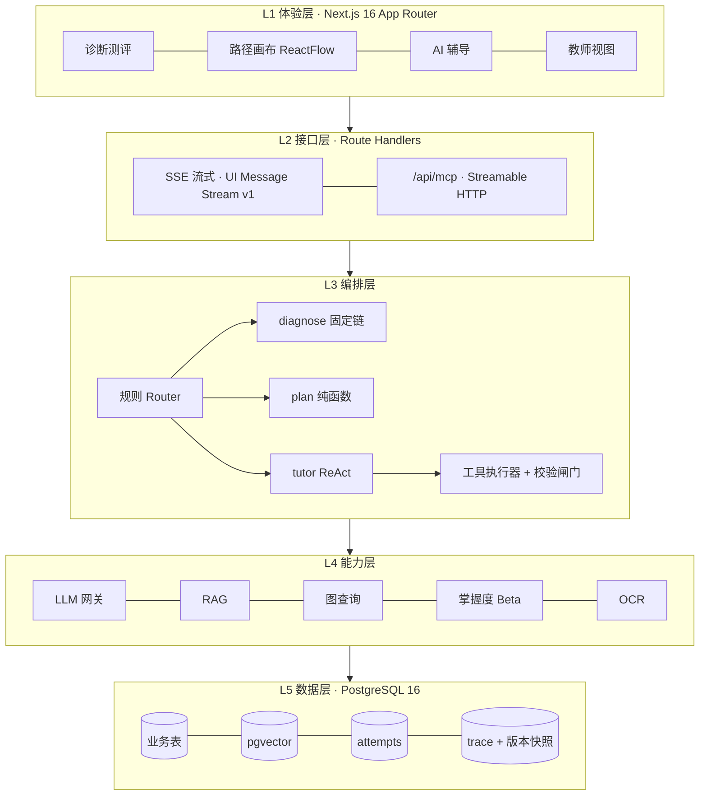

# 06 · 综合结论：一门课、一张图、一条能复现的路径

> 输入：`research/01`–`05` 五份调研 + `research/raw/track-10037-rules.md`。本文只写结论和取舍，证据回指原文件行号。
> 日期：2026-10-21（2026-10-22 第二次修订）。提交截止：2026-11-18。
> **本文是全项目唯一的执行口径**：与 01–05 冲突时以本文为准。01–05 顶部均已加「以 06 为准」横幅，正文冲突段落已就地标注。

---

## 0. 一页结论

**做什么**：给高校一门硬课（首发：数据结构）的学生和任课教师，做一张会解释、可改写、跨会话记得住的学习路径图。**路径顺序完全由确定性算法算出，LLM 不参与排序、只解释**；掌握度是难度加权的 Beta 后验，带显式不确定度。

**五个取舍**：

1. **LLM 不再有排序权。** 这是第二次修订最大的一处改动。上一版让 LLM 在候选集内重排，导致「路径可复现」与 LLM 采样直接冲突。现在 `plan` 是纯函数：同输入同版本 → 同路径，`path_hash` 可逐位复现（§3.6）。
2. **首发场景从「县域高中」改为「高校一门硬课」。** 4 周内拿不到未成年人的真实试点，而试点决定实用性 10% 的一半（§1.6）。
3. **放弃 BKT 与 IRT 3PL，改用难度加权的 Beta-Bernoulli。** n=30–60 估不出每 KC 四个 BKT 参数，更估不出每题三个 IRT 参数（§3.5）。
4. **图谱 40 概念 / 120 题 = 每 KC 3 题。** 这是让「置信档位」真正可达的最小配置（§1.2 算过：2 题时 sd 最好也只有 0.21，永远进不了「充分」）。
5. **分数给区间，不给单点。** 基准 75.7，最好 84.9，最差 56.0（§4）。

---

## 1. 产品定位

### 1.1 一句话

> **给高校一门硬课的学生和任课教师，做一张会解释、可改写、跨会话记得住的学习路径图——顺序由先修 DAG、掌握度与时间预算算出，可逐位复现；LLM 只解释和出内容，不决定顺序。**

拆开三件事：

| 问题 | 答案 |
| --- | --- |
| 做什么 | 诊断 → 生成路径 → 执行 → 错题回写 → 重规划 的闭环。不是聊天框，不是题库，不是看板。 |
| 给谁用 | 一门课 30–60 人的教学班 + 1 位任课教师。学生看到「今天学什么、为什么」；教师看到「班里谁不会哪个知识点」。 |
| 凭什么更好 | 商业产品的路径单向、学生改不了；开源产品里 LLM 与知识追踪没有在同一个多人产品里同时成立；且我们把掌握度的不确定度直接显示出来，不把先验包装成测量（§1.5）。 |

### 1.2 首发场景与数据规模

| 项 | 结论 | 为什么是这个数 |
| --- | --- | --- |
| 课程 | 数据结构 | 团队能拿到课件、习题与任课教师支持（需书面，§5.0） |
| 知识点 | **40 个概念 / 60 条先修边** | 每 KC 3 题才能让置信档位可达（见下表）；40 个概念是 3 人 5 个工作日能逐条签字的上限 |
| 题库 | **120 题 = 40 KC × 3 题**，每题带教师标注难度 d∈{1,2,3,4,5} | 3 题/KC 是「证据充分」可达的最低配置 |
| 首批用户 | 本校一个教学班 30–60 人；试点样本 n≥20 | 见 §2.4 的测量设计 |
| 不做 | K12 学生、家长、培训机构；作业管理、考试系统、成绩册 | 见 §7 |

**为什么是 3 题/KC，不是 2 题**（本次实算，`p₀=0.35, s=2`，全部答对）：

题数下限取决于题目难度，因为 `w = 0.5 + 0.25·d` 让同一题数在不同难度下给出不同证据量。两档都要算：

| 同 KC 全对次数 | 0 | 1 | 2 | 3 | 4 | 6 |
| --- | --- | --- | --- | --- | --- | --- |
| `sd`（d=1，w=0.75） | 0.275 | 0.258 | 0.228 | 0.201 | 0.179 | 0.146 |
| `sd`（**d=2，w=1.00**） | 0.275 | 0.248 | **0.210** | **0.179** | 0.156 | 0.123 |
| `sd`（d=3，w=1.25） | 0.275 | 0.238 | **0.193** | **0.161** | 0.137 | 0.106 |

结论按**题库的众数难度 d=2** 取：2 题全对 sd=0.210，进不了「证据充分」（阈值 0.20）；3 题全对 sd=0.179，进得去。所以下限是 3 题/KC。

**这个下限对难度敏感，必须写清前提**：若某 KC 的 3 道题都是 d=3，2 题全对就有 sd=0.193 已经达标；若都是 d=1，3 题全对（0.197）才勉强过线。因此「40 KC × 3 题」成立的条件是**每题难度标签准确且 KC 内难度分布在 d=2 附近**，这也是 §1.2 要求教师逐条签字标注难度的原因。不要把它当成与难度无关的定论。

**「高置信」这一档在本期不会出现**：要达到 sd≤0.12 需要 6 次同 KC 观测（d=2 时 0.123），超出题库容量。因此 UI **只设两档**：「证据充分」（sd≤0.20）/「证据不足」（sd>0.20）。这是诚实的选择，不是缺陷——不设一个永远点不亮的档位。

**⚠️ 档位不能只看 sd，必须同时显示观测次数 `n`**。`sd` 是后验的离散程度，它不只随证据量下降，也随答对/答错的比例变化：同一 KC 做 3 题（d=2）时，全错 sd=0.142、对 1 题 0.193、**对 2 题 0.203**、全对 0.179——对 2 题反而落在「证据不足」，比只对 1 题还差。这不是 bug，是 Beta 后验在 `α≈β` 时不确定性最大的正常表现，但如果 UI 只把 sd 翻译成「证据充分/不足」，学生就会看到「答得更好、标签更差」。**修法**：标签文案改为「已观测 n 题 · 掌握度 x%（±y）」，把 `n` 作为主信息、`sd` 作为精度注记；`sd≤0.20` 只用来决定「是否还需要出题」，不用来表达「你学得好不好」。

### 1.3 掌握度怎么算（一页讲清）

**难度加权 Beta-Bernoulli，零参数拟合。**

先验：`α₀ = s·p₀`，`β₀ = s·(1−p₀)`，`s = 2`，`p₀` 由图谱深度给出（根 0.35，每深一层 −0.05，下限 0.10）。

更新（`w` 为题目难度权重）：

```
答对：α ← α + w        答错：β ← β + w
w = 0.5 + 0.25·d       d∈{1,2,3,4,5} → w∈{0.75, 1.00, 1.25, 1.50, 1.75}
```

**为什么按难度加权**：答对一道 d=5 的题比答对 d=1 的题提供更多「会了」的证据。加权系数是**产品假设**，不是文献结论；取值使同一 KC 内最难与最易的题证据量相差 2.3 倍，不至于让一道怪题翻盘。

输出：

```
p_mastery = α / (α + β)
sd        = sqrt( α·β / ((α+β)² · (α+β+1)) )
```

置信两档：`sd ≤ 0.20` → 「证据充分」；`sd > 0.20` → 「证据不足」。

算例（`p₀=0.35, s=2`，全对，d=3）：`α=0.7, β=1.3` → p=0.350, sd=0.275（不足）；答对 1 次 → 0.567/0.248；2 次 → 0.675/0.210；3 次 → **0.740/0.179（充分）**。以上数字本次已用 Python 复算。

**三条必须写进文档的局限**：

1. **可交换性**：Beta 假设观测同分布，不含学习增益。对正在进步的学生后验均值偏低，是保守偏差。
2. **遗忘**：Beta 不含遗忘。遗忘单独用 FSRS 的 retrievability 表示，与掌握度是两个数、两个含义，UI 分开显示，不合并。
3. **题目独立性**：同一道题重复作答不满足独立性假设。**同一题只计一次证据**（重复作答只更新 `attempts`，不再加 α/β）；补充证据只能来自同 KC 的**不同题**或 LLM 生成的**变体题**（变体需与母题答案一致性校验通过，`evidence_source='variant'`，解释卡上标明）。

### 1.4 路径怎么算（三层，全部确定性）

```
① 可行性：先修 DAG 上取「外边缘」候选集
   外边缘 = 所有先修已满足（p_mastery ≥ 0.6）且自身未达标的节点
   —— 知识空间理论的 outer fringe（01-competition-strategy.md:118）

② 最优性：时间预算下的 0-1 背包
   价值 v(kc) = (目标掌握度 − 当前 p_mastery) × exam_weight(kc)
   成本 c(kc) = est_minutes(kc)
   约束 Σc ≤ weekly_minutes，输出选中集合

③ 排序：在选中集合上按「先修深度 + ZPD 距离」做确定性拓扑序
   ZPD 距离 = |预测正确率 − 0.80|，预测正确率由 Beta 均值与题目难度标签算出
   同分时按 kc_id 字典序打破平局 —— 保证唯一解
```

**LLM 在这一层完全不出现。** 它只在路径生成之后，为每个已确定的节点写一句理由（证据链由代码拼装，LLM 只负责措辞）。

**反事实因此与主路径同口径**：两者跑同一个纯函数，只有 `weekly_minutes` 不同。diff 里每一处位移都可归因于预算变化（§3.6）。

### 1.5 凭什么比现有方案好

能力矩阵（七行数值取自 `03-competitors.md:89-96`；「本产品」是目标值，不是现状）：

| 能力 | 松鼠 AI | Knewton Alta | Khanmigo | OATutor | OpenTutor | 本产品 |
| --- | :-: | :-: | :-: | :-: | :-: | :-: |
| 知识点级知识追踪 | ◐ | ◐ | ? | ● | ◐ | ● |
| 先修关系图 | ● | ● | ○ | ○ | ◐ | ● |
| 路径生成（非单题推荐） | ● | ● | ? | ◐ | ◐ | ● |
| LLM 对话/讲解 | ◐ | ○ | ● | ○ | ● | ● |
| **可解释的推荐理由** | ○ | ◐ | ? | ◐ | ? | **●** |
| **学生/教师可改路径** | ○ | ○ | ○ | ◐ | ◐ | **●** |
| 开源可自部署 | ○ | ○ | ○ | ● | ● | ● |

三条差异化，措辞按证据强度收敛：

1. **商业产品的路径是单向的。** 松鼠 AI「learning is not student-directed」（`03-competitors.md:106`）；Knewton 的推荐遵循 frontier learning（`03-competitors.md:108`）。这两条是有来源的事实。
2. **开源产品里 LLM 与知识追踪没有同时成立。** OATutor 有 BKT 无 LLM，OpenTutor 有 LLM 但知识图谱自标 Experimental，且自述「Multi-user SaaS/classroom mode is out of scope for this beta」（`03-competitors.md:72-76`）。
3. **「可解释的推荐理由」「可干预路径」两列，在能查到的公开材料里没有任何产品拿到 ●。** 注意：Khanmigo 与 OpenTutor 在「可解释理由」列是 `?`（未公开）；「可干预路径」列 Khanmigo 是 `○`、OpenTutor 是 `◐`（`03-competitors.md:93-94`）。准确表述是「公开材料未见」，不是「他们做不到」——这个区分答辩时必须自己先说出来，否则被一个反例打掉。

> **这张矩阵是自评，逐格来源不全。** `03-competitors.md` 的产品描述只能支撑其中一部分（例如给 Knewton 的「可解释理由」◐、给 OATutor/OpenTutor 的「可干预路径」◐，正文都没有直接描述对应功能）。因此本表**只用于内部取舍与视频叙事**，不写进技术文档当作事实；技术文档里改用「我们在查到的 N 个产品中未见 X」这种可核查的句式，并附检索日期。

### 1.6 为什么首发不是县中（对 05 结论的推翻）

`05-market-social-value.md:54` 把县域高中排第一，理由成立：政策原文点名「个性化自适应学习」、付费方清晰。不采纳作为首发，三条理由：

1. **试点拿不到，损失大于收益。** 「方案有效性 5%」要真实前后测（`01-competition-strategy.md:151`）。4 周内完成「学校审批 → 监护人同意 → 前测 → 干预 → 后测」不现实。拿不到数据这一项从 3.5 掉到 2 分以下；换成高校，社会价值最多少拿 1–2 分。净亏。
2. **合规成本前置。** 不满 14 周岁属敏感个人信息（PIPL 28/31 条），加未保条例与教育移动应用备案（`05-market-social-value.md:138-142,174`）。要做，但不该和核心功能抢 4 周。
3. **功能冲突。** 双减禁止「拍照搜题」类产品（`05-market-social-value.md:72`），而拍照识别是我们多模态分最自然的载体。高校叙事下它是正常学习工具，K12 叙事下要先解释十分钟。

**05 的内容不是「全部保留」**，逐项分流：

| 05 的内容 | 处理 |
| --- | --- |
| 政策引用（县中振兴、AI 通识教育指南、PIPL/AIGC 标识办法） | 保留，用在「规模化路径」与「合规」章节 |
| 教育公平论证（`05:108-110`） | **重写为高校口径**（§2.4），原 K12 版本不用 |
| 单位经济模型（`05:144-164`） | **只在「第二阶段（县中）」使用**；本期高校口径见 §4.1 |
| 市场盘子（`05:126` 的 453 亿） | **不使用**，05 已就地作废 |
| 合规清单（`05:170-190`） | 保留，作为需求文档条目 |

**决策门**：若 11/01 前拿到某中学的正式授权与指导老师背书，可换内容包，其余不动；否则按高校执行，此后不再讨论。

---

## 2. 核心功能清单

优先级：**P0** = 作品成立的必要条件；**P1** = 有余力才做；**P2** = 不做。

### 2.1 AI 技术深度（35%）

| 功能 | 用户看到什么 | 背后用了什么 AI 技术 | 评分点 | 优先级 |
| --- | --- | --- | --- | --- |
| **F1 诊断测评** | 10–12 道题，下一题在未测 KC 里选「预测正确率最接近 0.80」的；交卷后一张两色知识点图（证据充分 / 证据不足），每点带估计值、sd 与证据条数 | 选题：Beta 均值 + 教师难度标签算预测正确率，**不拟合 IRT**。掌握度：难度加权 Beta 更新（§1.3）。LLM 只做两件事——按 `{kc_id, target_d}` 生成变体题（JSON Schema 强约束，双次生成答案一致才入库）、把数值结果写成一句人话 | 大模型集成 8% | P0 |
| **F2 AI 辅导** | 先出现「正在检索 3 个知识点 → 正在核对先修 → 正在组织回答」，再逐字出答案；每个结论后有 [1][2] 可点回讲义原文；问到讲义外内容会说「这里没有依据，我不编」 | ReAct 式 `ToolLoopAgent`（最多 20 步、单会话 token 上限）；工具是图查询 / 资源检索 / 取题；RAG 走 pgvector 向量 + 进程内 BM25 双路召回 → RRF → LLM listwise 重排 → top-20 入上下文；生成后做引用存在性校验，无引用则拒答 | Agent 8% + RAG 6% + AI 交互 3% | P0 |
| **F3 错题回写（最小版）** | 截图/拍照上传 → OCR 出题干文字 → 学生从下拉里选所属知识点与错因 → 确认后今日路径立刻多出一个补强节点 | 多模态模型做 OCR + 结构化 `{stem, options, student_answer}`；**KC 与错因由人选，不由模型猜**；确认后写一条 attempt（同一题不重复计证据，§1.3） | 多模态 5%（只按 2.0 记，§4） | P0（1 天工作量） |
| **F4 MCP 工具层** | 评委用 **MCP Inspector**（Claude Desktop 作备选，配 `mcp-remote` 桥接）连上 server，列出 tools/resources/prompts，调一次 `get_learner_state` 看到路径与理由 | 一个 MCP server 暴露三类原语：`tools` 8 个（5 读 3 写，清单见 `04-architecture.md:126-131`）、`resources` 2 个（课程大纲、图谱导出）、`prompts` 2 个（出题、讲解模板）。Streamable HTTP 挂 `/api/mcp`，**静态 Bearer token（`MCP_TOKEN`，评审期有效）**；写操作先返回 diff 等确认；同 schema 注册 Function Calling 兜底 | MCP/工具 4% | P0 |
| **F5 降级与护栏** | **LLM API 不可用时**（拔 key、超时、限流），顶部出现「AI 讲解暂不可用，路径与题目仍可用」，路径照常生成（因为路径本来就不依赖 LLM）；连续对话 20 轮弹出「要不要先做 3 道题检验一下」 | 规则引擎兜底（纯图谱先修出题）；输出 JSON Schema 校验 + 引用校验；教学红线规则（不给最终答案、不强化错误概念、必须给脚手架）；每 N 轮强制小结 | AI 安全 4% | P0 |

> **不做的降级**：真断网（关掉网络后页面还能打开）需要 PWA + Service Worker + IndexedDB，P0 不含。README 与本文一律写「LLM API 不可用时降级」。

### 2.2 创新性（25%）

| 功能 | 用户看到什么 | 背后用了什么 AI 技术 | 评分点 | 优先级 |
| --- | --- | --- | --- | --- |
| **F6 路径画布 + 反事实预览** | 可缩放先修 DAG，节点颜色 = 掌握度，边 = 先修强度；**可拖拽重排（手动编辑）**；顶部「本周 5 小时 / 3 小时」滑块，拖动后路径实时重排并高亮差异 | 主路径与反事实**跑同一个纯函数**（§1.4），差别只在 `weekly_minutes`，因此 diff 可归因于预算。手动拖拽走独立的 `manual` 通道：**保留学生顺序，但实时标红违反先修的位置并给出原因**，不静默接受（§3.4） | 技术方案创新 8% + 交互创新 7% | P0 |
| **F7 解释卡** | 每个节点右侧一行「为什么现在学它」：前置 A 估计 0.41（sd 0.19，2 次证据）未达标 / 距考试 12 天 / 你在这类题上错过 3 次。点开能跳到对应 attempt | 证据链由代码拼装（Beta 数值 + sd + 图距离 + 错因计数），LLM 只负责措辞。所有数字来自数据库，不来自模型 | AI 安全 4%（可解释）+ 选题创新 10% | P0 |

> **关于「相似边」**：`01-competition-strategy.md:117` 提出用班级错题共现生成 similarity 边，`04-architecture.md:56` 也建议建两类边。**本期不做**：n=30–60、120 题时任意两 KC 的共现计数中位数为 0，估不出稳定相似度。01 该段已就地划掉。

### 2.3 前端工程与用户体验（20%）

| 项 | 结论 | 对应 |
| --- | --- | --- |
| **F8 流式四态** | `useChat` 的 `submitted / streaming / ready / error` 映射：骨架屏 → 展开推理面板 + 工具卡片 → 折叠保留「查看推理过程」→ 错误卡片可重试且不清空已生成内容 | AI 交互 3% |
| **F6 画布实现** | **`@xyflow/react` 12.12.0 + `elkjs` 0.12.0 做分层布局**（`npm view` 已核）。40 节点 / 60 边，目标首帧 <300ms、拖拽 60fps；布局在 Worker 里算。**无障碍替代**：提供「列表视图」切换（同一路径的线性表格），键盘可操作、屏幕阅读器可读 | UI 4% + 交互 3% |
| 状态分层 | TanStack Query 管服务端状态，Zustand 只管画布缩放/选中节点 | 组件化 3% |
| 路由级加载 | `loading.tsx` + Suspense，画布先出骨架图再逐节点填色 | 交互 3% |
| 性能预算与测法 | LCP ≤2.5s、INP ≤200ms、CLS ≤0.1。**首屏 JS 预算必须按路由拆，不能给一个总数**：`/` 与 `/diagnose` 首屏 JS ≤180KB gzip（不含画布）；`/path` 画布路由单独设 ≤700KB gzip。**依据**（`npm pack` 解包后 `gzip -c` 实测）：`elkjs@0.12.0` 的 `elk-worker.min.js` 单独就是 464,625 字节 gzip、`elk.bundled.js` 469,661 字节，且是预打包产物、不可 tree-shake；`@xyflow/react` 的 `dist/esm/index.js` 仅 52,290 字节。一个 elkjs 就是 180KB 预算的 2.6 倍，所以画布**必须**走 `dynamic(() => import(...), { ssr: false })` 路由级代码分割，且 elkjs 在 Web Worker 里加载，不进主 bundle。**测法**：Lighthouse 12 移动 preset，Chrome 稳定版，本地 production build 与国内云演示环境各 3 次取中位，记录机型/网络/日期；分路由各测一次，报告里两个数字都给 | 性能 3% |
| 设计 token | Tailwind + shadcn/ui；对比度 ≥4.5:1（大字 ≥3:1）；键盘可达、焦点可见 | UI 4% |
| 代码规范 | TS strict、ESLint + Prettier 可复现、按 feature 分目录、无大段 `any` | 代码质量 4% |

### 2.4 实用性与社会价值（20%）

**社会价值换成高校口径**，不借用 K12 的大班额、县中师资虹吸、双减与课后服务。

| 高校的缺口 | 怎么测（可执行） | 来源 |
| --- | --- | --- |
| 生师比高，答疑覆盖不到全班 | 直接引用生师比 16.96:1，**不引申** | 本科 16.96:1（`05-market-social-value.md:37`），教育部 2025 公报，本次未独立核验 |
| 先修缺口在开课时不可见 | 诊断识别出的「前置未达标」KC 数（系统日志直接统计） | 试点自测 |
| 教师排一次个性化复习要手工翻作业 | 3 位任课教师各排一次同一章复习计划，秒表计时，报均值与范围 | 试点自测 |
| 学生不知道「下一步该学什么」 | 5 点量表前测/后测：「我知道下一步该学什么」，配对 t 检验 | 试点问卷 |

**社会价值的写法**（不写「促进教育公平」）：只写试点测出来的三个数——教师排一次复习的耗时（前 vs 后）、被识别出的隐性薄弱点数、路径模板被复用的次数。**测不到就不写**，宁可在这一项少拿分。

| 功能 | 用户看到什么 | 背后用了什么 AI 技术 | 评分点 | 优先级 |
| --- | --- | --- | --- | --- |
| **F9 教师视图** | 班级薄弱点名单（按 KC 聚合「估计 <0.5 且 sd ≤0.20 的人数」——只列证据充分的学生，避免把先验当诊断）；一键导出路径模板 | 聚合查询 + LLM 写一段班级学情摘要（必须引用具体数字） | 场景真实性 5% + 社会价值 5% | P1 |

**⚠️ F9 在给定规模下可能产不出名单，必须先做覆盖率校验再决定是否投入。** 推算：诊断只做 10–12 题（F1），40 个 KC 里每个学生最多覆盖 12 个；`evidence_n=0` 时 sd=0.275（§1.2 表），必然被 `sd≤0.20` 排除，所以每个 KC 只有真正被出过题的学生才可能入选。一个 30 人班、每 KC 3 题、共 12 题覆盖 4 个 KC 时，多数 KC 只有 0–2 名学生有资格进入名单，名单基本是空的。

**决策规则（W3 之前必须跑一次）**：用模拟的 30 人作答数据算「有 ≥3 名学生入选的 KC 个数」。若 < 5 个，F9 改为**只展示「本班已诊断 KC 的分布与人数」**，不叫「薄弱点名单」；或在 W3 把诊断题量提到 20 题（覆盖 ~7 个 KC）。**不要在名单为空的情况下仍按「场景真实性 5% + 社会价值 5%」给分**——那两项的分要靠真实可用的功能支撑。
| **F10 试点证据**（任务） | 不展示给学生。产出：n≥20 同班，11/06–11/08 前测 → 11/09–11/15 使用 → 11/16 后测 | — | 方案有效性 5% | P0（任务） |

**试点测量怎么做才可信**：

1. 数据结构没有全国统一标准化测验，所以**不称「标准化题」**，称「统一命题前后测」。
2. 命题：2 位任课教师独立出题 → 交叉复核 → 分歧题删除；报告 Cronbach's α、每题难度 p 值与区分度 D。
3. 干预时长如实写「7 天」，不包装成「一学期」。
4. 无对照班就明说，改报「同班未使用同学的同期课程测验变化」作为参照，注明是准实验不是 RCT。
5. 效应量：n=20 的单组前后测只报 Cohen's d 与 95% CI，并注明「无对照，不能归因于产品」。
6. 「人工排路径耗时」由 3 位教师实测，报均值与范围，不引用未经实测的「40 分钟」（`01-competition-strategy.md:151` 的该示例已就地标注为待实测）。

### 2.5 优先级与砍单规则

| 优先级 | 功能 | 截止 |
| --- | --- | --- |
| P0 | F1 诊断、F2 辅导、F3 OCR 最小版、F4 MCP、F5 降级、F6 画布+反事实+手动编辑、F7 解释卡、F8 流式、F10 试点 | 见 §5 排期 |
| P1 | F9 教师视图 | 11/04 |
| P2 / 不做 | 语音、相似边、路径模板市场、报告导出、视频模态、PWA 离线 | 不做 |

**砍单规则（修正了上一版的自相矛盾）**：旧版写「11/03 未跑通的 P0 降为 P1」，但 F3/F4/F5 本来就排在 W3（11/04 起），会在开始前被自己砍掉。改为两个检查点：

- **11/05 检查点**：F1/F6/F7（核心闭环）必须能演示。若不能，砍 F4 MCP 与 F9，把人力压到核心闭环。
- **11/11 检查点**：F2/F3/F5 必须能演示。若不能，砍 F3（多模态归零，总分 −2），保 F2 与 F5。
- 任何被砍的功能在技术文档里写「已设计未实现」，不留半成品。

---

## 3. 技术架构

### 3.1 分层



### 3.2 每层选型与理由

| 层 | 选型（结论） | 为什么是它 | 排除的选项 |
| --- | --- | --- | --- |
| L1 框架 | **Next.js 16.4.2 App Router + React 19 + TS strict** | 赛道列为全栈 AI Web 推荐首选（`track-10037-rules.md:184`）；`loading.tsx` 让骨架屏成为默认行为；一个进程同时出页面和 API | Vue/Nuxt：可行，但 AI SDK 示例不同源 |
| L1 画布 | **@xyflow/react 12.12.0 + elkjs 0.12.0** | 40 节点 / 60 边的 DAG 需要缩放、拖拽、自定义节点；React Flow 自带这些，elkjs 做分层布局；都是纯前端，不增加后端依赖 | 自研 SVG：拖拽与缩放的手势细节要 3–5 天；d3-force：力导向布局对「先修层级」表达不如分层布局 |
| L1 UI | **Tailwind + shadcn/ui + Framer Motion** | shadcn 把源码复制进仓库，改样式不和组件库打架 | 黑盒组件库 |
| L1 状态 | **TanStack Query + Zustand** | 画布缩放不该触发重新请求 | 单一 Context |
| L2 流式 | **Route Handlers + SSE（UI Message Stream v1）** | 四态直接映射「AI 交互体验 3%」 | WebSocket：双向用不上 |
| L2 工具协议 | **MCP TypeScript SDK，Streamable HTTP 挂 `/api/mcp`** | 三类原语都有实现；stdio 不能上生产 | 只做 Function Calling：拿不到 MCP 4% |
| L3 编排 | **规则 Router + 2 条固定链 + 1 个 ReAct Agent** | **`plan` 是纯函数、不调 LLM**；只有开放对话需要自主循环 | 多 Agent 并行：token 约 15×（`04-architecture.md:123`） |
| L4 LLM | **DeepSeek（文本，按任务分档）+ 通义千问 VL（OCR）** | 国内访问稳定、单价低（`04-architecture.md:178`）、中文强 | 单一模型打天下 |
| L4 掌握度 | **难度加权 Beta-Bernoulli 纯函数（§1.3）** | 零参数拟合；sd 由公式直接算出 | BKT / IRT / DKT，理由见 §3.5 |
| L4 复习调度 | **`ts-fsrs` 5.4.2，用库内置默认权重（不拟合）** | 复习到期作为路径插队项；**不拟合 21 个 FSRS 参数**，用库默认值并在文档写明「未针对本课程校准」 | 自实现 FSRS：要自己维护权重与调度 |
| L4 图查询 | **PostgreSQL 递归 CTE** | 40 节点 / 60 边，闭包实测 **0.003 ms（6 次运行，min=max=0.003，精度 0.001 ms）**；拓扑 0.001–0.002 ms、**ZPD 贪心选步** 0.002–0.003 ms（`node bench/bench-path.mjs`，Node v24.15.0 / win32 x64）。**这些是 JS 数组实现，不是 Postgres 递归 CTE 的实测值**；选 CTE 的理由是节点规模小、省一套运维，不是因为它更快。**⚠️ bench 的 `greedyPath`（bench:67-86）只是 ZPD 贪心选步，不含 §3.4 的 0-1 背包、`p_mastery≥0.6` 外边缘阈值与「先修深度 + ZPD 距离」排序**——它证明的是「图遍历与选步是微秒级」，不是「完整 `plan` 是微秒级」。完整 `plan` 的耗时必须在 W2 用真实实现重测并替换此数字 | Neo4j / Apache AGE |
| L4 RAG | **pgvector + 进程内 BM25（中文 bigram）+ RRF + LLM listwise 重排** | 中文全文检索在 Postgres 要装分词扩展；几百个 chunk 的 BM25 放进程内更简单 | 纯向量 top-k |
| L4 向量 | **BGE-M3（1024 维，自托管）** | 国内可直连；1024 维在 pgvector 2000 维上限内 | `text-embedding-3-small`：境外接口不可靠 |
| L4 安全 | **规则词表 + 同模型分类器 + Schema/引用校验 + 教学红线** | 不用 OpenAI Moderation（境外接口）；且要审的是教学行为，不只是内容毒性 | 只写 system prompt |
| L5 存储 | **PostgreSQL 16 单库** | 一个库覆盖四类数据 | 多库拆分 |
| 部署 | **Docker Compose 单机，国内云 2C4G + 域名 HTTPS** | 评委国内访问稳定；SSE 与 MCP 长连接不被跨境网络掐 | Vercel + 海外库 |
| 测试 | **Vitest（算法纯函数）+ Playwright（三条主链路）** | 算法层要能被单测证明「先修约束 100% 满足」且「同输入同输出」 | 只手工点点 |

**版本锁定（2026-10-22 查 npm registry）**：

| 包 | 锁定版本 | 说明 |
| --- | --- | --- |
| `next` | `16.4.2` | latest |
| `ai` | **`6.0.312`** | latest 是 `7.0.148`。v6 导出 `stepCountIs`；v7 也导出 `stepCountIs`，`isStepCount` 只是内部名（解包两个 tarball 核对）。选 6 不赌 7 的生态 |
| `@xyflow/react` | `12.12.0` | 画布 |
| `elkjs` | `0.12.0` | 分层布局 |
| `ts-fsrs` | `5.4.2` | 复习调度 |
| `@modelcontextprotocol/sdk` | `1.32.1` | v1 包名 |
| `@modelcontextprotocol/server` | `2.3.1` | v2 服务端包 |

### 3.3 编排：三个工作流

```text
Router（规则 + 小模型分类）
 ├─ diagnose: 选 KC → 出题 → 判题 → 更新 Beta → 诊断报告    （固定链）
 ├─ plan:     读 mastery → 闭包 → 背包 → 确定性拓扑序 → 渲染  （纯函数，无 LLM）
 └─ tutor:    ReAct 循环（检索 → 讲解 → 追问 → 按需调工具）   （唯一真 Agent）
```

`diagnose` 用 `streamText` + `stopWhen: stepCountIs(5)` 做固定工具序列（选 KC → 取题 → 判题 → 写库）。`tutor` 用 `ToolLoopAgent`（默认 `stopWhen` 为 `stepCountIs(20)`）。

**`plan` 是纯函数，全程不经过 LLM**，这是「路径可复现」的实现前提，也是答辩时回答「去掉 LLM 这套系统还能不能跑」的答案：能跑，`plan` 单独可执行且结果确定。LLM 只在 `diagnose` 的选 KC、`tutor` 的讲解、以及题目的解释文本里出现，**不参与排序**。因此 `path_hash` 不含任何模型标识（见 §3.6）。

### 3.4 手动编辑：可改写怎么落地

「可改写」是核心差异化（§1.5 矩阵最后一列），必须在 schema 与校验里都有对应物。

**数据模型**：

```ts
// path_steps 增加
source: 'algorithm' | 'manual'        // 不再有 'llm'
manual_edit?: {
  edited_by: string                    // user_id
  edited_at: string
  original_step_ids: string[]          // 编辑前的顺序，用于 diff 与撤销
  violations: { from: KCId; to: KCId }[]  // 编辑后仍存在的先修违反（可为空）
}
```

**规则**：

1. 学生拖拽后，前端**立即**跑同一个 `checkPrereqOrder` 函数；违反先修的位置标红并显示「这一步需要先学 X」。
2. **允许保存违规顺序**（学生有最终决定权，这本身是产品主张），但违规项在 UI 上持续标红、在路径完成率统计里单列，不静默接受。
3. 每次编辑写 `path_edits` 表（`path_id, user_id, before_order, after_order, ts`），可回放。
4. `path_hash` 只对 `source='algorithm'` 的路径计算；手动编辑后 hash 失效并标记 `edited=true`，**不声称手动路径可复现**。

**校验函数（修正了上一版可被重复 ID 绕过的漏洞）**：

```ts
function checkPrereqOrder(order: KCId[], candidates: Set<KCId>, edges: [KCId, KCId][]): Violation[] {
  // 1. 必须是候选集的排列：无重复、无遗漏
  if (new Set(order).size !== order.length) throw new Error('duplicate ids');
  if (order.length !== candidates.size || !order.every(id => candidates.has(id)))
    throw new Error('not a permutation of candidates');
  // 2. 逐边检查：只检查两端都在 order 里的边
  const pos = new Map(order.map((id, i) => [id, i]));
  const v: Violation[] = [];
  for (const [u, w] of edges) {
    if (pos.has(u) && pos.has(w) && pos.get(u)! > pos.get(w)!) v.push({ from: u, to: w });
  }
  return v;
}
```

上一版的 `pos` 用 `Map` 对重复 ID 取最后位置，`[B,A,B]` 这类输入能绕过检查（`pos={A:1,B:2}`，边 `A→B` 通过，但第 0 位 B 在第 1 位 A 前）——所以第 1 步的「排列校验」是必需的，不是防御性代码。

**单测（6 条，覆盖上一版漏掉的情形）**：

1. 合法序 → 0 violations
2. 越界 ID → 抛错
3. 故意乱序（`[B,A]`，边 `A→B`）→ 1 violation
4. **重复 ID（`[B,A,B]`）→ 抛 `duplicate ids`**
5. **漏节点（候选 3 个只给 2 个）→ 抛 `not a permutation`**
6. **手动编辑通道**：拖拽产生的违规顺序能保存，且 `violations` 非空、`source='manual'`

6 条全过，文档里才能写「先修约束由代码校验」。

### 3.5 为什么不用 BKT / IRT / DKT

| 模型 | 需要什么 | 我们的现实 | 结论 |
| --- | --- | --- | --- |
| BKT 四参数 | 每 KC 一条足够长的对错序列来拟合 `p-init/p-transit/p-slip/p-guess` | 40 KC × 3 题 × 30–60 人；单 KC 单学生最多 3 次观测 | 估不出，只能手填 |
| IRT 3PL | 学生×题目矩阵估每题 a/b/c 与 θ | 120 题 × 30–60 人 × 10–12 题 ≈ **2.5–6 次/题**（本次复算：`30×10/120=2.5`，`60×12/120=6.0`） | 每题 2.5–6 次观测估不出 a/c；结论成立，但**不能用「0.25–0.5 次/题」这种错数字** |
| DKT / AKT | 10⁵–10⁶ 级交互（`02-learning-theory.md:169`）；AUC 仅比 BKT 高 2–5 点（`02-learning-theory.md:52`） | 无 | 不训练 |
| **难度加权 Beta** | 对错计数 + 难度标签 + 一个先验 | 完全够用 | **采用** |

`02-learning-theory.md:147` 自己写明 BKT 四参数是「工程默认值，不是文献结论」——既然是工程默认值，就不该用 BKT 的名字和公式包装。

### 3.6 可复现性：测什么、不测什么

**三条承诺，逐条对应可执行的测试**：

| 承诺 | 测试 | 通过标准 |
| --- | --- | --- |
| 同一输入 + 同一版本 → 同一路径 | `path_hash` 哈希**输出**（见下） | 3 条 golden case 的 hash 稳定 |
| 每个推荐理由可追溯到原始事件 | `mastery.attempt_ids` 非空；解释卡点任一数字能跳到 `attempts` 行 | Playwright 断言跳转后 `attempt_id` 一致 |
| 反事实 diff 可归因于预算 | 主路径与反事实跑同一纯函数，仅 `weekly_minutes` 不同 | 单测：同输入下两次调用返回同一数组 |

**`path_hash` 改为哈希输出**（修正上一版的关键缺陷）：

```ts
// 旧：hash(input) —— 输入相同但输出可能不同，测不出来
// 新：hash 只覆盖影响排序的量，不含任何模型标识
path_hash = sha256(canonicalJson({
  steps: path.steps.map(s => ({ kc_id: s.kc_id, kind: s.kind, est_minutes: s.est_minutes })),
  algo_version: ALGO_VERSION,
  kg_version: KG_VERSION,
}))
```

**为什么刻意不含 `model_version`**：`plan` 不调 LLM（§3.3），路径步骤与模型无关。若把 `model_version` 算进 hash，换模型会让同一路径的 hash 变化，等于自证「路径依赖模型」，直接削弱核心卖点。**判据**：如果某个字段变化会让 hash 变而 `steps` 不变，那个字段就不该在 hash 里。

`mastery` 表和 `paths` 表仍保留 `model_version` 字段（§3.7），但它的用途是**记录该次诊断/解释由哪个模型产生**，服务于可追溯与成本核算，不参与 `path_hash`。

golden case 断言这个 hash。改了算法或图谱导致输出变化 → hash 变化 → CI 红。**这才是可证伪的「可复现」。**

**不承诺的部分（写进文档）**：LLM 生成的解释措辞不可逐字复现（同一模型同一 prompt 也有采样差异）。我们的承诺是「**路径可复现、理由可追溯**」，不是「每句话都能逐字重现」。

### 3.7 数据模型（含背包输入与版本）

| 表 | 关键字段 | 作用 |
| --- | --- | --- |
| `users` | id, role, class_id | 双角色 |
| `concepts` | id, name, course_id, depth, **difficulty_label, exam_weight, est_minutes**, kg_version | 知识点；`exam_weight` 与 `est_minutes` 是背包的输入 |
| `prereq_edges` | from, to, strength, source, kg_version | 先修边（无环 + 反义对称校验） |
| `items` | id, stem, options, answer, kc_ids[], **difficulty_d**, **est_seconds**, item_version | 题库；`difficulty_d` 用于 Beta 加权与 ZPD 选题 |
| `attempts` | id, user_id, item_id, correct, latency_ms, ts, item_version, **counted_in_mastery** | 只追加；`counted_in_mastery` 标记该次是否计入证据（同题重复 = false） |
| `mastery` | user_id, kc_id, alpha, beta, p_mastery, sd, evidence_n, **attempt_ids[]**, model_version, updated_at | Beta 后验 |
| `paths` | path_id, learner_id, version, kg_version/model_version/algo_version, **path_hash, input_snapshot(jsonb), edited**, generated_at | 路径与其全部版本 |
| `path_steps` | path_id, step_id, kc_id, kind, **est_minutes**, reason, **source('algorithm'\|'manual')**, **manual_edit(jsonb)**, attempt_ids[] | 每步理由、成本、来源 |
| `path_edits` | path_id, user_id, before_order[], after_order[], violations(jsonb), ts | 手动编辑留痕 |
| `traces` | run_id, step, thought, action, observation, tokens, latency_ms, prompt_version | 轨迹回放 + 成本 |

**为什么这些字段是必需的**：`concepts.exam_weight` 与 `est_minutes` 是 0-1 背包的价值与成本；`items.difficulty_d` 是 Beta 加权的输入；`path_steps.est_minutes` 是路径总时长的来源。上一版缺这三个字段，背包算不出来。

### 3.8 部署与提交

- `docker compose up` 一条命令起完整环境；`.env.example` 列全部变量。
- 公网演示地址 + 评审专用账号（规则 5.4 可选加分，`track-10037-rules.md:126-128`）。
- 提交仓库必须 Public 或给评审开权限（`track-10037-rules.md:110`）；调研仓库不能直接当提交仓库（`track-10037-rules.md:116`）。

---

## 4. 评分对照表

规则只给权重与子项分值，**没有评分档位**（`track-10037-rules.md:67-76`）。下表是按「做到什么程度」正向估的三档，不是 rubric 换算。

| 维度 | 我们会怎么做 | 最差 | 基准 | 最好 | 满分 |
| --- | --- | :-: | :-: | :-: | :-: |
| **AI 技术深度 35%** | 模型路由 + Schema 约束 + **prompt v1→v3 评测记录**（7.0）；2 工作流 + 1 ReAct Agent + 轨迹回放（6.6）；双路召回 + 重排 + **50 条**评测集两列（5.2）；只做 OCR 一个模态（2.0）；降级 + 教学红线（3.6）；MCP 三类原语（3.4） | 19.5 | **27.8** | 31.7 | 35 |
| **创新性 25%** | 选题：公开材料未见「可解释 + 可干预 + 多人开源」三者同时成立（7.0，因矩阵自评扣 1）；技术：plan 纯函数、关掉 LLM 仍出同一条路径（6.2）；交互：反事实与主路径同口径（5.3） | 14.0 | **18.5** | 20.0 | 25 |
| **前端工程质量 10%** | TS strict + ESLint + feature 目录（3.3）；Query/Zustand 边界（2.5）；CWV 达标 + 前后对照（2.4） | 7.0 | **8.2** | 9.0 | 10 |
| **实用性 10%** | 真实课程与题库 + 可证伪需求句（3.5）；n≥20 统一命题前后测 + 教师实测耗时（3.5） | 4.5 | **7.0** | 8.5 | 10 |
| **用户体验 10%** | 设计 token + 对比度（3.4）；骨架屏（2.4）；流式四态 + 中断重试（2.4）；**可用性测试 3 人**（+0.5） | 7.0 | **8.2** | 8.7 | 10 |
| **社会价值与商业潜力 10%** | 高校口径三数（3.0）+ **高校付费方与成本结构**（3.0） | 4.0 | **6.0** | 7.0 | 10 |
| **合计** | | **56.0** | **75.7** | **84.9** | 100 |

**几处调整的理由**：

- **创新选题 8.0 → 7.0**：§1.5 的矩阵是自评、逐格来源不全，「空白」论证的强度不足以拿满。
- **实用 7.8 → 7.0**：访谈/问卷原始记录、任课教师书面支持、具名专家都还没有；「教师难度标签」在无人署名时只能算团队自标。
- **社会 7.0 → 6.0**：本期是高校口径，社会价值论证本来就比 K12 弱；且高校付费方尚未调研。
- **AI 深度不变 27.8**：RAG 评测集从 40 条提到 50 条（对齐 `01-competition-strategy.md:74`），多模态仍按 2.0 记，两者相抵。

**三档与风险的对应**：R2 说「试点 n<15 时实用性丢 2–3 分」——7.0 − 3 = 4.0，低于表中「最差 4.5」。因此 R2 触发时实用性按 4.0 计，总分从 75.7 降到 **72.7**（差额 3.0）。表里的「最差 56.0」是另一组更悲观的假设（AI 深度只拿 19.5 等），两者不叠加。**三档是估计，不是承诺。**

**多模态为什么只记 2.0**：P0 只有 OCR + 人工选 KC，没有「识别 → 自动回写 → 路径变化」的完整闭环。若 W3 有余力做出**置信度 + 人工确认**的 KC 建议（不是自动写入），加到 3.0；**不做自动识别 KC 并直接写入**——那与 §1.3「错误证据污染后验」的设计原则冲突。

**最可能丢的三处**：

1. **多模态 5%**：OCR 没做完则归零。止损：承认「本期只做 OCR」，把叙事重心放到回写闭环。
2. **方案有效性 5%**：n=20 准实验无对照班。诚实写法见 §2.4。
3. **选题创新 10%**：评委见过太多「AI 学习平台」。视频前 60 秒必须演反事实预览。

### 4.1 高校场景的付费方（本期新增）

| 项 | 结论 | 依据 |
| --- | --- | --- |
| 付费方 | 高校教务处 / 二级学院教学经费 / 教材建设专项 | 推断，非引用 |
| 客单价 | **不报数字** | 未找到高校单课工具的公开采购价；编一个会被问穿 |
| 可报的成本项 | LLM：按 `04-architecture.md:178` 单价外推，200 日活约 ¥520/月；服务器：2C4G 国内云千元/年量级；标注人力：待实测 | 推算，标注清楚 |
| 商业潜力的写法 | 只写「单校边际成本结构 + 可复制的部署方式」，不写 TAM/SAM/毛利率 | — |

> 05 §5.3 的 42–68 万/年客单价是**县中口径**（2000 人学校 × 5%–8% 数字化投入），其中 4250.77 元/年无链接、5%–8% 自认无来源、600 人未解释。**该数字只用于「第二阶段（县中）」的叙事，不用于本期高校场景。**

---

## 5. 28 天里程碑

10/21（周三）起算，11/18（周三）提交。中间 4 个完整自然周，11/18 只做提交与检查。

> **与 `01-competition-strategy.md` §7 的排期差异**：01 的试点是 11/13–11/15、n≥10；本表是 11/06 前测、11/09–11/15 使用、11/16 后测、n≥20。**以本表为准**——01 只留 3 天且无后测时间，拿不到前后测对照。

### 5.0 前置条件（10/21–10/22，先于一切开发）

| # | 事项 | 为什么是前置 | 完成标志 |
| --- | --- | --- | --- |
| **P0-1** | **报名 + 缴费** | `raw/track-10037.txt:117` 与 `rules.md:143`：提交入口需**缴费后**登录个人中心查看。未缴费 = 无法提交 | 个人中心能看到本赛道与提交入口 |
| **P0-2** | **确认组别与队友** | 选错组别无条件取消资格（`track-10037-rules.md:52`） | 3 人（或 2 人）名单 + 组别落定 |
| **P0-3** | **建公开代码仓库并提交第一次 commit** | `rules.md:113` 要求「保留完整提交历史，体现真实开发过程」。**当前 `E:/传智杯` 不是 git 仓库**（`git rev-parse --is-inside-work-tree` 返回 `fatal: not a git repository`），已无法「从 10/21 起提交」；补救是**今天建仓、今天首提**，并在 README 如实写明「调研阶段 10/21–10/22 在本地完成，代码仓 10/22 建立」 | 远程仓库可访问，有首日 commit |
| **P0-4** | **拿到任课教师的书面支持** | 实用性 5% 的「场景真实性」需要真实课程与教师背书；口头支持不算 | 一封邮件/一段聊天记录，说明可用其课程数据 |

> 这四项**不是开发任务，但任何一项缺失都会让后面 28 天作废**。10/22 当天完成，不占用 W1。

### 5.1 四周排期

| 周 | 日期 | 交付物 | 验收标准 |
| --- | --- | --- | --- |
| **W1** | 10/21–10/27 | ① 仓库 + Next.js 16.4.2 + TS strict + CI（typecheck/lint/test）<br>② 图谱 v1：**40 概念 / 60 边**，每条边有签字人<br>③ 题库 **60 题**（20 KC × 3；W3 补到 120）<br>④ 难度加权 Beta 纯函数 + 单测（含 sd 算例）<br>⑤ 诊断页跑通 10 题并落库 | `pnpm ci` 全绿；`pnpm kg:validate` 输出 0 error / 0 cycle / 0 反向边；10 题诊断后 `attempts` 有记录、`mastery.attempt_ids` 非空、`sd` 与手算一致 |
| **W2** | 10/28–11/03 | ① `plan` 纯函数（闭包 / 背包 / 确定性拓扑序）<br>② **6 条校验单测**（§3.4）<br>③ 路径画布（ReactFlow + elkjs）+ 拖拽 + 手动编辑通道<br>④ 反事实（Web Worker，同一纯函数）<br>⑤ 流式对话骨架（四态 + 骨架屏）<br>⑥ 解释卡 v1 | 6 条校验单测全过；同输入两次调用返回同一数组；诊断到路径渲染 <2s（**不含 LLM**）；拖滑块重排 <200ms；60 秒录屏能演完「改预算 → 重排 → 差异高亮」 |
| **W3** | 11/04–11/10 | ① RAG 全链 + **50 条**评测集两列<br>② MCP server（tools 8 / resources 2 / prompts 2）<br>③ OCR 最小闭环<br>④ 降级 + 护栏 + trace 抽屉<br>⑤ **11/06–11/08 试点前测**<br>⑥ 题库补到 120（40 KC × 3）<br>⑦ F9 教师视图（11/04 前完成，否则删）<br>⑧ **prompt v1→v3 版本化 + 固定评测集快照**（§4 大模型集成 8% 的给分依据） | `pnpm eval:rag` 打印两列 faithfulness；拔 key 后路径仍出；MCP Inspector 能列出三类原语；一张截图能变成一条 attempt；前测成绩表 + Cronbach's α 落盘；`prompts/` 下三个版本各带评测快照，技术文档能列出 v1→v3 的指标变化 |
| **W4** | 11/11–11/17 | ① 试点：11/09–11/15 使用、**11/16 后测**（留 11/17 一天缓冲）<br>② 性能与无障碍达标<br>③ 演示视频<br>④ 技术文档<br>⑤ README + `.env.example` + 公网演示 + 评审账号<br>⑥ 3 条 golden case 进 CI<br>⑦ **3 人可用性测试**（任务完成率 + SUS 简版，§2.3 UX 的 +0.5 依据） | Lighthouse ≥90、CWV p75 三项达标；试点表落盘（n/前后测/α/d/CI）；视频与文档按 §5.2 清单逐项打勾；golden case 的 `path_hash` 稳定；可用性测试记录 3 人 × 3 任务的完成率与 SUS 得分 |
| **D-Day** | 11/18 | 官网提交 | 按 §5.2 清单打勾 |

**为什么把后测从 11/17 挪到 11/16**：上一版后测当天就要出文档与视频，零缓冲。挪一天后，11/17 只做「把数据填进文档」这一件事。

### 5.2 提交材料清单（按规则原文）

| 材料 | 规则要求 | 检查项 |
| --- | --- | --- |
| 代码仓库 | Public 或给评审开权限；**保留完整提交历史**（`rules.md:110-116`） | 首提在 10/22；commit 按功能；`.env` 不入库；README 写明调研阶段的本地工作 |
| README | 项目介绍、技术架构、安装运行指南、团队信息 | 四项齐全 + `.env.example` + 依赖清单 |
| 演示视频 | 5–8 min；**MP4、≥1080p、普通话、可配字幕**；含**项目介绍、核心功能演示、AI 技术亮点**（`rules.md:120`） | 三段式：0:00–1:00 痛点与反事实 / 1:00–6:00 核心功能 / 6:00–8:00 AI 技术亮点 |
| 技术文档 | PDF ≤30 页；含**项目概述、需求分析、系统架构、AI 技术方案、核心功能实现、测试与部署、总结与展望**；重点写 **AI 选型理由、集成方式、优化策略**；明确列出**技术创新点与应用创新点**（`rules.md:124`） | 七章 + 两重点 + 创新点单列，逐项打勾 |
| 在线演示 | 公网可访问；评审期可用；需登录则给测试账号（`rules.md:126-128`） | 11/15 冻结部署，每日健康检查 |
| 报名缴费 | 提交入口需缴费（`rules.md:143`、`txt:117`） | §5.0 P0-1 已完成 |

### 5.3 分工（3 人）

| 角色 | 主责 | 关键交付 |
| --- | --- | --- |
| A 前端与画布 | 脚手架、ReactFlow 画布、拖拽、流式四态、性能 | W1 脚手架、W2 画布、W4 性能 |
| B AI 与后端 | Beta 掌握度、`plan` 纯函数、校验、RAG、MCP | W1 Beta、W2 路径与 6 条单测、W3 RAG/MCP |
| C 数据与教研 | 图谱、题库、命题、试点 | W1 20 KC + 60 题、W3 补到 40 KC + 120 题与前测、W4 后测与文档 |

**人力核算（修正上一版的矛盾）**：上一版说「40 概念 / 60 边，3 人 5 天可建完」，但分工又把图谱与题库全给 C 一人——C 在 W1 只有 7 天，做不完 40 KC + 120 题。现在改为：

- W1：**C 主建 20 KC + 60 题**（3 题/KC），A/B 各抽 1 天协助出题与校对 → 合计约 9 人日。
- W3：**三人共同补到 40 KC + 120 题**（约 12 人日，分摊在 W3 的 7 天里）。
- 若 W3 结束仍未到 40 KC，**降级为 30 KC + 90 题**，并在文档里如实写规模；不虚报。

**组队截止**：10/24 前若无人认领三个角色，按 2 人重排，砍 F4 MCP 与 F9。

---

## 6. 主要风险与应对

| # | 风险 | 触发信号 | 影响 | 应对 |
| --- | --- | --- | --- | --- |
| **R0** | **未报名/未缴费** | 10/22 未完成 §5.0 P0-1 | 无法提交，全盘归零 | 今天完成；个人中心截图留证 |
| R1 | 范围过大 | 10/27 时 W1 完成 <70% | 全盘延期 | 执行 §2.5 检查点 |
| R2 | 试点样本不足 | 11/05 时报名 <15 | 实用性 7.0 → 4.0 | 降级为「n=12 探索性结果」；如实写 n；总分按 72.7 报 |
| R3 | OCR 准确率低 | 抽检 20 张，题干字段准确率 <80% | 多模态分与数据可信度 | KC 与错因本来就要人选；演示选清晰截图 |
| R4 | RAG 评测集标注超时 | 11/07 时 <35 条 | RAG 6% 无对照数字 | 降到 35 条也出两列；优先标「有答案/无答案/需拒答」 |
| R5 | LLM 出题答案错 | 双次生成不一致率 >10% | 题库污染 | 一致才入库 + 人工抽检 10% |
| R6 | 演示现场网络/API 故障 | 彩排超时 >3 次 | 视频与现场双崩 | 预录视频备份；Function Calling 兜底 MCP；**MCP 演示改用 Inspector，避免 Claude Desktop 配置问题** |
| R7 | 评委认为「又一个 AI 学习平台」 | 预答辩被问「和松鼠 AI 区别」 | 选题创新掉分 | 前 60 秒演反事实；对比表点名四家；主动说「公开材料未见」而非「他们做不到」 |
| R8 | 合规 | 用了未授权教材或学生真实信息 | 取消资格 | 自制讲义 + 公开目录；试点数据匿名化；不碰未成年人 |
| R9 | 三人协作冲突 | 同一文件频繁冲突 | 进度不可控 | 按 `features/` 划分所有权；每天合并；CI 挡不合规提交 |
| R10 | 评审期部署挂掉 | 演示地址 5xx | 在线演示加分归零 | 11/15 冻结；每日健康检查；镜像 + 快照可一键重建 |
| R11 | 掌握度被质疑是「先验换皮」 | 答辩问「每 KC 几道题」 | AI 深度与创新同时受损 | 按 §1.2/§1.3 正面回答：3 题/KC、难度加权、只显示两档 |
| **R12** | **6 条校验单测未覆盖真实拖拽** | W2 结束时手动编辑通道无测试 | 「可改写」不可信 | 单测第 6 条必须覆盖 manual 通道；E2E 加一次真实拖拽 |

---

## 7. 明确不做的事

| 不做 | 理由 | 评委问起怎么答 |
| --- | --- | --- |
| **LLM 排序** | 与「路径可复现」直接冲突；LLM 排的路径不保证先修约束、不可复现（`02-learning-theory.md:123` 的 PersonaPath 29.5% 通过率） | 「排序是纯函数，LLM 只解释。所以我能给你演示同一输入两次跑出同一个 hash。」 |
| **BKT 四参数** | 单 KC 单学生最多 3 次观测，四参数估不出 | 「40 个知识点、120 道题、40 人，BKT 参数只能手填。手填的 BKT 和 Beta 先验是同一件事。」 |
| **IRT 3PL** | 每题 2.5–6 次观测，a/c 不可识别 | 「难度用教师标签，区分度和猜测率不估。」 |
| **自训 DKT / AKT / RL** | 需 10⁵–10⁶ 级交互（`02-learning-theory.md:169`）；AUC 与 BKT 只差 2–5 点且不可解释（`02-learning-theory.md:52`） | 「数据量差三个数量级。」 |
| **相似边（错题共现）** | n=30–60、120 题时共现计数中位数为 0 | 「共现矩阵太稀疏。」 |
| **全量 GraphRAG** | 面向百万 token 级总结；我们只有 40 个概念 | 「只做 1–2 跳邻域扩展。」 |
| **多 Agent 并行** | token 约 15×（`04-architecture.md:123`） | 「一个真 Agent 加两条固定链。」 |
| **Neo4j / Apache AGE** | 40 节点 / 60 边，图算法在 JS 里实测 0.001–0.003 ms；Postgres 递归 CTE 未实测，但规模上不会成为瓶颈 | 「图数据库解决千万级节点，我们解决 40 个概念的教学问题。」 |
| **按学习风格个性化** | 无充分证据（`02-learning-theory.md:101`） | 「文献上不成立。」 |
| **K12 / 县中作为首发** | 4 周拿不到未成年人试点；合规前置；双减禁拍照搜题（§1.6） | 「第二阶段落地场景。」 |
| **移动 App / 小程序** | 教育移动应用备案要 ICP + 等保定级 + 提供者备案（`05-market-social-value.md:138-142`） | 「Web 优先，上线前需备案。」 |
| **拍照直接出答案** | 政策红线（`05-market-social-value.md:72`） | 「拍照只做识别入库。」 |
| **完整 LMS** | 与评分表无关 | 「我们做路径引擎。」 |
| **语音 / 视频模态** | 本期连 OCR 都没做满 | 「本期只做图像 OCR。」 |
| **PWA 离线 / 真断网** | 需 Service Worker + IndexedDB，挤掉 RAG | 「承诺的是 LLM API 不可用时降级。」 |
| **453 亿 TAM** | 05 把三个不同口径相加（`05:126` 已作废） | 「不报 TAM，只报单校成本结构。」 |
| **自动识别 KC 并直接写入** | 错误证据污染后验；与「同题不重复计证据」冲突 | 「KC 由人选，模型只做 OCR。」 |

---

## 8. 待核验事项

1. **决赛奖项比例**（已核，本次修正了描述）：`rules.md:171-174` 与 `raw/track-10037.txt:611-620` 的**表格**都是 5% / 25% / 30% / 40%；只有 `raw/track-10037.txt:359-363` 的 **bullet** 写 5% / 20% / 35% / 40%。即：**raw 文件内部就自相矛盾**（bullet vs 表格），表格与 md 一致。上一版只拿 md 对 bullet 说「两处都不一致」，描述不完整。结论不变：**不用该数字做推算**。
2. **VanLehn (2011)**：`01-competition-strategy.md:205` 明说未取得原文、正文未采用；`05:80` 已就地加限定。正式文档要用须先取得原文。
3. **Kulik & Fletcher**：`01:207` 标注为经 Wikipedia 转引、未读原文；`05:82` 已补同样限定。两处年份不同（01 写 2015，05 写 2016），引用前统一。
4. **「前 20%」无来源**：`05:110` 仍有该说法且 05 §8 未列。**本次已在 05:102 就地加「无来源，勿引用」标注**，本文不使用。
5. **教育移动应用备案办法**：moe.gov.cn 原页 404，用高校转载全文（`05:217`）。
6. **ZPD 目标正确率**：全文统一 **0.80**，标为产品假设。`02:105` 明确 85% 规则是 SGD 二分类算法结论、不是人类学习实验结论，因此**不引 Wilson 作为人类学习依据**。敏感性：目标从 0.80 改到 0.75/0.85，路径前 10 步重叠率应 ≥70%。
7. **FSRS 参数**：`ts-fsrs` 5.4.2 用库内置默认权重，**未针对本课程校准**；不拟合 21 个参数（`02-learning-theory.md:94`）。文档里写明这一点。
8. **AI SDK 版本**（已核）：`ai` latest `7.0.148`、`ai@6` latest `6.0.312`、`next` `16.4.2`、`@xyflow/react` `12.12.0`、`elkjs` `0.12.0`、`ts-fsrs` `5.4.2`、MCP SDK `1.32.1` / `2.3.1`。解包 tarball 确认 v6 与 v7 都导出 `stepCountIs`。
9. **市场口径**：`05:126` 的 453 亿已作废；本期高校场景不报 TAM/SAM/客单价（§4.1）。
10. **05 表格算术**（已核）：`05:43` 校均与在校生/学校数不吻合；`05:47` 本专科合计差 51.83 万。均已就地加注。
11. **法规核验状态**：`05:174` 写「本次均已抓取正文并逐条核对，除《数据安全法》外」；本文与 05 的其余部分**没有独立复核这些抓取**。正式文档引用法条时，按「05 声称已核对、本报告未复核」标注，不要写成「已核实」。
12. **教育部 2025 公报 / CNNIC 第 57 次 / IDC / 艾瑞 / NBER w35620 / 七部法规全文**：本次未独立核验，只按 05 的转述使用，并注明来源层级。

---

## 9. 修订记录

### 9.1 第二轮审读（2026-10-22，38 条）

| # | 问题 | 改法 | 落在哪 |
| --- | --- | --- | --- |
| 1 | **LLM 重排与「路径可复现」冲突** | **取消 LLM 排序权**：`plan` 改为纯函数（闭包 → 背包 → 确定性拓扑序，同分按 kc_id 字典序），LLM 只写理由。反事实与主路径同口径 | §0、§1.1、§1.4、§3.3、§3.6、§7 |
| 2 | **path_hash 只哈希输入** | 改为哈希**输出步骤**（kc_id/kind/est_minutes）+ 三个版本号；golden case 断言它 | §3.6 |
| 3 | **2 题/KC 撑不起置信档位** | 图谱 60→**40 KC**、题库 120 题 = **3 题/KC**；**删掉「高」档**，只留「证据充分/不足」两档（阈值 sd≤0.20）；给出 0–6 次观测的 p/sd 实算表 | §1.2、§1.3 |
| 4 | **题目难度没进更新** | 加难度权重 `w = 0.5 + 0.25·d`，答对加 `w`、答错加 `w` 到 β；标为产品假设 | §1.3 |
| 5 | **FSRS 参数来源缺失** | 用 `ts-fsrs` 5.4.2 内置默认权重，不拟合；文档写明「未针对本课程校准」 | §3.2、§8 第 7 条 |
| 6 | **IRT 算术错误** | 「0.25–0.5 次/题」改为 **2.5–6 次/题**（`30×10/120=2.5`，`60×12/120=6.0`），本次复算 | §3.5 |
| 7 | **校验器可被重复 ID 绕过** | `checkPrereqOrder` 先做**排列校验**（无重复、无遗漏）再查边序；单测从 4 条扩到 6 条 | §3.4 |
| 8 | **「可改写」在 schema 里没落地** | `path_steps.source` 改 `'algorithm'\|'manual'`；加 `manual_edit(jsonb)`、`path_edits` 表；手动违规允许保存但标红；`path_hash` 对手动路径失效 | §3.4、§3.7 |
| 9 | **背包缺输入字段** | `concepts` 加 `exam_weight`、`est_minutes`；`items` 加 `difficulty_d`、`est_seconds`；`path_steps` 加 `est_minutes` | §3.7 |
| 10 | **反事实口径混杂** | 主路径与反事实跑同一纯函数，仅 `weekly_minutes` 不同；单测断言两次调用同输入同输出 | §1.4、§3.6 |
| 11 | **02/03/05 没有「以 06 为准」横幅** | 01/02/03/05 **四个文件**顶部各加横幅；02 §1 选型表、02 §7 推荐架构、03 §2 结论、05 §4 公平性、05 §7 效果评估、05 §6 法规链接 就地标注 | 01、02、03、05 顶部与对应段 |
| 12 | **法规核验状态矛盾** | §8 第 11 条改为「05 声称已核对、本报告未复核」；05 §6 原文同步加注 | §8、05 |
| 13 | **Khanmigo 显著性自相矛盾** | `03:18` 改为「**点估计 0.06–0.08 SD，作者称与无 AI 练习相近**」，删除「未检测到显著」的统计判断 | 03 |
| 14 | **7 处行号错** | 逐条重新对齐，并用脚本比对 **42 处**引用的「行号 ↔ 内容」，0 失败 | 全文 |
| 15 | **引用内容对不上** | BM25 描述改为「进程内 BM25 + RRF + LLM listwise 重排」（我们的实现）；Khanmigo/OpenTutor 在「可干预路径」列改述为「Khanmigo ○、OpenTutor ◐，均非 ●」 | §1.5、§3.2 |
| 16 | **奖项证据不全** | §8 第 1 条补：raw 的**表格**（611-620）与 md 一致，只有 bullet（359-363）不同；raw 内部矛盾 | §8 |
| 17 | **竞争矩阵逐格无源** | §1.5 加注：矩阵是自评、逐格来源不全，**只用于内部取舍与叙事，不写进技术文档当事实** | §1.5 |
| 18 | **国内产品结论样本过强** | `03:57` 改为「在我们查到的这 5 家里，未见公开可复现的路径算法或效果评估」 | 03 |
| 19 | **单位经济三个输入两个无源** | 05 §5.3 标「4250.77 无链接」「5%–8% 无来源」「600 人未解释」；**06 新增 §4.1 高校口径**，本期不报客单价 | §4.1、05 |
| 20 | **人力核算矛盾** | W1 改为 C 主建 20 KC + 60 题（A/B 各协助 1 天）；W3 三人共同补到 40 KC + 120 题；未达标降级为 30 KC + 90 题并如实写 | §5.3 |
| 21 | **砍单规则与排期矛盾** | 改为两个检查点（11/05 核心闭环、11/11 F2/F3/F5），不再用「11/03 一刀切」 | §2.5 |
| 22 | **后测零缓冲** | 后测 11/17 → **11/16**，11/17 只做填文档 | §5.1 |
| 23 | **仓库与报名缴费** | 新增 §5.0 四项前置（报名缴费、组别队友、今天建仓首提、教师书面支持）；如实写明调研阶段未进 git；R0 风险 | §5.0、§5.2、R0 |
| 24 | **RAG 40 条 < 01 要求 50 条** | 提到 **50 条**；R4 下限从 25 提到 35 | §4、§5.1、R4 |
| 25 | **Prompt 版本化无交付物** | §4 与 W1–W4 加「prompt v1→v3 + 固定评测集快照」交付物，写进技术文档 | §4、§5.1 |
| 26 | **MCP 现场配置是单点故障** | 演示改用 **MCP Inspector**（Claude Desktop 作备选，配 `mcp-remote`）；鉴权改静态 Bearer `MCP_TOKEN` | §2.1 F4、R6 |
| 27 | **画布无技术选型** | 选 `@xyflow/react` 12.12.0 + `elkjs` 0.12.0；40 节点首帧 <300ms、拖拽 60fps；加列表视图作无障碍替代 | §2.3、§3.2 |
| 28 | **性能无测法** | 写明 Lighthouse 12 移动 preset、Chrome 稳定版、本地 production + 演示环境各 3 次取中位、记录机型/网络/日期 | §2.3 |
| 29 | **2s 渲染预算与 LLM 冲突** | 因为 `plan` 不再调 LLM，2s 预算成立；验收标准明确写「不含 LLM」 | §5.1 |
| 30 | **访谈/教师支持缺失** | §5.0 P0-4 要求书面支持；§2.4 把「专家难度标签」改为「任课教师标注 + 双人复核」，无署名则不称专家 | §2.4、§5.0 |
| 31 | **无可用性测试** | W4 加 3 人可用性测试（任务完成率 + SUS 简版），UX 最好档 +0.5 | §2.3、§4 |
| 32 | **社会价值与商业潜力证据弱** | 社会 7.0→6.0；新增 §4.1 高校付费方（不给数字）；商业潜力只写成本结构 | §4、§4.1 |
| 33 | **分数与 R2 不自洽** | 三档重算（**75.7 / 84.9 / 56.0**）；注明「R2 触发时实用性按 4.0 计，总分 **72.7**」，并说明与「最差 56.0」不叠加 | §4 |
| 34 | **空话** | 删除「30 人以下算不出任何分布」「60 人以上答疑做不完」「第一代大学生缺少隐性知识」「教师每周节省时间」；改为可测项（§2.4 表） | §1.2、§2.4 |
| 35 | **旧结论未清理** | `05:110` 加「无来源」标注；`05:200` 的「标准化测验」加注；`01:151` 的「40 分钟」加注为待实测 | 05、01 |
| 36 | **README 状态表误导** | 改为「同一选题的五个侧面」，不再暗示存在方向筛选报告 | README |
| 37 | **表格被 blockquote 截断** | `01` §3 的 blockquote 移到表后（表格三行现在连续）；`05` §1.1 的 blockquote 移到表后（九行现在连续） | 01、05 |
| 38 | **bench 区间不稳、覆盖不足** | 重跑 6 次得闭包 0.003 ms（min=max）、拓扑 0.001–0.002、路径 0.002–0.003；README 明确 bench 只覆盖四组，02 的 BKT/UCB/LSTM 未纳入 | 06 §3.2、README |
| 39 | **难度权重 w 与「3 题/KC」自相矛盾** | 原表标注「d=3 即 w=1.0」，但同节公式 `w=0.5+0.25·d` 在 d=3 时给 1.25、d=2 才是 1.00。按公式复算：d=3 两题全对 sd=0.193 已达标，「必须 3 题」的结论被自己的公式推翻。改为**按众数难度 d=2 给结论并列出 d=1/2/3 三行**，同时写明该下限依赖难度标签准确 | §1.2 |
| 40 | **两档置信标签在非全对情形下非单调** | 复算 3 题（d=2）：全错 sd=0.142、对 1 题 0.193、对 2 题 0.203、全对 0.179——答对 2 题反落「证据不足」，比答对 1 题更差。改为**标签以观测次数 `n` 为主信息、sd 仅作精度注记**，`sd≤0.20` 只用于决定是否继续出题 | §1.2 |
| 41 | **`plan` 是否调 LLM 自相矛盾** | 原文同段既写 `plan` 用 `streamText`+`stepCountIs(5)`，又写「`plan` 不经过 LLM」。改为：`diagnose` 用 `streamText`，`plan` 是纯函数、不适用 streamText，LLM 不参与排序 | §3.3、`04-architecture.md:123` |
| 42 | **`path_hash` 含 `model_version`，削弱可复现卖点** | `plan` 不调 LLM，换模型不该改变路径 hash。改为 hash 只覆盖 steps + algo_version + kg_version；`model_version` 仅作为可追溯字段保留在表里、不参与 hash。给出判据：若某字段变而 steps 不变却让 hash 变，该字段就不该在 hash 里 | §3.6 |
| 43 | **180KB 首屏预算与 elkjs 冲突** | `npm pack` 解包实测：`elkjs@0.12.0` 的 `elk-worker.min.js` gzip 后 464,625 字节、`elk.bundled.js` 469,661 字节（不可 tree-shake）；xyflow esm 仅 52,290 字节。改为**按路由拆预算**（`/`、`/diagnose` ≤180KB；`/path` 画布路由单独 ≤700KB），画布强制 `dynamic(..., {ssr:false})` + elkjs 走 Worker | §2.3 |
| 44 | **把不存在的规模写成实测** | 04 原写「60 节点/90 边闭包实测 0.0045 ms」，但 bench 第 8 行的 `N_MID/E_MID` 从未被 `buildDag` 使用，实际只跑 40/60 与 500/984（bench:118-119）。改为「40 节点/60 边实测」，并注明原数字来源有误 | `04-architecture.md:38` |
| 45 | **bench 覆盖面被高估** | `greedyPath`（bench:67-86）只是 ZPD 贪心选步，不含 0-1 背包、`p_mastery≥0.6` 阈值、先修深度排序。改为「证明图遍历与选步是微秒级，不是完整 `plan` 是微秒级」，并要求 W2 用真实实现重测替换 | §3.2、README |
| 46 | **两条修订记录在正文里不存在** | 第 25 条称已加「prompt v1→v3 评测记录」、第 31 条称已加「3 人可用性测试」，但 W1–W4 与 §2.3 均无对应交付物，而评分表据此给了 7.0 与 +0.5。改为**实际补进 W3 ⑧ 与 W4 ⑦**，让给分有依据 | §4、§5.1 |
| 47 | **F9 教师视图在给定规模下产不出名单** | 诊断只做 10–12 题覆盖 ≤12/40 KC，`evidence_n=0` 时 sd=0.275 必被排除，30 人班里多数 KC 仅 0–2 人有资格入选。补**覆盖率校验决策规则**（有 ≥3 人入选的 KC <5 个则改展示口径或提高题量），并明确名单为空时不能按「场景真实性 5% + 社会价值 5%」给分 | §2.3 |
| 48 | **05 仍在用已作废的县中客单价** | 05:201 把「单校 42–68 万元/年」列为「写进技术方案的 8 个具体动作」之一，与 06 的「不用于本期」冲突。改为**按本期高校单班口径**写，并说明为何不能混用 | `05-market-social-value.md:201` |
| 49 | **跨文件行号引用失效 3 处、语义错配 2 处** | 写了脚本 `checkrefs` 校验全部引用：`04→02:141`、`04→02:99`、`06→01:112` 指向空行，已改为 105/105/118；`06` 两处把「AUC 差 2–5 点」（02:52）当作「10⁵–10⁶ 级交互」的依据，已拆分为 02:169 + 02:52。当前 37 处引用全部指向非空行 | 全局 |

### 9.2 第一轮审读（2026-10-22，29 条）

| # | 问题 | 改法 |
| --- | --- | --- |
| 1 | 150 KC / 120 题与 IRT + BKT 不匹配 | 弃用 IRT 3PL 与 BKT，改 Beta-Bernoulli（第二轮进一步改为 40 KC × 3 题 + 难度加权） |
| 2 | 校验器不保证拓扑序 | 加边序校验（第二轮补排列校验与 6 条单测） |
| 3 | `se` 字段无算法 | 改 `sd`，公式 `sqrt(αβ/((α+β)²(α+β+1)))` |
| 4 | 可复现无数据模型支撑 | 补四个 version + `attempt_ids` + golden case（第二轮把 `path_hash` 改为哈希输出） |
| 5 | 多模态分数与优先级矛盾 | AI 深度基准降为 27.8，多模态按 2.0 记 |
| 6–8 | VanLehn / Kulik / Khanmigo 引用问题 | 05 加限定、03 改「点估计」表述 |
| 9–11 | 市场口径、单位经济、05 表格算术 | 453 亿作废；05 §5.3 拆客单价/成本/毛利；05 表格加注 |
| 12–15 | 「前 20%」、二等奖、两套预测、未公开当没有 | 逐一修正措辞 |
| 16–17 | 05 的 K12 结论、排期矛盾 | 逐项分流表；F9 前移、试点提前 |
| 18–19 | 04 冲突、版本锁定 | 04 就地标注；锁 `ai@6.0.312` 等 |
| 20–23 | 参数四个数、MCP 三类原语、断网、试点测量 | 统一 0.80；补 resources/prompts；改「API 不可用」；改「统一命题前后测」 |
| 24–27 | 分数假精确、28 天不可执行、本地实测、提交漏项 | 三档；砍规模；新增 bench；新增 §5.2 清单 |
| 28–29 | 社会价值是 K12 的、相似边被丢掉 | 换高校口径；明确不做并说明 |

## 附：一句话答辩稿

> 我们不做「又一个 AI 家教」，做的是**一门课里那张会解释、能改写、记得住、而且能复现的学习路径图**：40 个知识点、每点 3 道题、一个班 40 人——这个规模下 BKT 和 IRT 的参数都估不出来，所以我们用难度加权的 Beta 后验，把不确定度直接显示给学生；路径是纯函数算的，LLM 只写理由，所以同一输入两次跑出同一个 hash。API 挂了，路径照样出。
